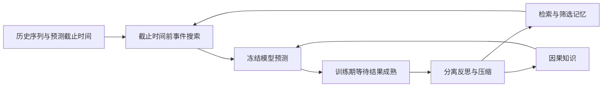
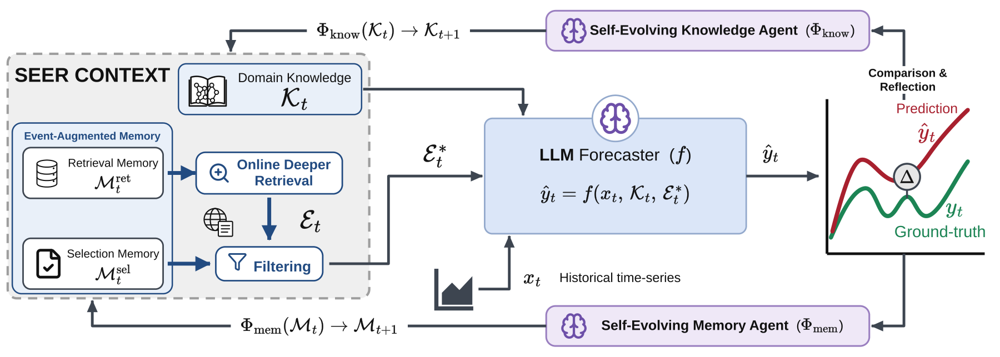

# SEER：通过事件记忆与因果知识改进预测

> 历史高优先补漏资料；**成本过高，不复现（审查 DONE）**。没有本地能力结果或可执行 Evolve 算子。

## 论文信息

| 字段 | 内容 |
| --- | --- |
| 论文链接 | [arXiv 2610.04109v1](https://arxiv.org/abs/2610.04109v1)；[固定正文](https://arxiv.org/html/2610.04109v1) |
| 公司 / 机构 | 一作 Mingtian Tan 同时署名 Google Cloud AI Research 与 University of Virginia；第一署名单位 Google Cloud AI Research |
| 首次公开日期 | 2026-10-02 22:30:10 UTC（arXiv v1，不用机构目录日期覆盖） |
| 原作者代码 | [BennyTMT/SEER](https://github.com/BennyTMT/SEER)；作者仓库存在，所读根目录仅 README、assets、paper 和 citation，未确认可执行核心代码 |
| 本地 adapter / 稳定键 | `seer-forecasting`（仅资料键）；`adapter: null` |
| 本地复现代码 | 无；仅本文及 `src/auto_research/paper_specs/catalog/agent-research/seer-forecasting.json` |

## 原始论文总结

### 背景与主要改动

数值历史可能缺少外部事件信息，普通 RAG 又不会从预测错误中修订检索方法。SEER 保持预测模型权重不变，把上下文拆成检索记忆、筛选记忆和因果知识。只有过去结果真正可见后，才从预测轨迹中分别更新两类记忆与知识；容量不足时压缩，而不是无限追加。

图按原文 Figure 2 与 §3 重绘。[原图及方法](https://arxiv.org/html/2610.04109v1)。

<!-- paper-figure:start -->
### 原论文关键图

> **原论文 Figure 2**：预测器、检索/筛选记忆和因果知识之间的学习闭环；训练期反馈与冻结测试期的边界见正文说明。 图片来自[原论文](https://arxiv.org/abs/2610.04109v1)，版权归原作者所有；此处将作者SVG渲染为PNG展示，不是上方Mermaid重绘。点击图片查看原始图源。
<!-- paper-figure:end -->

### 核心公式

原文 §3.2–3.3 将事件扩展与过滤分开：

$$
\hat y_t=f(x_t,R(\mathcal E_t,\mathcal K_t,\mathcal M_t)),\quad
R=(\rho_{\mathcal M^{sel}}\circ\sigma_{\mathcal M^{ret}}(\mathcal E_t),\mathcal K_t).
$$

结果成熟后，在学习窗口执行
$\mathcal M_{t+1}=\mathcal C\circ\Phi_{\rm mem}(\xi_t,\mathcal M_t)$、
$\mathcal K_{t+1}=\mathcal C\circ\Phi_{\rm know}(\xi_t,\mathcal K_t)$。
测试窗口冻结 $\mathcal M,\mathcal K$，不得用测试结果继续反思。事件发生与可获得时间也须符合预测截止约束，模型声称“新闻时间正确”不等于独立核验通过。

### 论文离线与线上效果

六类领域覆盖天气、电力、股票、存储器价格和事件预测，并比较四种 LLM、纯数值模型、无事件与普通事件 RAG。原文 §4 保留不同任务和骨干差异，不能把部分平均收益说成所有任务都改善。未报告生产 A/B，预测基准不是证券投资建议或线上部署证明。

## 本地复现与成本判断

完整协议涉及 Gemini 3.1 Pro/Flash、Claude 4.6 Sonnet/4.8 Opus，多轮搜索、LEAF 事实核验与顺序回测（§4.1）。闭源调用与六领域完整成本无法用廉价只读检查可靠固定；**成本过高，不复现（审查 DONE）**。

[作者仓库](https://github.com/BennyTMT/SEER) 当前可核到论文、图和案例，不能据此声称核心可执行实现已开源。本轮无本地代码、指标或 GPU 实跑，未接入 Evolve。时间过滤、反馈成熟与测试冻结可作为后续接口议题，但尚未实现，也不能用手写因果规则冒充 LLM 反思。
