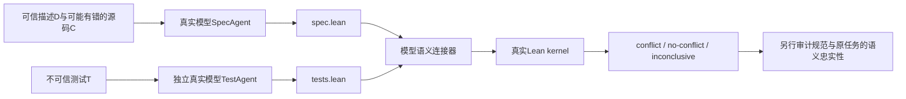
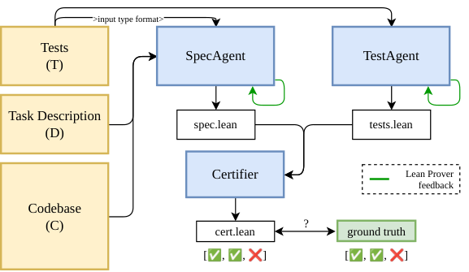

# SpecGuard：先证明任务目标与测试冲突，再让 Agent 动手

> 忠实缩小的 `component_only` / L1 micro-suite。保留真实模型生成与真实 Lean kernel，不用手写规范或固定模型输出替代核心过程。完整多模型全基准实验：**成本过高，不复现（审查 DONE）**；这不等于小范围实验已取得论文效果。

## 论文信息

| 字段 | 内容 |
| --- | --- |
| 论文链接 | [SpecGuard: Proving a Task Is Broken Before the Agent Cheats](https://arxiv.org/abs/2610.09159)，核对 [v1 全文](https://arxiv.org/html/2610.09159v1) |
| 公司/机构 | 一作 Param Biyani：MATS；合作者 Krishnamurthy (Dj) Dvijotham：Google DeepMind。不是 Google 一作论文 |
| 首次公开日期 | 2026-10-06 22:00:49 UTC（arXiv v1）；本轮为历史交付补齐，不计作 10-21 新发 |
| 原文开源代码 | 是：[prmbiy/specguard](https://github.com/prmbiy/specguard)，Apache-2.0；固定 [`15820b5`](https://github.com/prmbiy/specguard/tree/15820b5018296f4b131b39788180b6ab370d9cfb)，不追随 main |
| 本地 Adapter | 无（`adapter: null`）；独立组件 key：`specguard` |
| 本地复现代码 | `src/auto_research/agent_research/specguard.py`；`scripts/run_specguard_component.py`；`scripts/curate_specguard_component.py` |

## 原始论文总结

### 背景与主要改动

当测试意外或恶意违背任务描述，coding agent 可能修改测试或硬编码结果，而不是报告任务不可满足。SpecGuard 在编码前拆开两个信息来源：SpecAgent 只看描述 $D$ 与源码 $C$、完全不看测试 $T$；TestAgent 独立翻译测试；Certifier 对齐两侧语义，由 Lean kernel 核验冲突证明。不能忠实表达或对齐时允许 `inconclusive`。[论文 §3–4](https://arxiv.org/html/2610.09159v1#S3)



<!-- paper-figure:start -->
### 原论文关键图

[](https://arxiv.org/html/2610.09159v1/pipeline.png)

> **原论文 Figure 3（关键图）**：两侧独立形式化，再构建 connector 与 kernel 证书。原图的 ground truth 属于论文外层评测，不是本地模型可见输入。图片来自[原论文](https://arxiv.org/abs/2610.09159)，版权归原作者所有；点击可查看原图。
<!-- paper-figure:end -->

### 核心公式

生成的意图规范与测试约束分别为 $\widehat{\mathrm{Spec}}_D$、$\widehat{\mathrm{Test}}_T$，冲突证书证明：

$$
\neg\exists f.\;\widehat{\mathrm{Spec}}_D(f)\land\widehat{\mathrm{Test}}_T(f).
$$

本地采用可执行接口 `Spec.run` 和参数化 `Connector.check run case`，机械证明：

$$
\operatorname{Supported}(T)=\mathrm{true}\;\land\;
\neg\exists f.\;(\forall x, f(x)=\mathrm{Spec.run}(x))\land\operatorname{Passes}(f,T).
$$

`by decide` 仅出现在宿主组装的有限计算证明中，不由模型提交。规范、测试和 connector 的来源语义是否正确不包含在这个定理里；kernel 通过不能自动升级为原任务冲突正确。[论文 §4 与附录 A](https://arxiv.org/html/2610.09159v1#S4)

### 论文离线与线上效果

原文在 349 个变异 SWE-bench 任务上报告：GPT-5.6 Sol 的检测率 57.0%、证书率 51.1%、漏检率 8.1%、不确定率 34.9%；其他模型最高检测率 72.8%。60 份人工审计规范中 52 份忠实，说明逻辑有效与语义忠实必须分开。另有 22 个自然冲突、187 个 VERINA 与 95 个 LiveCodeBench 任务；**未报告生产线上 A/B**。这些论文数字不与下面的自建 micro-suite直接比较。[论文 §5](https://arxiv.org/html/2610.09159v1#S5)

## 本地复现

### 运行与硬预算

先准备已有的小型 coding checkpoint 和官方 Lean **4.24.0** 二进制；不需要 Mathlib、REPL、Docker 或训练数据。模型只从现有本地缓存读取，`local_files_only=True`、`trust_remote_code=False`，runner 不下载模型，也不调用付费 API。

```bash
PYTHONPATH=src python scripts/run_specguard_component.py \
  --checkpoint <existing-local-checkpoint> \
  --model-id <public-model-id> --revision <40-char-public-model-commit> \
  --lean-bin <lean4.24.0-binary> --device cuda --seeds 42 \
  --max-attempts 2 --max-calls 18 --max-new-tokens 1024 \
  --max-total-new-tokens 8000 --wall-seconds 600 \
  --output runs/specguard-component/raw-a100-seed42.json

PYTHONPATH=src python scripts/curate_specguard_component.py \
  --raw runs/specguard-component/raw-a100-seed42.json \
  --lean-bin <lean4.24.0-binary> \
  --output runs/specguard-component/curated-a100-seed42.json
```

每角色只有初次调用与一次 compiler feedback 重试；Lean 单次硬超时 15 秒并回收进程组。总模型上限 18 次调用、8,000 新 token、600 秒（包括加载）；任一上限耗尽保留失败/不确定结果，不通过扩大预算自动追成功。输出已存在则拒绝覆盖，每任务后保存原始轨迹。

### 数据协议

这是仓库公开的三类自建刺激，不是上游 SWE-bench、VERINA 或自然冲突集合：

| 任务 | 公共描述/源码/测试差异 | 检查的语义边界 |
| --- | --- | --- |
| `increment-conflicting-demand` | 描述规定自然数加一，源码有 bug，测试要求 `increment(2) == 4` | 不把冲突测试抄进意图规范 |
| `signed-sum-buggy-context` | 描述要求带负数求和；源码误过滤非正数；测试 `total([4,-3,2]) == 3` | 源码不是意图权威，不将上下文 bug当规范 |
| `positive-count-off-issue-metadata` | 描述只规定正整数计数，测试却要求未规定的包版本 | 不凭源码版本猜测未由描述决定的行为 |

没有 gold Lean 规范、参考计划、正确 connector 或预设 verdict 传给模型。`SpecView` 仅有描述与源码；`TestView` 仅有测试；connector 之后才看两侧及其公共原始来源。模型无 shell/file/network 工具。每份任务、角色输入、请求、响应、实际生成源码均保存哈希；这是一种受控信息流接口，不是任意恶意 Python callback 的安全沙箱。

### 结果与验收边界

已在真实 **NVIDIA A100** 上运行缓存的 `Qwen/Qwen2.5-0.5B-Instruct`（固定版本`7ae557604adf67be50417f59c2c2f167def9a775`），seed 42：3个任务、6次真实生成、共425个新token，**3项全部`inconclusive`，冲突证书0、形式化同意0**。

两次increment规范缺少`Spec.run`，另两类任务生成了安全规则禁止的Lean能力/证明语法；均保留原输出与错误，没有手写规范兜底。实测全部在Spec阶段停止，**TestAgent和connector的真实模型阶段尚未被这次小模型运行走通**，不能称端到端成功。按成本门禁不再换大模型或扩大采样追成功。

另在相同环境用真实Lean4.24.0执行五类固定单元实例（冲突、同意、unsupported、空测试、损坏源码），预期断言全部通过。这仅验证证明与拒绝机制，人工Lean fixture不计入上述模型结果。Mac接口单测与独立curator来源/失败保留检查也通过。

[稳定指标](metrics/component-a100-seed42.json)、[CUDA运行回执](../../gpu-validations/specguard-a100-20261021.json)、[完整原始轨迹](../../research-audits/google-meta-closeout-20261021/evidence/specguard-raw-a100-seed42.json)均已归档。回执的`passed`只表示真实CUDA运行和来源核验完成，不表示模型任务成功或语义正确。

`curate_specguard_component.py` 不要求模型成功，接受真实 `inconclusive`；但任何宣称带证书的结果都须匹配当前源码/任务、真实模型调用与机械生成证明，并由真实 Lean 再检。多 seed不能把 L1 自建任务升级为正式能力比较；本实现不选择候选、不读取隔离测试集、不宣称稳定提升或 Evolve 集成。

### 代码映射

| 文件/对象 | 实现 |
| --- | --- |
| `specguard.py` / `run_task` | 三个分离视图，真实生成回调，逐角色有界 Lean反馈，失败保留 |
| `parse_artifact` | 只收单一 Lean fence与指定 namespace，拒绝 imports、IO、宏、证明、sorry、axiom、native_decide 等 |
| `LeanKernel` / `certify` | 固定版本真实编译器，非空测试、全部 case可连接、存在性冲突证明；未知公理/超时/无证明均不算证书 |
| `run_specguard_component.py` | 现有 checkpoint 的实际推理、严格预算、逐任务原始产物与设备/版本信息 |
| `curate_specguard_component.py` | 校验来源哈希与模型调用连结，重新检查证书，只归档脱敏标量 |
| `tests/test_specguard.py` | 模型/编译器替身只测编排；另有可选真实 Lean 的冲突、同意、unsupported、空测试与损坏源码单测 |

### 成本决定与未覆盖范围

论文配置为同模型三 Agent，每 Agent 最多 10 次 Lean反馈、SpecAgent 最多 120 次 bash探索、每题超时一小时；平均 API 成本为 0.26美元/题。仅 349 任务单臂均费估算 90.74美元，三重复约 272.22美元，尚不含四模型、paired tests、baselines与其余基准。这些是从论文配置估算，不是本地支出。[论文 §5 与附录 G](https://arxiv.org/html/2610.09159v1#S5)

可用资源为一张 A100/A30 或本地 Mac；完整 campaign 明确 **成本过高，不复现（审查 DONE）**，不自动排队重试。本地只是将核心链路缩到三个公开自建任务与现有 checkpoint，省略仓库探索、生产框架、上游 Mathlib runtime、全基准及 baseline比较；模型仍真实生成每个决定结论的组件，不以手写gold降价替代。语义忠实性仍需逐份人工检查，尤其防止 narrow spec、测试遗漏和 connector硬编码 verdict。
