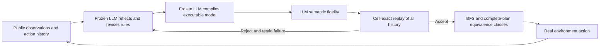
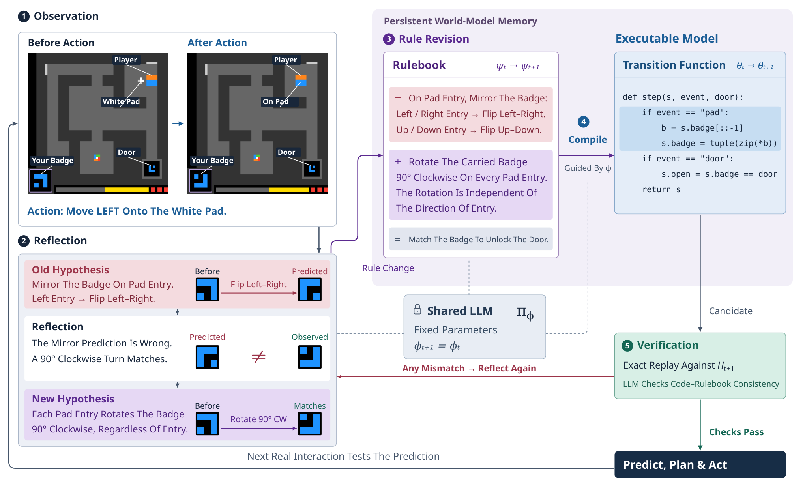

# Memento 3: Reflective Rulebooks and Executable World Models

<!-- source-sha256: 01c4eb08c1db97beac5a32463168dd65e8aeb5a51d6cb4e4f692d2e4ae3dd520 -->

[简体中文](README.md)

## Paper information

| Field | Value |
| --- | --- |
| Paper | [arXiv:2610.11794v1](https://arxiv.org/abs/2610.11794v1); [full text](https://arxiv.org/html/2610.11794v1) |
| Affiliations | First author: University College London; collaborators: Huawei Noah’s Ark Lab and University of Liverpool |
| First public release | 2026-10-08 |
| Authors' code | No public implementation found. The baseline1 starting code mentioned in the paper is not a Memento 3 release. |
| Adapter | `memento3` (standalone checkpoint runner, not a general Agent benchmark registration) |
| Local code | `src/auto_research/agent_research/memento3.py`, `memento3_python.py` |

## Original paper

### Background and contribution

A frozen LLM writes black-box interaction evidence into an editable rulebook and compiles it to a world model. New code must pass both semantic fidelity and exact cell-by-cell replay of all history. Planning mismatches trigger repair. Models share history, and complete plans are sampled uniformly across distinct equivalence classes, not by counting duplicate models as votes. See [Section 2](https://arxiv.org/html/2610.11794v1#S2).



<!-- paper-figure:start -->
### Key figure from the paper

[](https://arxiv.org/html/2610.11794v1/codeasmodel-overview.png)

**Original Figure 2:** Mismatch, reflection, rule revision, compilation, and double verification. Its badge example corrects a mirroring hypothesis to clockwise rotation; this is a [paper](https://arxiv.org/abs/2610.11794v1) example, not a local success. Copyright belongs to the authors.
<!-- paper-figure:end -->

### Core equations

Accept only if $\theta\in[\![\psi]\!]$ and every transition satisfies $\rho_\theta(f_\theta(\hat s_i,a_i))=o_{i+1}$. Initialize each trajectory once from its first observation, then replay continuously rather than resetting from the next real frame at each step.

Identical nonempty complete action sequences form one class. Sample uniformly from classes and retain the chosen plan until completion, mismatch, or replanning. See [Equations 20–21 and 32–33](https://arxiv.org/html/2610.11794v1#S2).

### Paper results

The [paper](https://arxiv.org/html/2610.11794v1#S4) reports completing all 25 public ARC-AGI-3 games, mean RHAE 100, with 44% of human baseline actions. Three Pong starts each ended 21:0. No production A/B was reported. These are not local results.

## Local reproduction

This **L1 mechanism experiment** ran frozen Qwen2.5-7B on a real NVIDIA A100-SXM4-80GB. **The first real action falsified the generated model, repair failed, no valid model remained, and the task was not completed.** It is not the original benchmark or capability improvement.

```bash
# Install pinned gymnasium==1.1.1 and use a cached public pinned checkpoint.
# Set SOURCE_COMMIT to the 40-character commit containing the execution source.
PYTHONPATH=src python scripts/run_memento3_checkpoint.py \
  --checkpoint /path/to/Qwen2.5-7B-Instruct \
  --output runs/memento3-seed42.json \
  --source-commit "${SOURCE_COMMIT:?set the 40-character execution source commit}" \
  --seed 42 --population 2 --action-budget 8 --revisions 2
```

### Data protocol

Use deterministic Gymnasium 1.1.1 FrozenLake-v1 with a seeded 4×4 random grid. The policy sees integer grids, action IDs, and actual completion/termination, not environment source, hidden transitions, correct plans, or reward implementation. This substitute does not compute ARC RHAE or reproduce Pong or the 25-game evaluation. The same frozen model generates rules, source, semantic judgments, and exploration actions.

### Results and limitations

Public checkpoint `Qwen/Qwen2.5-7B-Instruct`, revision `bb46c15ee4bb56c5b63245ef50fd7637234d6f75`, source `c10a88e8ba06d764628642405eb6e99baa285cd5`, seed 42, population 2, real-action budget 8, at most 2 revisions, and 1600 tokens per code generation.

| Local measurement | Result |
| --- | ---: |
| Frozen LLM calls / code-generation calls | 9 / 2 |
| Once-accepted versions (initial observation only) | 1 |
| Real actions / mismatches | 1 / 1 |
| Rejected rule or code proposals | 3 |
| Final models replaying all history | 0 |
| Task complete | No |

The model invented a rule that filling the grid with numbers wins. Its generated code followed that wrong rulebook, so the uncalibrated semantic judge agreed. Initial replay could not test dynamics. After action 1, the real next grid differed; the controller stopped the plan and revoked the model. Repair returned the same source, which failed replay. Another member returned the wrong rule type, and later exploration failed the JSON contract. No synthetic actions were added.

`learning_status=falsified_generated_model` does not mean a world model was learned. [Metrics](metrics/checkpoint-a100-seed42.json) retain both accepted and falsified counts. The [GPU receipt](../../gpu-validations/memento3-a100-20261011.json) marks `passed` for actual CUDA inference, safe interpretation, validation, and mismatch handling only; `capability_passed: false`. Semantic-judge agreement is not real-world correctness.

CPU tests cover full-history replay, population plan classes, mismatch stops, revocation when the budget runs out, and rejection of syntax escapes, recursion, infinite loops, and huge allocations. Handwritten programs are L0 fixtures, never runtime fallbacks. Output retains generated content, rejection reasons, actions, mismatches, valid final model count, and success. Keep failure even when no valid model is generated. Accepted versions enter isolated Git memory with fixed filenames and iteration tags, never executing model-supplied paths or commands.

The same frozen LLM is the uncalibrated semantic judge. Replay rules out contradictions only on observed states, not unseen-state errors. The bounded interpreter excludes general Python features such as attribute calls, imports, and comprehensions, and corresponding rejections are retained.

### Code map

| Component | Code |
| --- | --- |
| Reflection, rulebook, compilation, double gate, shared population history | `src/auto_research/agent_research/memento3.py` |
| Bounded AST interpreter without exec/eval | `src/auto_research/agent_research/memento3_python.py` |
| Actual frozen checkpoint, black-box environment, Git memory | `scripts/run_memento3_checkpoint.py` |
| L0 safety and behavior | `tests/agent_research/test_memento3.py` |
| Evidence binding and falsification checks | `scripts/curate_memento3_evidence.py`, `tests/agent_research/test_memento3_evidence.py` |

The substitute-environment metric is not used for Evolve promotion. A registry label alone does not establish integration.
