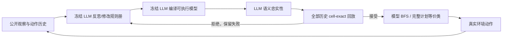

# Memento 3：反思规则册与可执行世界模型

## 论文信息

| 字段 | 内容 |
|---|---|
| 论文链接 | [arXiv:2610.11794v1](https://arxiv.org/abs/2610.11794v1)；[官方全文](https://arxiv.org/html/2610.11794v1) |
| 一作所属机构 | University College London；合作作者来自 Huawei Noah’s Ark Lab、University of Liverpool |
| 首次公开日期 | 2026-10-08 |
| 原作者开源代码 | 未找到作者公开实现；论文提到 baseline1 起始代码，不等同于 Memento 3 开源 |
| Adapter | `memento3`（独立 checkpoint runner；尚未注册为通用 Agent 基准） |
| 本地复现代码 | `src/auto_research/agent_research/memento3.py`、`memento3_python.py` |

## 原始论文总结

### 背景与主要改动

冻结 LLM 将黑盒交互证据写成可修改规则册，再编译为世界模型。新代码必须同时通过语义忠实性判断和全部历史逐格回放；规划失配会触发修复。多个模型共享历史，按不同完整计划的等价类均匀抽样，而非按重复模型投票。[论文第 2 节](https://arxiv.org/html/2610.11794v1#S2)



<!-- paper-figure:start -->
### 原论文关键图

[](https://arxiv.org/html/2610.11794v1/codeasmodel-overview.png)

> **原论文 Figure 2（关键图）**：观察失配、反思、规则修正、编译与双重验证构成冻结 LLM 的世界模型学习闭环；图中由镜像假设修正为徽章顺时针旋转规则。为原论文示例，不是本地成功轨迹。图片来自[原论文](https://arxiv.org/abs/2610.11794v1)，版权归原作者所有；点击图片可查看来源。
<!-- paper-figure:end -->

### 核心公式

接受要求为 $\theta\in[\![\psi]\!]$ 且对全部历史转移有
$\rho_\theta(f_\theta(\hat s_i,a_i))=o_{i+1}$。模型从每条轨迹初始观察仅初始化一次，再连续回放；不能每步用下一张真实图重置状态。

相同非空完整动作序列组成一个等价类；从类集合均匀抽样，并保持所选计划直到完成、失配或重新规划。[论文式 20–21、32–33](https://arxiv.org/html/2610.11794v1#S2)

### 论文离线与线上效果

论文报告 ARC-AGI-3 25 个公开游戏全部完成，平均 RHAE 100，动作量为人类基线的 44%；Pong 三个开局均为 21:0。未报告生产线上 A/B。上述数值均不是本地结果。[论文第 4–5 节](https://arxiv.org/html/2610.11794v1#S4)

## 本地复现

当前实现为 **L1 核心机制实验**，不是原论文完整基准。已在 NVIDIA A100-SXM4-80GB 上实际运行冻结 Qwen2.5-7B；**生成模型在第一次真实动作后被证伪，修复未成功，最终没有可用世界模型，任务也未完成**。这是一条保留失败的机制执行记录，不是能力提升结果。

```bash
# 另安装固定版 gymnasium==1.1.1；checkpoint 必须是公开固定版本缓存。
PYTHONPATH=src python scripts/run_memento3_checkpoint.py \
  --checkpoint /path/to/Qwen2.5-7B-Instruct \
  --output runs/memento3-seed42.json \
  --source-commit <包含本轮源码的40位提交号> \
  --seed 42 --population 2 --action-budget 8 --revisions 2
```

### 数据协议

使用 Gymnasium 1.1.1 的 deterministic FrozenLake-v1，4×4 随机地图在运行前由 seed 固定。政策仅看到整数 grid、动作编号、真实 completion/termination；不看到环境源码、隐藏转移表、正确计划或奖励实现。这个替代环境不计算 ARC RHAE，也不冒充 Pong 或 25-game 能力评测。冻结 Qwen2.5-7B 同时生成规则、源码、语义判断与探索动作。

### 结果与边界

固定公开 checkpoint 为 `Qwen/Qwen2.5-7B-Instruct`，revision `bb46c15ee4bb56c5b63245ef50fd7637234d6f75`；实际执行源码提交 `c10a88e8ba06d764628642405eb6e99baa285cd5`。seed 42、人口 2、真实动作上限 8、最多 2 轮修订；每次源码生成上限 1600 token。

| 本地实测 | 结果 |
|---|---:|
| 冻结 LLM 调用 / 生成源码调用 | 9 / 2 |
| 曾接受版本（仅通过初始观察，尚无真实转移） | 1 |
| 实际动作 / 预测失配 | 1 / 1 |
| 拒绝的规则或源码提案 | 3 |
| 最终满足全部历史 replay 的模型 | 0 |
| 任务完成 | 否 |

人工核查显示：模型从初始 grid 臆测“填满数字即获胜”的规则，编译出的源码与该错误规则册一致，因此未校准的语义 judge 同意。初始观察回放尚不能检验动作动态；执行动作编号 1 后，真实下一帧与生成模型逐格不符，控制器立即停止余下计划、撤销旧模型。修复时模型返回相同源码，仍被完整历史回放拒绝；另一成员规则输出类型错误，随后探索输出也不满足 JSON 合同，运行不再补造动作。

因此 `learning_status` 为 `falsified_generated_model`，不是“已学会世界模型”。[指标产物](metrics/checkpoint-a100-seed42.json)保留接受与证伪两个计数；[GPU 回执](../../gpu-validations/memento3-a100-20261011.json)中的 `passed` **只表示 CUDA 推理、安全解释、验证/失配控制链真实执行**，明确 `capability_passed: false`。不删除负结果，也不把语义 judge 的同意冒充现实环境正确性。

CPU 单测覆盖全部历史逐格验证、共享人口计划等价类、失配停止、预算耗尽撤销旧模型、语法逃逸/递归/无限循环/超大分配拒绝。测试中的手写程序只用于 L0 测试，从不作为运行时的生成或修复 fallback。

运行产物保存全部生成输出、拒绝原因、动作、失配、合法最终模型数及成功与否。**没有合法生成模型也保留失败，不能用手写导航规则补齐。** 每个接受版本保存到独立运行 Git memory，固定文件名与 iteration tag；不执行模型生成的路径或命令。

语义 judge 由同一个冻结 LLM 完成，尚未人工校准，因此“judge 同意”不能当作语义正确性能力指标。逐格回放只能排除已观察证据矛盾，也不保证未见状态泛化。受限 Python 解释器不支持完整 Python（例如属性调用、导入、推导式），这是安全与规模折衷，结果必须保留对应生成拒绝。

### 代码映射

| 组件 | 代码 |
|---|---|
| 反思、规则册、编译、双重验收、共享历史人口 | `src/auto_research/agent_research/memento3.py` |
| 有界 AST 解释器（无 exec/eval） | `src/auto_research/agent_research/memento3_python.py` |
| 冻结真实 checkpoint、黑盒环境、Git memory | `scripts/run_memento3_checkpoint.py` |
| L0 安全和行为回归 | `tests/agent_research/test_memento3.py` |
| 真实结果源代码/生成来源/逐格验证与证伪状态防伪 | `scripts/curate_memento3_evidence.py`、`tests/agent_research/test_memento3_evidence.py` |

尚未将此替代环境指标用于 Evolve 晋级；不是只添加 registry 标签便称“已接入”。
