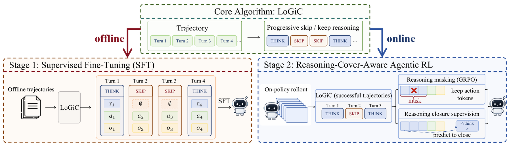

# RACE: reasoning compression guided by action likelihood across turns

<!-- source-sha256: 6e37519d1dba41f961aa5a801c1fa51bca1074eaaa18be55aea5ed85d470d398 -->

[简体中文](README.md)

> Standalone core-mechanism API and real-checkpoint interface. The short run is an L1 diagnostic, not a benchmark rerun. Unified evolve promotion is not integrated.

## Paper information

| Field | Details |
|---|---|
| Paper | [arXiv 2610.12061 v1](https://arxiv.org/abs/2610.12061) |
| Organization | Renmin University of China; first author Yiruo Cheng |
| First public release | 2026-10-08 |
| Authors' code | The [announced repository](https://github.com/HututuAI/RACE) was empty as of 2026-10-10; no implementation was available. |
| Adapter | `race`, standalone mechanism API, not a general reproduce adapter |
| Local reproduction code | `src/auto_research/agent_research/race.py`; shared backend `oct10_backend.py`; `scripts/run_oct10_agents.py` |

## Original paper

### Motivation and method

Starting at the second turn, LoGiC incrementally removes reasoning and checks the change in mean token log likelihood for the current and all later original actions. Accepted removals continue to affect later context. Compressed successful trajectories train SFT. RL masks removable reasoning and supervises early closure. Reasoning tokens decrease by 32.3%, 80.2%, 46.4%, and 62.0% in the paper's four agent environments; no online A/B test is reported.

### Architecture and flow

~~~mermaid
graph LR
 A[Real successful training trajectories] --> B[Remove reasoning turn by turn]
 B --> C[Recompute likelihoods of all subsequent actions]
 C --> D[Accept removal or keep reasoning]
 D --> E[SFT on compressed trajectories]
 D --> F[Mask policy terms and supervise closure]
 F --> G[Real on-policy tool trajectories]
~~~

<!-- paper-figure:start -->
### Key figure from the paper

> **Figure 3:** Training flow and key optimization steps. From the [original paper](https://arxiv.org/abs/2610.12061); copyright remains with the authors.
<!-- paper-figure:end -->

### Core equations

$d_j=\ell(a_j\mid h_j)-\ell(a_j\mid\tilde h_j)$. Delete only if $d_j\le\epsilon$ for every $j\ge t$. The RL denominator retains the full original policy-token count, while the closure term is normalized by all turns.

### Paper results

The figures above come from the [full paper](https://arxiv.org/html/2610.12061v1), not local experiments. Different model sizes and metric protocols preclude direct comparison.

## Local reproduction

The implementation provides action likelihood, successful-trajectory SFT, and cover-aware actor gradients. Inputs must specify a public environment, revision, and reason/action/observation training trajectories. QA rows must not be substituted for tool trajectories. Evaluated agents do not see reference actions. Full on-policy RL across the four paper environments and end-to-end capability outcomes have not been reproduced.

### Running and data protocol

~~~bash
python -m pip install -e '.[post-training-gpu]'
PYTHONPATH=src python scripts/run_oct10_agents.py \
  --method race --checkpoint /path/to/public/checkpoint \
  --dataset /path/to/train.jsonl --device cuda \
  --seed 42 --output runs/race/result.json
~~~

Input requires `question`, `environment`, `source_revision`, `split=train`, `successful=true`, and `turns`, each with `reasoning`, `action`, and `observation`. References are for training only. With `--race-bounded`, the repository's public bounded calculator samples and executes real A/B tool actions. The environment privately judges success before sampling fresh on-policy trajectories for training. This is an L1 runtime-contract check, not official ScienceWorld.

### Validation and boundaries

On 2026-10-10, an NVIDIA A100 with SmolLM2-135M-Instruct and seed 42 ran `bounded-calculator-v1`. The model sampled actions and executed calculator tools, used successful trajectories for SFT, then sampled 64 fresh on-policy trajectories, of which 11 succeeded. Cover-aware actor loss was 0.02441, with six actual closure-supervision terms, an original policy denominator of 554 tokens, and 24 masked reasoning tokens. This environment checks the training mechanism only; it is not ScienceWorld and does not rank capabilities.

See the [local L1 GPU diagnostic](metrics/checkpoint-a100-seed42.json). Checkpoint revision, source commit, and command are in the batch's GPU receipt.

`tests/test_race.py` checks formulas and state contracts. Real runs record diagnostic status, seed, trajectory/likelihood or evaluation paths. One seed, short responses, and few updates do not establish stable improvement; failures and negative results are retained. GPU receipts are registered at batch integration; raw runs and weights are not committed. CPU can debug the mechanism, but CUDA paths require real NVIDIA validation.
