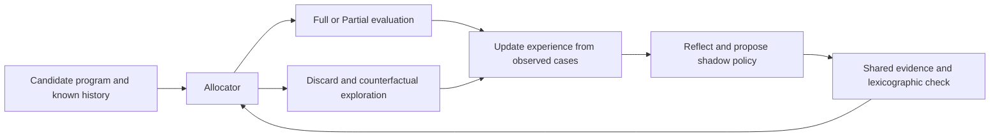
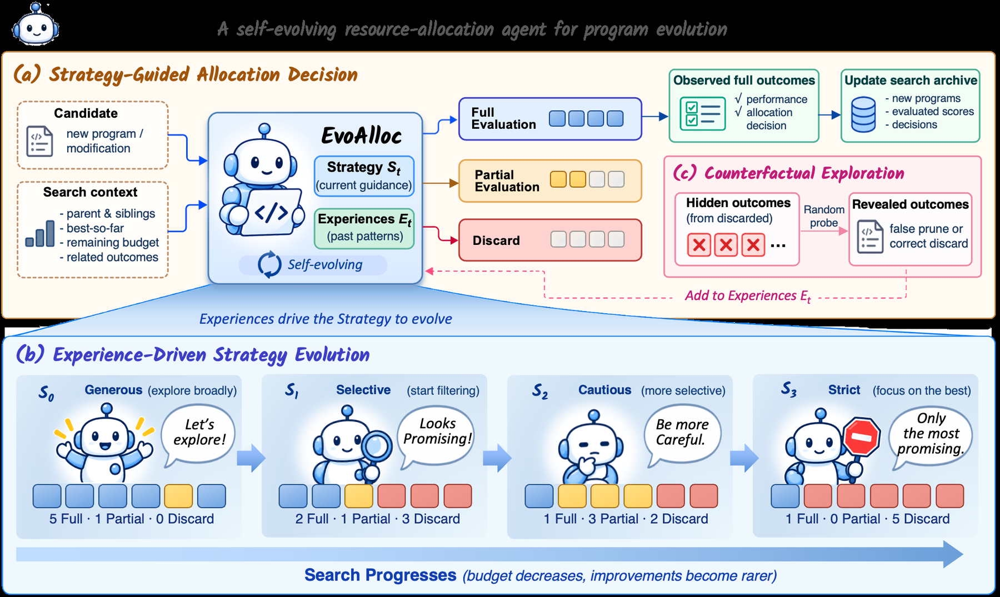

<!-- source-sha256: f4312d0c743a145f4d388b9d5c203325cec849ee3c2bb74c3df54731db7604dd -->

[简体中文](README.md) · English

# EvoAlloc: Evaluation resource allocation that evolves with search

> Standalone core-mechanism API and real-checkpoint interface. The short run is an L1 diagnostic, not a rerun of the paper benchmark. Unified Evolve promotion is not integrated.

## Paper information

| Field | Details |
|---|---|
| Paper | [arXiv 2610.12086 v1](https://arxiv.org/abs/2610.12086) |
| Institution | King Abdullah University of Science and Technology (first author Yanning Dai) |
| First public release | 2026-10-08 |
| Original source code | No public author code found in the text or project links as of 2026-10-10. |
| Adapter | `evoalloc`, a standalone mechanism API, not a general reproduce adapter |
| Local reproduction code | `src/auto_research/agent_research/evoalloc.py`; shared backend `oct10_backend.py`; `scripts/run_oct10_agents.py` |

## Original paper summary

### Background and main changes

Choose Full, Partial or Discard, then decide whether to continue once Partial evidence is available. Observed cases update fixed-statement experience and support policy reflection. Shadow policies share the same evidence and are ranked first by missed new bests, then evaluation cost. Probabilistic counterfactual evaluation of rejected candidates addresses selective feedback. The paper reports 59–82% fewer Full evaluations to reach baseline and 8.7–12.0% better results at the same budget. No production A/B is reported.

### Architecture



<!-- paper-figure:start -->
### Key figure from the paper

[](https://arxiv.org/html/2610.12086v1/figures/fig1.png)

> **Figure 1:** Overall design and components. From the [paper](https://arxiv.org/abs/2610.12086); copyright belongs to the authors. Click for the source.
<!-- paper-figure:end -->

### Core equations

Count every actual Full evaluation, including warmup, shadow unions and counterfactual exploration. Compare lexicographically by $(missed\ newbest,\#Full,\#Partial)$. Promotion requires two observed disagreements.

### Offline and online results

The numbers above are from the [paper](https://arxiv.org/html/2610.12086v1), not local results. Model scales and metric protocols differ.

## Local reproduction

Use the actual Linux bubblewrap/prlimit Circle26 sandbox. A trusted geometry checker, not the model, supplies scores. Sandbox failure blocks execution. Circle26 has no Partial, so only Full and Discard are available. Experience ADD/UPDATE/DELETE cannot rewrite the statement on UPDATE, use unobserved cases as evidence, or retain more than four active/tentative and four stale records.

### Usage and data protocol

```bash
python -m pip install -e '.[post-training-gpu]'
PYTHONPATH=src python scripts/run_oct10_agents.py \
  --method evoalloc --checkpoint /path/to/public/checkpoint \
  --dataset /path/to/train.jsonl --device cuda \
  --seed 42 --output runs/evoalloc/result.json
```

The public Circle26 geometry contract defines the program objective. The QA file does not enter scoring.

### Verification and limits

On 2026-10-10, SmolLM2-135M-Instruct ran four Full Circle26 sandbox evaluations on NVIDIA A100 with seed 42. The best stayed at the initial program's 2.16667. Small-model candidates did not complete the new-best/non-best warmup, so no policy was promoted. A separate actual reflection probe was explicitly not promoted. Contracts test Partial and shadow promotion after two disagreements; the short GPU run did not exercise them.

See [L1 GPU diagnostic](metrics/checkpoint-a100-seed42.json). The batch GPU receipt pins checkpoint revision, executed commit and command.

`tests/test_evoalloc.py` verifies formulas and state contracts. Actual runs retain diagnostic labels, seed, trajectory/likelihood or evaluation paths. One seed, short responses and few training steps do not establish stable improvement. Failures and negatives remain; GPU receipts are registered with the batch while raw runs and weights are not committed. CPU may debug mechanisms; CUDA requires actual NVIDIA validation.
