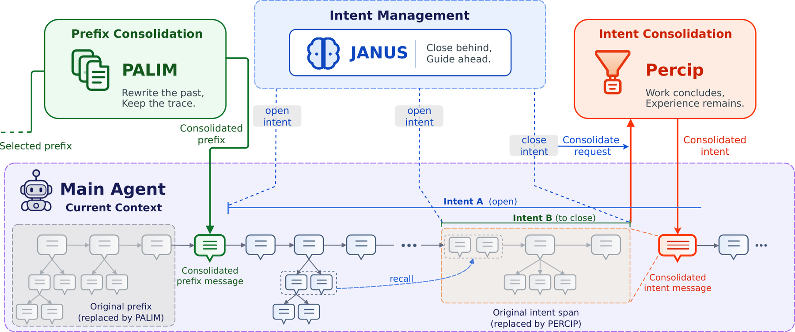

# Hippocam: hierarchical intent consolidation and progressive recall

<!-- source-sha256: cb2b38601b7590f00919052dfb110f7bbfcc3e88bd8af966d472f72246f2fd8f -->

[简体中文](README.md)

> Standalone core-mechanism API and real-checkpoint interface. The short run is an L1 diagnostic, not a benchmark rerun. Unified evolve promotion is not integrated.

## Paper information

| Field | Details |
|---|---|
| Paper | [arXiv 2610.12124 v1](https://arxiv.org/abs/2610.12124) |
| Organization | Institute of Information Engineering, Chinese Academy of Sciences; first author Xiangyi Zeng |
| First public release | 2026-10-08 |
| Authors' code | No public author code was found in the full text or project links as of 2026-10-10. |
| Adapter | `hippocam`, standalone mechanism API, not a general reproduce adapter |
| Local reproduction code | `src/auto_research/agent_research/hippocam.py`; shared backend `oct10_backend.py`; `scripts/run_oct10_agents.py` |

## Original paper

### Motivation and method

Janus maintains nested intents before reasoning. Precip summarizes closed intents after the main response but before tool results. Palim recursively condenses earlier prefixes into narrative and knowledge while preserving original messages as tree children. Each recall returns one layer and the agent decides whether to descend. The paper reports 97.8% ALFWorld success, 81.9% ScienceWorld progress, and 81.7% mean StreamBench accuracy. No online A/B test is reported.

### Architecture and flow

~~~mermaid
graph LR
 A[Janus intent stack] --> B[Main model reasoning]
 B --> C[After-response closure hook]
 C --> D[Precip intent consolidation]
 D --> E[Palim recursive prefix consolidation]
 E --> F[Tree archive of original messages]
 F --> G[One-layer recall tool]
 G --> B
~~~

<!-- paper-figure:start -->
### Key figure from the paper

> **Figure 2:** Overall method and components. From the [original paper](https://arxiv.org/abs/2610.12124); copyright remains with the authors.
<!-- paper-figure:end -->

### Core equation

$B=\min(\alpha W,\max(B_{min},K\operatorname{Quantile}_q(R)))$. Protect at least K complete exchanges and B tokens. The pressure budget includes request overhead and the estimated next turn; if still over capacity, fail before main reasoning.

### Paper results

The figures above come from the [full paper](https://arxiv.org/html/2610.12124v1), not local results. Model sizes and metrics differ and are not directly comparable.

## Local reproduction

The implementation updates intent positions, runs the after-response hook, preserves complete tool exchanges, folds prefixes normally or under emergency pressure, enforces minimum savings and retry rules, retains original text on failure, and supports one-layer recall. An auxiliary checkpoint actually generates summaries. When autonomous Janus closes no intents, the run reports zero archives. Controlled Precip/Palim diagnostics do not establish autonomous memory improvement.

### Running and data protocol

~~~bash
python -m pip install -e '.[post-training-gpu]'
PYTHONPATH=src python scripts/run_oct10_agents.py \
  --method hippocam --checkpoint /path/to/public/checkpoint \
  --dataset /path/to/train.jsonl --device cuda \
  --seed 42 --output runs/hippocam/result.json
~~~

Task JSONL includes `question`. The model reads only questions and generated work products, never gold.

### Validation and boundaries

On 2026-10-10, an NVIDIA A100 ran SmolLM2-135M-Instruct with seed 42. The autonomous three-question run closed no intents and archived zero items. A separate controlled pressure probe triggered real summarization, creating three archive nodes and reducing context from 3248 to 24 tokens while preserving the open exchange. The controlled result does not support autonomous memory or accuracy claims.

See the [local L1 GPU diagnostic](metrics/checkpoint-a100-seed42.json). Checkpoint revision, source commit, and command are in the batch's GPU receipt.

`tests/test_hippocam.py` checks formulas and state contracts. Actual runs save diagnostic status, seed, trajectory/likelihood or evaluation paths. Single-seed, short runs with few updates do not establish stable improvement; failures and negative results remain. GPU receipts are registered during batch integration, and raw runs and weights are not committed. CPU can debug the mechanism, but the CUDA path requires real NVIDIA validation.
