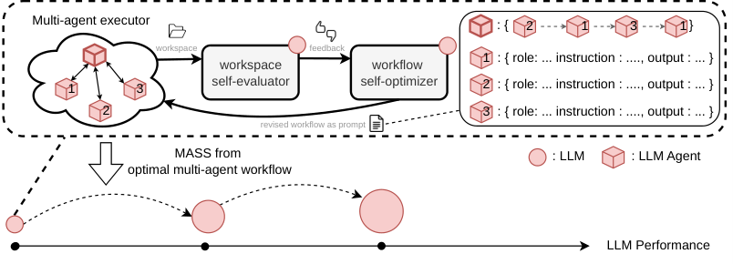

# MASS: recursive improvement through multi-agent self-supervision

<!-- source-sha256: 58c632fe8941cdcda8a3869464e5753fb8681a4b1bcfdfd4ada4f1a771e3096a -->

[简体中文](README.md)

> Standalone core-mechanism API and real-checkpoint interface. The short run is an L1 diagnostic, not a benchmark rerun. Unified evolve promotion is not integrated.

## Paper information

| Field | Details |
|---|---|
| Paper | [arXiv 2610.12176 v1](https://arxiv.org/abs/2610.12176) |
| Organization | UC Berkeley; first author Hyunin Lee |
| First public release | 2026-10-08 |
| Authors' code | [Public implementation](https://github.com/SakanaAI/mass) |
| Adapter | `mass`, standalone mechanism API, not a general reproduce adapter |
| Local reproduction code | `src/auto_research/agent_research/mass.py`; shared backend `oct10_backend.py`; `scripts/run_oct10_agents.py` |

## Original paper

### Motivation and method

The same model executes workflows, proposes workflows, and judges them pairwise. After search at fixed weights, trajectories are collected independently. Bradley–Terry ranking selects the top K−1 trajectories for training and the Kth for validation. Only the orchestrator's initial workflow prompt is removed; worker role assignments remain. Assistant-token SFT updates the weights before repeating. The paper reports about 1.2–1.6× performance per output token on research tasks after two rounds with Qwen3.6-27B. No online A/B test is reported.

### Architecture and flow

~~~mermaid
graph LR
 A[Current shared weights] --> B[Propose workflows]
 B --> C[Independent worker and orchestrator execution]
 C --> D[Pairwise judging with the same weights]
 D --> E[BT ranking and independent trajectory split]
 E --> F[Assistant-token LoRA training]
 F --> A
~~~

<!-- paper-figure:start -->
### Key figure from the paper

> **Figure 1:** Overall workflow, key stages, and data flow. From the [original paper](https://arxiv.org/abs/2610.12176); copyright remains with the authors.
<!-- paper-figure:end -->

### Core equation

$P(i\succ j)=\sigma(s_i-s_j)$; sample worker and orchestrator supervision windows in a 2:1 ratio.

### Paper results

The figures above come from the [full paper](https://arxiv.org/html/2610.12176v1), not local measurements. Different model sizes and metric protocols preclude direct comparison.

## Local reproduction

A real shared checkpoint completed two rounds of search, judging, trajectory collection, and LoRA SFT. The bounded local text-workflow family fixes two workers and one orchestrator, but permits changing role instructions and content passed between them. It does not support arbitrary workflow graphs or qwen-code file and terminal tools, and is not a full research coding-agent reproduction.

### Running and data protocol

~~~bash
python -m pip install -e '.[post-training-gpu]'
PYTHONPATH=src python scripts/run_oct10_agents.py \
  --method mass --checkpoint /path/to/public/checkpoint \
  --dataset /path/to/train.jsonl --device cuda \
  --seed 42 --output runs/mass/result.json
~~~

Task JSONL contains `question`. Models see only the question and generated work products, not gold.

### Validation and boundaries

On 2026-10-10, an NVIDIA A100 with SmolLM2-135M-Instruct and seed 42 ran two rounds of shared-weight execution, proposal, and judging, independent trajectory ranking, and real LoRA SFT. Each round ran three steps, sampling the orchestrator and both workers. Rank was 8, and LoRA and the optimizer were reinitialized. Validation losses were 0.73961 and 0.33264 on self-generated validation trajectories, not independent-task accuracy or paper-level research gains.

See the [local L1 GPU diagnostic](metrics/checkpoint-a100-seed42.json). The batch GPU receipt records the checkpoint revision, source commit, and command.

`tests/test_mass.py` checks formulas and state contracts. Real runs save diagnostic flags, seed, and trajectory/likelihood or evaluation paths. One seed, short responses, and few updates do not establish stable gains. Failures and negatives are retained. GPU receipts are registered at batch integration; raw runs and weights are not committed. CPU can debug the mechanism, but CUDA paths require real NVIDIA validation.
