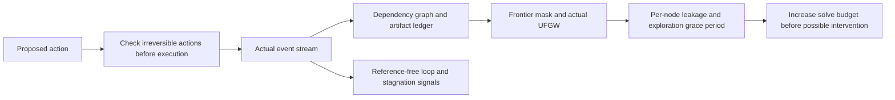
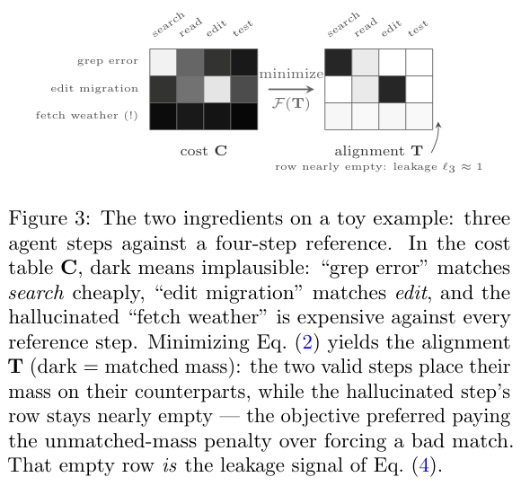

<!-- source-sha256: de1d55333e3bcdbe8bfa0041c2bb81aaeffb8acbeff3628edf81e555f77e6f62 -->

[简体中文](README.md) · English

# OnTrack: Real-time monitoring of agent execution trajectories

> The local implementation replays public logs for monitoring without executing logged commands. It is not an agent task-success measurement or a production safety certification.

## Paper information

| Field | Details |
|---|---|
| Paper | [OnTrack: Real-Time Monitoring and Intervention in LLM Agent Trajectories via Streaming Structure-Aware Optimal Transport](https://arxiv.org/abs/2610.12375) |
| Institution | Cribl AI (first author Babak Barazandeh) |
| First public release | 2026-10-08 (arXiv v1) |
| Original source code | The paper says code and configs are public. No verifiable public repository was found in this review, so this is not an author-implementation integration. |
| Local adapter | `ontrack` |
| Local reproduction code | `src/auto_research/agent_research/ontrack.py`, `ontrack_transport.py`, `ontrack_replay.py`; entry point `scripts/run_ontrack_public_replay.py` |

## Original paper summary

### Background and main changes

A final answer score cannot explain what happened on the way to an agent failure. OnTrack forms a dependency graph from events and aligns the current execution prefix to successful reference trajectories with unbalanced, structure-aware optimal transport. Without references it explicitly falls back to loop, retry and information-stagnation detection.



<!-- paper-figure:start -->
### Key figure from the paper

[](https://arxiv.org/pdf/2610.12375#page=5)

> **Figure 3:** In a toy alignment, an irrelevant weather-tool call cannot match any reference step, giving leakage mass near 1. From the [paper](https://arxiv.org/abs/2610.12375); copyright belongs to the authors. Click the image for the source.
<!-- paper-figure:end -->

### Core equations

Agent-node prefix mass is fixed at $\mu_i=1/\bar m$, without rescaling old nodes to $1/t$ as each new event arrives. Reference nodes activate based on coverage in the previous event's alignment, so independent branches can be active together. Node leakage is $\ell_i=[1-\sum_jT_{ij}/\mu_i]_{[0,1]}$.

The structure term uses the actual quadratic Gromov–Wasserstein gradient, not an indexwise distance proxy. Each event takes one warm-start CG step and a short Sinkhorn solve. Structural contribution grows as a new node ages; consuming an artifact removes its discount immediately. Before intervention, increase the solve budget and reassess. At termination, cold-start the same implementation without the frontier mask or age weights for batch finalization.

The pre-execution gate does not read a stale cached frontier. Reversible actions pass through. For irreversible actions it checks schema-required artifacts, recomputes the reference frontier from the current coupling, and evaluates the proposed action against it. Planner references are warning-only and cannot automatically stop execution.

### Paper results

The [paper](https://arxiv.org/html/2610.12375v1) includes synthetic faults and replay of real SWE-agent logs. It reports near-random discrimination for some structural anomalies on real trajectories and substantial false-stop costs. Diagnostic scores are not correctness proofs, and the paper's stop thresholds are not used in production here.

## Local reproduction

### Installation and usage

```bash
python -m pip install -e '.[agent-monitor]'
PYTHONPATH=src python scripts/run_ontrack_public_replay.py \
  --calibration-instances 64 --reference-pool 32 --references 3 \
  --evaluation-instances 64 --steps 8 --reference-steps 24 \
  --seed 42 --output runs/ontrack-public-replay.json
```

The runner downloads pinned public `sailplane/swe-agent-trajs` (about 92 MB) and `all-MiniLM-L6-v2`. Embedding and monitoring are CPU-only; no GPU is needed. Commands in trajectories are always untrusted text and never execute. Default cache: `.cache/ontrack-public`.

### Data isolation and model inputs

Split by SWE-bench instance ID into 64 calibration, 32 reference-pool and 64 evaluation instances. Select successful trajectories only from the separate reference pool. Calibration selects regularization from seven values, then a severe-flag density threshold; freeze both before evaluation. The parser does not read `resolved/exit_status/submission`; labels are only for external scoring and reference-pool selection, never events or embeddings.

Extract paths from strings and `open_file` metadata. The ledger can add artifact IDs discovered later and repair old dependency edges. Dynamic shell paths and implicit dependencies can be missed. The distance matrix is recomputed fully; the paper's bitset millisecond optimization is not reproduced.

### Measurements

A rerun on current source matched the initial results. There were 11 resolved instances among 64 evaluated. With selected $\lambda=0.5$, OnTrack AUROC was **0.6021** versus **0.5437** for local pooled-action cosine. The paired-bootstrap difference interval **[-0.0872, 0.1939]** crosses zero, so no stable advantage is established.

Under a calibration false-stop cap of 10%, the selected density threshold was **1.0**. The current protocol requires density strictly above threshold, so no trajectory stops. Both true and false stops were 0 on evaluation. This policy was inactive under the budget; it establishes neither safety nor savings. [All results](metrics/public-replay-cpu-seed42.json).

### Code map, tests, and missing parts

`ontrack_transport.py` implements the full quadratic gradient, unbalanced Sinkhorn, frontier mass and separation of the actual objective from the reported surrogate. `ontrack.py` covers the artifact ledger, structural age, grace-period lifecycle, reference-free signals, multiple references, pre-execution gate and increased solve budget before intervention. `ontrack_replay.py` covers safe parsing, instance isolation and paired statistics.

Regression tests check allows and blocks: allowing valid irreversible actions, blocking absent artifacts, avoiding stale-frontier false blocks, retry caps, late dependencies, cold-start finalization, and label leakage prevention. Synthetic embeddings are unit-test-only; public results use actual MiniLM.

No official SWE-bench container ran and no agent trajectories were regenerated. The authors' full 2,294-trajectory protocol, multiple seeds and all baselines are not reproduced, nor are bitset/hierarchical compression or real dollar savings. The gate is a callable API. Public logs lack irreversible-action schemas; its tests are not evidence of production blocking. Results are not eligible for Evolve capability promotion.
