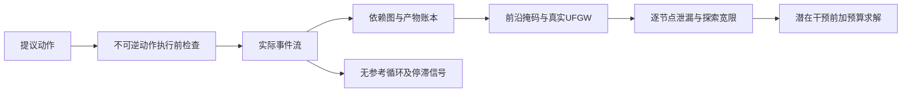
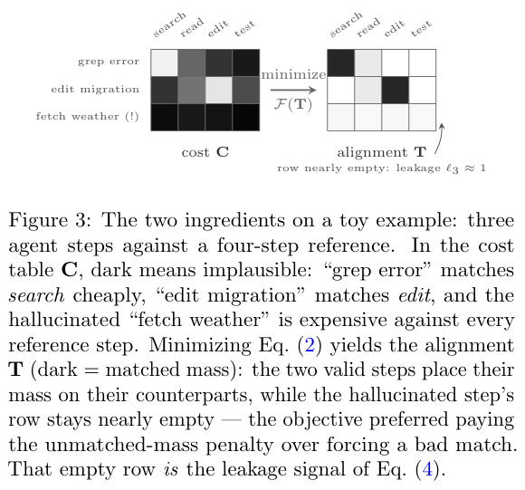

# OnTrack：实时监控 Agent 的执行轨迹

> 本地实现是公开日志回放监控，不执行日志命令，也不是 Agent 解题成功率或生产安全认证。

## 论文信息

| 字段 | 内容 |
|---|---|
| 论文链接 | [OnTrack: Real-Time Monitoring and Intervention in LLM Agent Trajectories via Streaming Structure-Aware Optimal Transport](https://arxiv.org/abs/2610.12375) |
| 公司 / 机构 | Cribl AI（第一作者 Babak Barazandeh） |
| 首次公开日期 | 2026-10-08（arXiv v1） |
| 原作者代码 | 正文声称公开代码与配置；本轮未找到可核验的公开仓库链接，不视为已接入原作者实现 |
| 本地 Adapter | `ontrack` |
| 本地复现代码 | `src/auto_research/agent_research/ontrack.py`、`ontrack_transport.py`、`ontrack_replay.py`；入口 `scripts/run_ontrack_public_replay.py` |

## 原始论文总结

### 背景与主要改动

Agent 最终失败时，单个答案分数解释不了中间发生了什么。OnTrack 把事件组织成带依赖边的图，将当前执行前缀和成功参考轨迹作非平衡结构化对齐；无参考时则明确退化为循环、重试和信息停滞检测。



<!-- paper-figure:start -->
### 原论文关键图

[](https://arxiv.org/pdf/2610.12375#page=5)

> **原论文 Figure 3（关键图）**：玩具轨迹的代价矩阵与最优传输对齐：无关的天气工具调用无法匹配参考步骤，产生接近 1 的泄漏质量。图片来自[原论文](https://arxiv.org/abs/2610.12375)，版权归原作者所有；点击图片可查看来源。
<!-- paper-figure:end -->

### 核心公式

代理节点的前缀质量固定为 $\mu_i=1/\bar m$，不能每来一个事件就把旧节点重新缩放为 $1/t$。参考节点按上一事件的对齐覆盖度激活，独立分支可同时执行。节点泄漏为 $\ell_i=[1-\sum_jT_{ij}/\mu_i]_{[0,1]}$。

结构项保留真正二次 Gromov–Wasserstein 梯度，而不是逐索引距离代理；每事件一次 warm-start CG 和短 Sinkhorn。新节点的结构贡献随年龄增长，产物被消费后立即解除折扣。准备干预时扩大求解预算并重新判定；结束时冷启动、移除前沿掩码和年龄权重，以同一实现进行批处理终结。

执行前 gate 不读取过期缓存前沿。可逆动作不拦截；不可逆动作先检查 schema 产物，再用当前 coupling 重算参考前沿，判断提议动作的匹配。planner 参考只能告警，不能据此自动停机。

### 论文离线与线上效果

[原文](https://arxiv.org/html/2610.12375v1)包含合成故障和真实 SWE-agent 日志回放。作者也披露：真实轨迹上的部分结构异常辨别接近随机，停止策略有明显误停成本。这里不把其诊断分数解释成正确性证明，也不照搬停止阈值上线。

## 本地复现

### 安装与运行

```bash
python -m pip install -e '.[agent-monitor]'
PYTHONPATH=src python scripts/run_ontrack_public_replay.py \
  --calibration-instances 64 --reference-pool 32 --references 3 \
  --evaluation-instances 64 --steps 8 --reference-steps 24 \
  --seed 42 --output runs/ontrack-public-replay.json
```

运行器下载固定版本的公开 `sailplane/swe-agent-trajs`（约 92 MB）和 `all-MiniLM-L6-v2`。嵌入和监控均为 CPU 路径，无需 GPU。轨迹里的命令始终作为不可信文本，不会执行。缓存默认在 `.cache/ontrack-public`。

### 数据隔离与模型输入

按 SWE-bench instance ID 划分，校准 64、参考池 32、评测 64；只在独立参考池中选择成功轨迹。校准集从七个值选择正则强度，再选择严重标记密度阈值；两者冻结后才调用评测。解析器不读取 `resolved/exit_status/submission`，这些标签只留在外部评分和参考池筛选中，不进入事件或嵌入。

路径产物通过字符串和 `open_file` 元数据提取，支持后补产物标识、修复旧依赖边。这个提取器可能漏掉 shell 动态路径和隐含依赖；距离矩阵完整重算，不声称论文的 bitset 毫秒级优化已经复刻。

### 实测结果

当前源码重跑与首轮结果一致。64 个评测实例含 11 个 resolved；选择 $\lambda=0.5$ 后，OnTrack AUROC 为 **0.6021**，本地 pooled-action cosine 对照为 **0.5437**；成对 bootstrap 差值区间 **[-0.0872, 0.1939]** 跨过 0，不能声称稳定优势。

在校准集约束误停率不超过 10% 后，选中的密度阈值为 **1.0**；当前“密度大于阈值”协议下不会停止任何轨迹。评测真停、误停都为 0，意味着策略在这个预算下是惰性的，不证明安全，也不支持节省成本的结论。[全部结果](metrics/public-replay-cpu-seed42.json)。

### 代码映射、测试与未完成部分

`ontrack_transport.py`：完整二次梯度、非平衡 Sinkhorn、前沿质量、真实目标与报告 surrogate 分离。`ontrack.py`：产物账本、结构年龄、宽限生命周期、无参考信号、多参考、执行前 gate 与干预前扩大求解。`ontrack_replay.py`：安全解析、实例隔离、成对统计。

回归同时覆盖允许与拦截：合法不可逆动作放行、缺产物拦截、过期前沿不误拦截、重试次数上限、后发现依赖、冷启动终结和反标签泄漏。数值合成嵌入只用于单测，公开结果来自真实 MiniLM。

未运行官方 SWE-bench 容器或重新生成 Agent 轨迹；未复刻作者全部 2,294 条协议、多种子和全部基线；未实现 bitset/hierarchical 压缩；没有测到真实美元成本节省。gate 是可调用 API，公开日志没有不可逆 schema，不能把 gate 单测算作真实生产拦截。暂不作为 Evolve 的 Agent 能力晋级证据。
