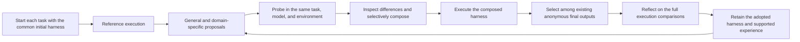
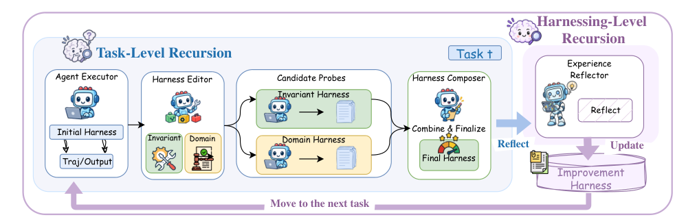

# Harness²: Improve a harness through execution comparisons, then retain how it improved

<!-- source-sha256: c738a9266c1647b8f5cc0e50a0055d1aecf1fcf783ee78de3405c2e84850f48a -->

[简体中文](README.md)

> `component_only` / L1 CPU controller and interface. Python probes actually execute, but the editor and selector are deterministic test doubles. This is not a model-backed agent evaluation or an Evolve integration.

## Paper information

| Field | Details |
|---|---|
| Paper | [Harness²: Recursive Agent Harnessing for an Open World](https://arxiv.org/abs/2610.14224), reviewed at v1 |
| Institutions | First author Ruiyao Xu, Northwestern University; collaborator Google Cloud AI Research. The catalog groups by first-author affiliation and tracks Google collaboration separately. |
| First public release | 2026-10-09 18:34:25 UTC (arXiv v1); historical backfill, not an October 20 release |
| Author code | [google-research/harness2](https://github.com/google-research/harness2), Apache-2.0; reviewed at pinned commit [`1cfe254`](https://github.com/google-research/harness2/tree/1cfe254e8d25b15f37048c3730134686abe60335), not automatically tracked from main |
| Local adapter or method key | No adapter (`adapter: null`); component key `harness2`. |
| Local reproduction code | `src/auto_research/agent_research/harness2.py`; `scripts/run_harness2_component.py`. |

## Paper method and evidence

A harness consists of prompts, tools, memory, skills, scripts, subagents, and middleware outside the model. Harness² keeps model weights fixed and connects better execution on the current task to experience about how to improve future harnesses. It does not require gold answers, rubrics, or a verifier: inspect execution, propose general and domain-specific changes, execute both, and compose based on behavioral differences. A score is not treated as proof of correctness. [Section 2](https://arxiv.org/html/2610.14224v1#S2)



<!-- paper-figure:start -->
### Original paper figure

[](https://arxiv.org/html/2610.14224v1/harness2_main_new.png)

The left side shows general and domain proposals, probes, and composition for the current task; the right shows persistence after the task. Copyright remains with the [paper](https://arxiv.org/abs/2610.14224) authors.
<!-- paper-figure:end -->

### Core equations

Let $\mathcal M$ be the fixed model, $\mathcal H$ the harness, $q_t$ the public task, $e=(\tau,y)$ execution evidence, and $\mathcal R_t$ the cross-task improvement library:

$$
(\mathcal H',e',\xi)=\Phi(q_t,\mathcal H,\mathcal E;\mathcal R_t).
$$

$\Phi$ performs Propose–Probe–Compose; $\xi$ records references, proposals, executions, and composition decisions. Parallel mode proposes $k$ general and $k$ domain candidates, then produces $k$ independent compositions. Sequential mode chains $k$ steps, each reading the previous harness and all earlier within-task history. Both modes use:

$$
R=k+2k+k=4k,\qquad P=k+k+k=3k.
$$

Selection and reflection are accounted for separately. For $k=1$, adopt the sole final artifact directly. For $k>1$, the selector gets only anonymous final artifacts and public task/materials: no associated harnesses, reference or proposal artifacts, or ability to create a new answer. Update only after the task:

$$
\mathcal R_{t+1}=\operatorname{Update}(\mathcal R_t,\mathcal H_t^\star,\mathcal D_t).
$$

The star means adopted, not verified best. Unsupported experience is not stored. The next task resets execution to $\mathcal H_0$ rather than inheriting the previous task's harness. [Sections 2.2–2.3](https://arxiv.org/html/2610.14224v1#S2.SS2)

### Reported results

On WorkBuddy-Bench, JobBench, and LAB across three random task orders and four model–executor combinations, the largest single-step gains over the base harness were 11.5, 4.5, and 11.8 percentage points, respectively (LAB measures partial pass). Larger recursive budgets increased inference cost. These are professional-task benchmark results, not production A/B or local scores. [Sections 3–4](https://arxiv.org/html/2610.14224v1#S3)

## Local reproduction

```bash
PYTHONPATH=src python scripts/run_harness2_component.py \
  --mode both --k 2 --workers 2 --seeds 42,43,44 \
  --output runs/harness2-component/raw-cpu-seeds42-44.json
```

Uses the Python standard library, with no downloads, API credentials, or GPU. Choose a new output path for every run. Trusted Python probes execute in temporary directories with a five-second subprocess timeout; this is not a sandbox for arbitrary user scripts.

### Protocol and measurements

Seeds 42/43/44 each generate positive and negative transaction records. Each mode runs two tasks in sequence. This is not JobBench, LAB, or WorkBuddy and does not define capability train/validation/test splits. The deterministic script-edit test starts with a positive-only filter: the general branch updates a constraint, the domain branch removes the filter that conflicts with the public task, and composition combines changes that actually ran. The selector chooses existing anonymous artifacts without using precomputed totals. An external arithmetic check runs only after adoption and never feeds the editor, selector, or reflector.

Across three seeds, two modes, and two tasks per mode, 96 Python executions and 72 edit stages ran. All 12 tasks met $R=4k$ and $P=3k$; every second task read the first task's persisted experience, and there were no execution failures. All 12 external arithmetic checks passed, validating the controlled script mechanism, not LLM reasoning or open-world capability. [Archived metrics](metrics/component-cpu-seeds42-44.json)

Raw local JSON retains trajectories, candidate trees, support labels, fallbacks, and failures. `scripts/curate_harness2_component.py` verifies execution records, source SHA-256, pinned protocol, modes, and seeds before archiving scalar metrics. Full outputs and checkpoints are not committed.

### Implementation and trust boundaries

| Object | Behavior |
|---|---|
| `Harness` | Eight component-file surfaces with immutable public content; rejects traversal, duplicates, skills without triggers, missing scripts, and unresolved templates. |
| `Harness2` | Injects `executor/editor/selector/reflector`, orchestrates both modes, keeps model/environment fixed and record order stable. Invalid proposals get at most one retry, then retain the current harness. |
| `EditContext` | Exposes current harness, reference, executed candidates, full sequential history, and a frozen same-domain experience snapshot. Edits must cite visible execution labels. |
| `SelectionContext` | Exposes public task and anonymous final artifacts only. Selection failure uses a deterministic final-artifact fallback, not a quality win. If all final executions fail, it does not fabricate adoption from the baseline. |
| `EvidenceLibrary` | Isolates by model, environment, improver version, initial-harness SHA-256, seed, mode, and budget. Returns earlier same-domain tasks only and persists the complete adopted tree and referenced execution comparisons. Checksums, atomic writes, and conflict rejection protect stored data. |

There are no answer, plan, rubric, or grader-score parameters. Common leakage fields and paths are rejected, but string filtering cannot prove information-flow safety. Integrators must use trusted callbacks and constrain network and filesystem access. Closures, network access, and process environment are not sandboxed by this component. The upstream default executor has unrestricted networking and its authors warn that public rubrics may be downloadable; do not use this unmodified for a formal evaluation. [Upstream security notes](https://github.com/google-research/harness2/blob/1cfe254e8d25b15f37048c3730134686abe60335/docs/experiments.md#web-access)

Reflection rejects unknown labels, identical or self comparisons, failures, and comparisons without a behavioral difference. Those checks cannot establish that the resulting textual experience is correct or transferable. Model-backed editors and selectors, benchmark adapters, restricted tool environments, and executable Evolve evaluation are not implemented. Status remains `diagnostic_only=true`, `promotion_eligible=false`, and `evolve_integrated=false`.

**Full experiment not reproduced due to cost; review complete.** The original setup uses frozen Gemini 3.5 Flash/GLM-5 executors, a Claude Opus 4.8 default editor, three professional benchmarks, four model–harness combinations, several budgets, and three task orders. One upstream LAB stream has 1,143 tasks with at least $4k$ executions and $3k$ edit stages per task, plus selection, reflection, and scoring via APIs. One A100/A30 or Mac is not a cheap substitute. No trial or download was started to estimate cost. The verified CPU orchestration component does not change the status of the full experiment or block the review watermark.
