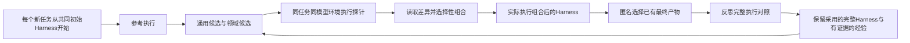

# Harness²：用执行对照优化 Harness，再积累如何优化的经验

> `component_only` / L1 CPU 控制器与接口。真实执行 Python 探针，但 editor、selector 是确定性机制测试替身；不是模型支持的 Agent 能力评测，也不是已接入 Evolve。

## 论文信息

| 字段 | 内容 |
| --- | --- |
| 论文链接 | [Harness²: Recursive Agent Harnessing for an Open World](https://arxiv.org/abs/2610.14224)，本轮核对 v1 |
| 公司/机构/学校 | 一作 Ruiyao Xu，Northwestern University；合作机构 Google Cloud AI Research。按一作机构聚合，Google 合作属性单独保留，不将一作改归 Google |
| 首次公开日期 | 2026-10-09 18:34:25 UTC，arXiv v1；本轮属于历史补漏，不算 10-20 首发 |
| 原文开源代码 | [google-research/harness2](https://github.com/google-research/harness2)，Apache-2.0；核对固定 commit [`1cfe254`](https://github.com/google-research/harness2/tree/1cfe254e8d25b15f37048c3730134686abe60335)，不自动追随 main |
| 本地 Adapter | 无（`adapter: null`）；组件 key：`harness2` |
| 本地复现代码 | `src/auto_research/agent_research/harness2.py`；`scripts/run_harness2_component.py` |

## 原始论文总结

### 背景与主要改动

Harness 是模型外的提示、工具、记忆、技能、脚本、子代理和中间件。论文在不改模型权重的前提下，把“改进当前任务执行方式”和“积累以后如何改进的经验”连接起来。它不要求任务答案、评分细则或验证器：先观察执行，再提出通用候选与领域候选，执行二者，最后按行为差异组合，而不是把某个评分函数冒充正确性判定。[论文 §2](https://arxiv.org/html/2610.14224v1#S2)



<!-- paper-figure:start -->
### 原论文关键图

[](https://arxiv.org/html/2610.14224v1/harness2_main_new.png)

> **原论文 Figure 3**：左侧为当前任务的通用/领域候选、执行探针和组合，右侧在任务结束后更新持久经验。图片来自[原论文](https://arxiv.org/abs/2610.14224)，版权归原作者所有；点击可查看原图。
<!-- paper-figure:end -->

### 核心公式

设固定模型为 $\mathcal M$，执行框架为 $\mathcal H$，公开任务为 $q_t$，执行证据为 $e=(\tau,y)$，跨任务改进库为 $\mathcal R_t$：

$$
(\mathcal H',e',\xi)=\Phi(q_t,\mathcal H,\mathcal E;\mathcal R_t).
$$

其中 $\Phi$ 包含 Propose–Probe–Compose；$\xi$ 保存参考、候选、实际执行与组合决定。并行模式提出 $k$ 个通用和 $k$ 个领域候选，随后产生 $k$ 个相互独立的组合；顺序模式串联 $k$ 步，每一步读取此前 Harness 与全部任务内历史。两者均为：

$$
R=k+2k+k=4k,\qquad P=k+k+k=3k.
$$

选择器和反思另计，不藏在预算中。$k=1$ 直接采用唯一最终产物；$k>1$ 只向选择器提供匿名最终产物及公开请求/素材，不能见产物对应的 Harness，不能混入参考或提案产物，也不能生成新答案。任务结束再更新：

$$
\mathcal R_{t+1}=\operatorname{Update}(\mathcal R_t,\mathcal H_t^\star,\mathcal D_t).
$$

$\star$ 仅代表采用，不代表已验证最优。没有执行对照支撑时不保存经验；下一任务重新从 $\mathcal H_0$ 开始，不直接继承上一任务的执行 Harness。[论文 §2.2–2.3](https://arxiv.org/html/2610.14224v1#S2.SS2)

### 论文离线与线上效果

原文在 WorkBuddy-Bench、JobBench 和 LAB 上比较三次随机任务顺序及四种模型–执行器组合，报告单步相对基础 Harness 的最高增益分别为 11.5、4.5、11.8 个百分点（LAB 为 Partial pass 指标）；更大递归预算进一步增加推理开销。它们是专业任务基准，不是生产线上 A/B；本文没有将本地机制结果与这些分数比较。[原论文 §3–4](https://arxiv.org/html/2610.14224v1#S3)

## 本地复现与边界

### 一键运行

```bash
PYTHONPATH=src python scripts/run_harness2_component.py \
  --mode both --k 2 --workers 2 --seeds 42,43,44 \
  --output runs/harness2-component/raw-cpu-seeds42-44.json
```

只使用 Python 标准库，无模型下载、API 凭证或 GPU。产物存在时拒绝覆盖，重复执行请换输出路径。实际探针在临时目录运行可信 Python 脚本，单次 subprocess 超时 5 秒；不执行任意外部用户脚本，不声称提供恶意代码安全沙箱。

### 数据协议与真实测量

本轮为 seed 42/43/44 生成的正负交易流水，每个 seed、每个模式顺序执行两个任务；不是 JobBench/LAB/WorkBuddy，也没有训练/验证/测试能力切分。编辑器诊断脚本中的正数过滤，通用分支更新约束，领域分支删除不符合公开任务的过滤，组合分支合并**实际执行过**的修改。选择器仅选择匿名现有产物；机制替身不根据预先算好的总数选择。数字核对只在最终采用之后由外层诊断完成，结果不进入 editor、selector 或 reflector。

本轮三 seed、两种模式、每种两个任务共实跑 **96 次 Python 执行、72 个编辑阶段**；12 次任务均满足 $R=4k$ 和 $P=3k$，第二任务均读取第一任务持久经验，未出现执行失败。12 次外层算术检查通过，只说明该受控脚本修补机制按预期运行，不说明 LLM 推理或开放任务能力。[归档标量](metrics/component-cpu-seeds42-44.json)

原始轨迹、候选树、支持标签、fallback 和失败保留在本地 raw JSON。归档指标通过 `scripts/curate_harness2_component.py` 检查实际执行记录、source SHA256、固定协议、模式与 seed；不提交完整输出或 checkpoint。

### 接口、可信边界与代码映射

| 对象 | 已实现的行为 |
| --- | --- |
| `Harness` | 八种组件文件表面，拒绝路径穿越、重复文件、缺触发的技能、缺失脚本、未展开模板；不可变公开内容 |
| `Harness2` | 注入 `executor/editor/selector/reflector`；并行与顺序编排，保持同一固定模型/环境配置，稳定记录顺序；无效提案至多重试一次后保留当前 Harness |
| `EditContext` | 当前 Harness、参考、已执行候选与完整顺序历史、任务开始时冻结的同域经验快照；修改须引用可见执行标签 |
| `SelectionContext` | 只有公开任务和匿名**最终**产物；失败记录为确定性最终产物 fallback，不称质量获胜；最终产物全失败则不从基线伪造采用结果 |
| `EvidenceLibrary` | 按模型、环境、改进器版本、初始Harness SHA256、seed、模式、预算隔离；只提供同域先前任务，持久保留完整采用树与被引用执行对照；SHA256防误改、原子写、冲突拒绝 |

没有答案、计划、rubric、grader 分数的参数，也拒绝常见泄漏路径/字段；但字符串过滤不是信息流安全证明。外部回调须可信，并由集成者限制网络和文件权限；闭包、外部网络或进程环境不受本模块沙箱约束。上游默认执行器网络不受限，官方也提醒公开基准 rubric 可能被下载，不能直接复制为正式评测设置。[上游安全说明](https://github.com/google-research/harness2/blob/1cfe254e8d25b15f37048c3730134686abe60335/docs/experiments.md#web-access)

反思会拒绝未知标签、相同执行、自身对照、失败执行和没有行为差异的对照；这些结构性检查仍不保证语言经验语义正确或可迁移。正式采用的模型 editor、selector、benchmark adapter、受限工具环境及 Evolve 候选评估仍未实现，因此保持 `diagnostic_only=true`、`promotion_eligible=false`、`evolve_integrated=false`。不能仅把它登记为 operator 就宣传已完成 Evolve 集成。

### 成本决定

完整配置涉及 Gemini 3.5 Flash/GLM-5 冻结执行器、Claude Opus 4.8 默认编辑器、三个专业任务基准、四种模型–Harness 组合、多预算与三次任务顺序；上游 LAB 单流包含 1,143 个任务，每题至少 $4k$ 次执行、$3k$ 个编辑阶段，另有选择、反思和评分，且依赖 API。单卡 A100/A30 或 Mac 不能廉价等价代替该模型与完整调用矩阵；不为估算成本再启动试跑或下载模型。**高成本完整实验：成本过高，不复现（审查 DONE）**。CPU 编排组件实测与完整实验不复现是两项独立事实，不阻塞审查水位。
