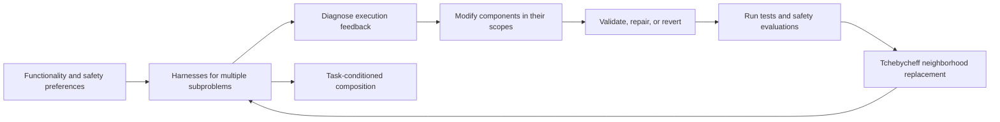
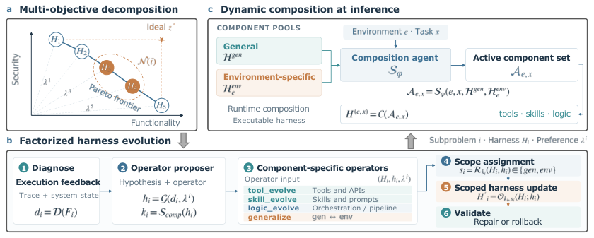

# Harmony Harness: Multi-objective harness evolution for functionality and safety

<!-- source-sha256: 5abfb13a9e993a3c4e78784eec05ec75cccbe24148be64f01e2a71c3f174b520 -->

[简体中文](README.md)

> High-priority historical backfill. Full experiments were not reproduced due to cost; review is complete. No local capability result or executable Evolve operator.

## Paper information

| Field | Details |
|---|---|
| Paper | [arXiv 2610.15150v1](https://arxiv.org/abs/2610.15150v1); [pinned full text](https://arxiv.org/html/2610.15150v1); [PDF affiliation page](https://arxiv.org/pdf/2610.15150v1#page=1) |
| Institutions | First author Weichen Yu is listed with Google Cloud AI Research and Carnegie Mellon University, in that order, on the official PDF. Collaborators also include Google DeepMind. The footnote places the work during a student research appointment at Google Cloud. |
| First public release | 2026-10-10 20:06:59 UTC (arXiv v1, not the institutional listing date) |
| Author code | No author implementation repository found in the reviewed paper or official abstract. Anonymous result visualizations are not algorithm source code; release status is unconfirmed. |
| Local adapter or method key | `harmony-harness` (literature-only key); `adapter: null`. |
| Local reproduction code | None; only this document and `src/auto_research/paper_specs/catalog/agent-research/harmony-harness.json`. |

## Paper method and evidence

Single-objective evolution can improve functional scores by relaxing checks, at the expense of safety. Harmony Harness keeps functionality and safety as separate objectives: each preference vector has a harness, and a candidate replaces only worse neighbors. Tools, skills, and logic are stored in general or environment-specific scopes; a composer selects an execution DAG for the current task.

The diagram is a redraw of the mechanism, not a local execution record. See the [paper and original figure](https://arxiv.org/html/2610.15150v1).

<!-- paper-figure:start -->
### Original paper figure

This original author PNG is distinct from the Mermaid redraw. It illustrates the method, not a locally executed pipeline. Copyright remains with the [paper](https://arxiv.org/abs/2610.15150v1) authors.
<!-- paper-figure:end -->

### Core equation

For functionality and safety estimates $\hat f_j$ and current ideal point $z_j^*$, Section 4.1 uses:

$$
g(H\mid\lambda,z^*)=\max_j\lambda_j|z_j^*-\hat f_j(H)|.
$$

A candidate replaces an incumbent only if it strictly decreases $g$ for that neighboring subproblem; at most two incumbents are replaced by one candidate. The final harness maximizes $\arg\max_H\min(\hat f_{\rm func},\hat f_{\rm sec})$ on the search set; held-out ID and OOD sets do not inform selection. Joint success means both conditions are met on the same trajectory, not the minimum of two marginal rates.

### Reported results

The authors split SecRepoBench into 30/30/30 and BaxBench into 28/28/28 evolution, in-domain held-out, and out-of-domain held-out examples. Section 5.1 reports OOD joint success on SecRepoBench rising from 36.7% to 66.7%, but the appendix also documents a failure where evaluator leakage inflated search scores. No production A/B was reported. This is Agent/RSI research, not an industrial recommendation experiment.

## Local reproduction boundary

Gemini 3.6 Flash acts as proposer and solver; the paper runs three independent repeats, multiple generations and subproblems, real Docker builds, and exploit evaluations (Section 5, Appendices C/G/I). That scope exceeds the available budget. No MOEA/D harness, LLM editor, safety evaluator, Evolve interface, local metrics, GPU receipt, or executable operator was produced. Neighborhood replacement and scoping contracts could be studied separately, but implementing the scalarization alone would not reproduce the self-evolution pipeline.
