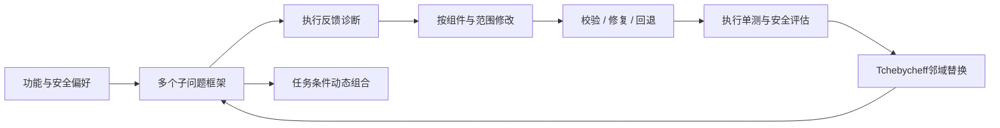
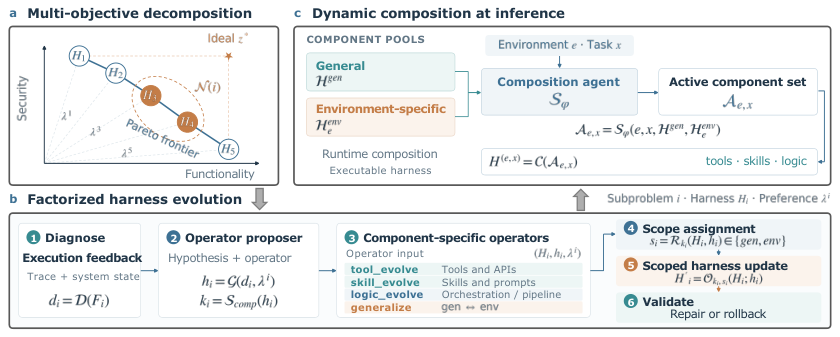

# Harmony Harness：兼顾功能与安全的多目标框架演化

> 历史高优先补漏资料；**成本过高，不复现（审查 DONE）**。没有本地能力结果或可执行 Evolve 算子。

## 论文信息

| 字段 | 内容 |
| --- | --- |
| 论文链接 | [arXiv 2610.15150v1](https://arxiv.org/abs/2610.15150v1)；[固定正文](https://arxiv.org/html/2610.15150v1)；[PDF首页机构](https://arxiv.org/pdf/2610.15150v1#page=1) |
| 公司 / 机构 | 官方 PDF 首页一作 Weichen Yu 上标 1、2：Google Cloud AI Research / Carnegie Mellon University；第一署名单位为 Google Cloud AI Research，合作方另含 Google DeepMind。首页脚注注明工作在 Google Cloud 学生研究期间完成 |
| 首次公开日期 | 2026-10-10 20:06:59 UTC（arXiv v1，不用机构目录日期覆盖） |
| 原作者代码 | 未在所读论文/官方摘要中找到作者实现仓库；有匿名结果可视化，不等于开源算法代码；未找到不表示已证明未发布 |
| 本地 adapter / 稳定键 | `harmony-harness`（仅资料键）；`adapter: null` |
| 本地复现代码 | 无；仅本文及 `src/auto_research/paper_specs/catalog/agent-research/harmony-harness.json` |

## 原始论文总结

### 背景与主要改动

单目标演化可能通过放松检查提高功能分数，同时损害安全。Harmony Harness 将功能与安全保持为两个独立目标：每个偏好向量维护一个框架，候选只替换邻域中更差的框架。工具、技能、逻辑分别记录在通用或环境专属范围，再由组合器为当前任务选择执行 DAG。

图为依据原文 Figure 1 重绘的机制说明，不是本地执行记录。[原图与正文](https://arxiv.org/html/2610.15150v1)。

<!-- paper-figure:start -->
### 原论文关键图

> **原论文 Figure 1**：功能—安全子问题、按范围分解的演化算子和推理时动态组合；是作者框架图，不是本地已执行的流程。 图片来自[原论文](https://arxiv.org/abs/2610.15150v1)，版权归原作者所有；此处保留作者PNG，不是上方Mermaid重绘。点击图片查看原始图源。
<!-- paper-figure:end -->

### 核心公式

功能与安全估计为 $\hat f_j$，当前理想点为 $z_j^*$。原文 §4.1：

$$
g(H\mid\lambda,z^*)=\max_j\lambda_j|z_j^*-\hat f_j(H)|.
$$

仅当候选在目标邻域子问题上严格降低 $g$ 时替换，单个候选最多替换两个 incumbent。最终部署框架由搜索集上的 $\arg\max_H\min(\hat f_{\rm func},\hat f_{\rm sec})$ 选出；held-out-ID/OOD 不参与选择。联合成功必须在同一轨迹同时满足功能和安全，不能拿两个边际率的最小值冒充联合率。

### 论文离线与线上效果

作者在 SecRepoBench 与 BaxBench 分别使用 30/30/30 与 28/28/28 的演化、域内留出、域外留出划分。§5.1 报告 SecRepoBench 域外联合成功由基线 36.7% 到 66.7%，但附录也展示评分器泄漏导致搜索分数虚高的失败。未报告生产线上 A/B；这是 Agent/RSI 研究，不套用推荐业务门槛。

## 本地复现与成本判断

Gemini 3.6 Flash 承担 proposer 与 solver；三次独立运行、多代多子问题，真实 Docker 构建和 exploit 评估主导耗时（§5、附录 C/G/I）。完整实验**成本过高，不复现（审查 DONE）**；成本判断源于论文规模，不是本地测量。

本轮仅补资料，未实现 MOEA/D 框架、LLM 修改器、安全评测或 Evolve 接口，没有本地指标、GPU 回执和可执行 operator。低成本可单独研究邻域替换与范围合同，但不能仅实现标量化公式就宣称复现完整自进化。
