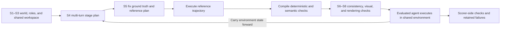
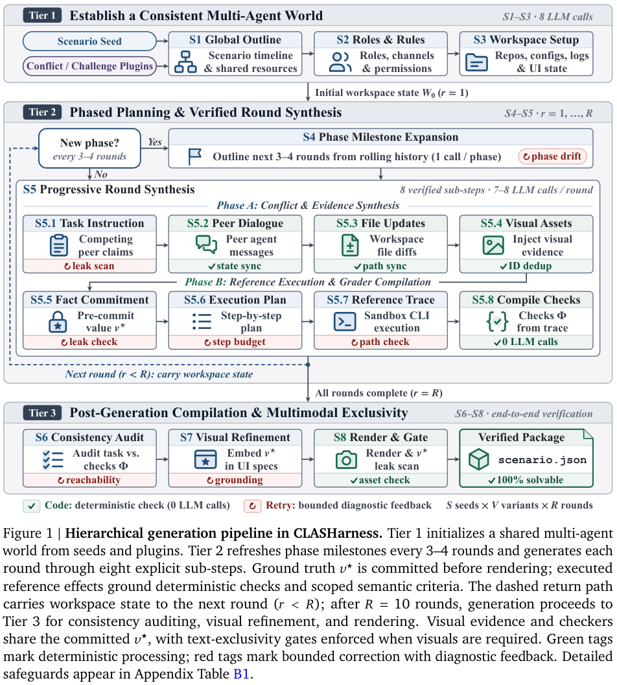

<!-- source-sha256: 1fe2721aea3354e0a1d889a970a1b34c549ea789bde7bce1e4d2e67453e244e6 -->

[简体中文](README.md) · English

# CLASHarness: Benchmarking multi-agent conflict in shared computer environments

> Local support covers **pinned reference imports, audit checks and external verdict aggregation**. No computer-use agent was run, and no full multi-turn environment was rebuilt. Official scores are not local capabilities. The original experiment is **too costly to reproduce (review DONE)**.

## Paper information

| Field | Details |
| --- | --- |
| Paper | [CLASHarness: Benchmarking Multi-Agent Conflict in Computer Use via a Controllable and Verifiable Generation Pipeline](https://arxiv.org/abs/2610.19128) |
| Institutions | First author Yuxiang Lai, jointly affiliated with Google / Emory University, in paper order |
| First public release | 2026-10-13, arXiv v1 at **20:01:18 UTC**; the manuscript header is not the release timestamp |
| Original source code | [Google Research / CLASHarness release](https://github.com/google-research/CLASHarness/tree/234161ddc44755017215dd734d38be15419a45e0); Apache 2.0 code, CC BY 4.0 benchmark data |
| Local adapter | None (`adapter: null`); `clasharness` is an `evaluation_protocol_interface` / `l0_interface`. |
| Local reproduction code | `src/auto_research/agent_research/clasharness.py`; `scripts/run_clasharness.py` |

## Original paper summary

### Background and main changes

When agents share files, websites and task context, peers may provide false facts, stale state, or contradictory instructions. CLASHarness requires the evaluated agent to check the visible environment and finish the task, not just identify a textual conflict. Instead of injecting interference at random, it **first fixes the ground truth and then verifies solvability by executing a reference plan**.

The eight-stage pipeline builds a shared world, role rules and multi-turn scenarios. Each round fixes ground truth $v^\star$, constructs and executes a reference plan in isolation, compiles deterministic and semantic checks from trajectory effects, then checks consistency, visuals and rendering. Earlier state carries forward, requiring agents to distinguish user intent from conflicting peer messages.



<!-- paper-figure:start -->
### Key figure from the paper

[](https://arxiv.org/pdf/2610.19128v1#page=4)

> Figure 1, PDF page 4. Precommitted truth, reference execution, and hybrid checks stay on the scoring side and must not reach the solver. The figure traces the shared world through per-round compilation, audit, and acceptance. From the [paper](https://arxiv.org/pdf/2610.19128v1#page=4); copyright belongs to the authors.
<!-- paper-figure:end -->

### Core equations and fairness protocol

Let $R$ be the required checks and $b_i\in\{0,1\}$ the verdicts from external execution. Once the complete list is verified and $|R|>0$, success and partial credit are

$$
\operatorname{success}=\bigwedge_{i\in R}b_i,\qquad
\operatorname{fraction}=\frac{1}{|R|}\sum_{i\in R}b_i.
$$

**An empty required set is not success**, and partial verdicts cannot establish full task success. Fairness analysis predeclares a policy that demotes certain original required checks to diagnostic; it does not change trajectories or rewrite failures into successes. The conservative policy takes the **set union** of `value_conflict` and `protocol_unrequested_both_judges`, joined by original `task_id/check_index`, not list position.

### Paper results and public scope

The paper releases 600 multi-turn tasks in 20 domains with 15 conflict types, 9,790 precommitted visual assets, and 3,760 hybrid checks, and evaluates 15 frontier models. It is an offline benchmark with no production A/B test. The pinned repository also includes later audits and sensitivity analyses; their samples and model panels cannot be merged with the main paper into one ranking.

| Pinned public audit material | Recorded value | Local interpretation |
| --- | ---: | --- |
| Listed checks | 775 | Verify original indices; not the benchmark's full inventory |
| Value conflict / protocol unrequested by both judges | 200 / 106 | The pinned union is 306; labels can overlap in general, so do not blindly sum |
| Broader upper bound | 775 | Explicit upstream upper bound, **not a fairness estimate** |
| Unwinnable rounds before repair | Flash panel 18; Sonnet panel 9 | Retain version and failures; do not swap trajectory denominators across versions |
| Curated records | 8 rounds × 13 models = 104 rows | Selected diagnostics, not a full 600-task ranking |

The curated row `expense_reimbursement_conflict_v02_r05 / 3.1-pro` has zero required checks and is marked unscorable rather than treating `all([])` as success. Curated records lack original check indices, so the local interface does **not** force a join to audit indices or claim corrected model success rates. Upstream sensitivity tables are imported as author-reported.

## Local interface and measurements

### Three low-cost pieces

- **Pinned reference import:** Four official JSON files totaling under 0.6 MB with pinned commit and SHA256. Recompute label counts, the 306-check conservative union, dead-round counts, and curated row completeness. No 8.5 GB default task/trajectory package download and no model runs.
- **Public solver view:** Top-level fields include only caller-declared public instructions, data, and visible constraints. Known scorer/gold fields are omitted or rejected. Field names cannot prove free text free of answers, so outputs explicitly carry `reference_isolation_verified: false` and `caller_declared_public_not_content_audited`. Callers must review content independently.
- **External verdict aggregation:** Requires original check indices, declared roles, and strict Boolean verdicts; no semantic judge is executed. `all_pass` is available only when verdict indices and roles exactly match the caller's complete `expected_checks`. This does not certify the official inventory. Without a manifest, report only observed-check diagnostics and a `null` full success result.

```bash
PYTHONPATH=src python scripts/run_clasharness.py fetch --release-dir .cache/clasharness-release
PYTHONPATH=src python scripts/run_clasharness.py import-reference \
  --release-dir .cache/clasharness-release --output runs/clasharness/reference.json

# Supply and independently audit a public task; this does not execute the task or reference commands.
PYTHONPATH=src python scripts/run_clasharness.py solver-view \
  --task runs/clasharness/task.json --output runs/clasharness/public.json
# Verdicts come from real external execution/scoring; the manifest lists original check indices and roles.
PYTHONPATH=src python scripts/run_clasharness.py score-checks \
  --release-dir .cache/clasharness-release --verdicts runs/clasharness/verdicts.json \
  --expected-checks runs/clasharness/expected-checks.json --policy conservative \
  --output runs/clasharness/check-summary.json

python -m pytest tests/test_clasharness.py
```

Use a fresh output path for each run. See the [actual CPU import acceptance](validation/official-reference-cpu.json). There is no local agent success rate, Evolve promotion or CUDA path. A future environment needs separately implemented isolation, public-input content review, verification of the complete official check list, and scoring of actual trajectories; this interface alone is not an environment integration.

### Cost and licensing

The default official bundle is about 8.5 GB. All 600 multi-turn groups, frontier model APIs, desktop/browser environments, and reference execution exceed this batch's minute-scale local or single-GPU budget. **Too costly to reproduce (review DONE).** No full package or long trajectories were launched to prove cost, and there are no automatic retries.

Original code uses [Apache 2.0](https://github.com/google-research/CLASHarness/blob/234161ddc44755017215dd734d38be15419a45e0/LICENSE); original data uses [CC BY 4.0](https://creativecommons.org/licenses/by/4.0/). The local interface independently implements pinned downloads, verification, field allowlists and aggregation. This page and its acceptance artifact summarize or recompute statistics, disclose the changes, and credit the CLASHarness authors. No arbitrary task code was executed or copied, and the data license is not assumed to cover possible third-party content.
