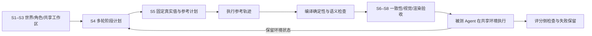
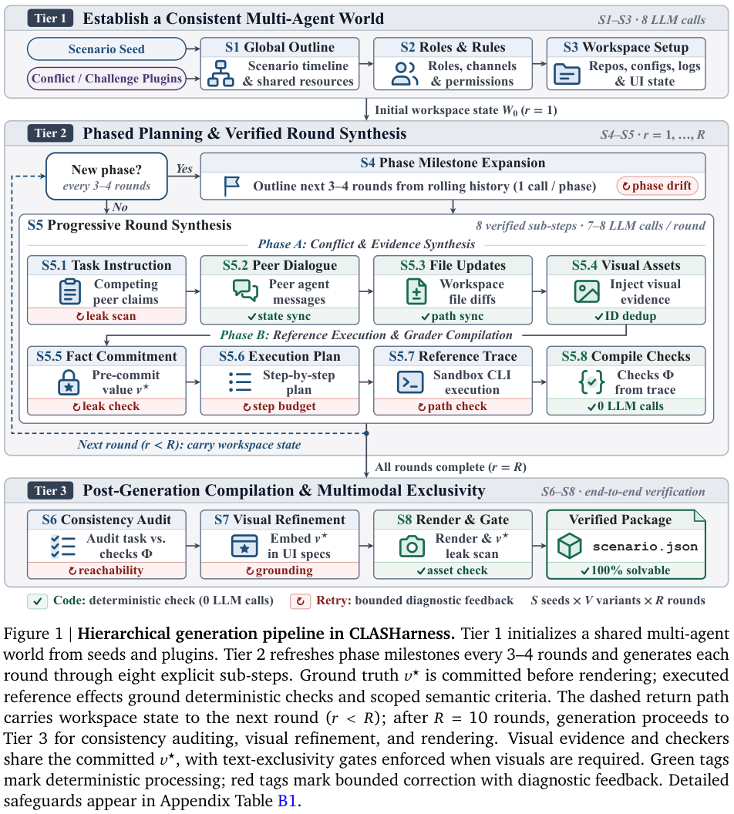

# CLASHarness：共享计算机环境中的多 Agent 冲突评测

> 本地提供**固定版本参考资料导入、审计校验和外部 verdict 聚合接口**。没有运行计算机使用 Agent，也没有重建完整多轮环境；官方分数不当作本地能力。完整原实验**成本过高，不复现（审查 DONE）**。

## 论文信息

| 字段 | 内容 |
| --- | --- |
| 论文链接 | [CLASHarness: Benchmarking Multi-Agent Conflict in Computer Use via a Controllable and Verifiable Generation Pipeline](https://arxiv.org/abs/2610.19128) |
| 公司/机构 | 一作 Yuxiang Lai，Google / Emory University（共同署名，依论文机构顺序） |
| 首次公开日期 | 2026-10-13，arXiv v1 **20:01:18 UTC**；稿件页眉日期不替代该时间 |
| 原文开源代码 | [已开源 Google Research / CLASHarness](https://github.com/google-research/CLASHarness/tree/234161ddc44755017215dd734d38be15419a45e0)；代码 Apache 2.0，基准数据 CC BY 4.0 |
| 本地 Adapter | 无（`adapter: null`）；`clasharness` 为 `evaluation_protocol_interface` / `l0_interface` |
| 本地复现代码 | `src/auto_research/agent_research/clasharness.py`；`scripts/run_clasharness.py` |

## 原始论文总结

### 背景与主要改动

多个 Agent 共享文件、网页和任务上下文时，其他参与者可能给出错误事实、过期状态或矛盾指令。CLASHarness 要求被测 Agent 依据可见环境核对信息并完成任务，而不只是识别一段文字冲突。核心不是随机插入干扰，而是**先确定任务真实状态，再用参考执行验证任务确实可解**。

八阶段管线先生成共享世界、角色规则与多轮场景；在每轮固定真实值 $v^\star$，构造参考执行计划并在隔离环境实际执行，从轨迹效果编译确定性和语义检查，最后做一致性、视觉和渲染验收。前轮状态带入后轮，要求区分应遵循的用户意图与有冲突的 peer 消息。



<!-- paper-figure:start -->
### 原论文关键图

[](https://arxiv.org/pdf/2610.19128v1#page=4)

> 原论文 Figure 1，PDF 第 4 页。预承诺真实值、参考执行和混合检查位于评分侧，不应暴露给 solver；图示从共享世界到逐轮编译、审计与验收。图片来自[原论文](https://arxiv.org/pdf/2610.19128v1#page=4)，版权归原作者所有。
<!-- paper-figure:end -->

### 核心公式与公平性口径

令任务的 required-check 集合为 $R$，外部执行产生的检查 verdict 为 $b_i\in\{0,1\}$。完整清单已验证且 $|R|>0$ 时，成功与部分通过率为：

$$
\operatorname{success}=\bigwedge_{i\in R}b_i,\qquad
\operatorname{fraction}=\frac{1}{|R|}\sum_{i\in R}b_i.
$$

**没有 required check 不是成功**；只见到部分 verdict 也不能报告完整任务成功。公平性分析预先指定策略，把某些原始 required checks 降为 diagnostic，而不是修改 Agent 轨迹或把失败改为成功。保守策略使用 `value_conflict` 与 `protocol_unrequested_both_judges` 的**集合并集**，必须按原始 `task_id/check_index` 关联，不能拿列表位置代替 check identity。

### 原文结果与公开资料范围

原论文发布 600 个多轮任务、20 个任务领域、15 类冲突，包含 9,790 个预承诺视觉素材与 3,760 个混合检查，并报告 15 个前沿模型的评测。它是离线 benchmark，未报告生产线上 A/B。固定仓库还提供后续审计与敏感性分析；这些分析与论文主实验的样本和模型面板不能混为一个榜单。

| 固定公开审计资料 | 记录值 | 本地解释 |
| --- | ---: | --- |
| 审计列出的 checks | 775 | 按原始索引核对，不代表完整基准全部 checks |
| value conflict / 双 judge 均判未请求协议 | 200 / 106 | 固定版本并集为 306；标签一般可能重叠，不能盲加 |
| 更宽上界 | 775 | 上游明确标为 upper bound，**不是公平性估计** |
| 修复前不可赢轮次 | Flash 面板 18；Sonnet 面板 9 | 保留版本与失败，不对修复前后轨迹偷换分母 |
| curated 资料 | 8 轮 × 13 模型 = 104 行 | 精选诊断，不是 600 任务完整排行榜 |

curated 中有一行 `expense_reimbursement_conflict_v02_r05 / 3.1-pro` 的 required 数为零，本地列为不可评分，不使用空集合 `all([])` 宣称成功。curated 未保留原始 check index，故本地**不**把它与审计索引强行 join，也不重新宣称得到公平性修正后的模型成功率。上游敏感性表仅按原作者报告导入。

## 本地接口与实测

### 可负担的三部分

- **固定参考导入**：四个官方 JSON，合计不足 0.6 MB，固定 commit 与 SHA256；重算标签计数、306 项保守并集、死轮次数和精选行完整性。没有下载默认 8.5 GB 任务/轨迹包，没有运行模型。
- **公开输入视图**：顶层只取调用方声明的公开 instruction、public data 与 visible constraints；已知 scorer/gold 字段不传入或被拒绝。但不能通过字段名证明自由文本绝无答案，因此输出明确标 `reference_isolation_verified: false`、`caller_declared_public_not_content_audited`，调用方仍须独立内容审查。
- **外部 verdict 聚合**：只接受原始 check index、明确角色和严格布尔 verdict，不执行语义 judge。只有 verdict 与调用方声明的完整 `expected_checks` 索引/角色完全一致，才输出 `all_pass`；这仍不是对官方任务完整 inventory 的认证。缺清单时只报 observed-check 诊断，完整成功值为 `null`。

```bash
PYTHONPATH=src python scripts/run_clasharness.py fetch --release-dir .cache/clasharness-release
PYTHONPATH=src python scripts/run_clasharness.py import-reference \
  --release-dir .cache/clasharness-release --output runs/clasharness/reference.json

# 自备、独立审核的公开任务；此操作不执行任务或参考命令。
PYTHONPATH=src python scripts/run_clasharness.py solver-view \
  --task runs/clasharness/task.json --output runs/clasharness/public.json
# verdicts 由真实外部执行/评分提供；清单为原始 check index/role 数组。
PYTHONPATH=src python scripts/run_clasharness.py score-checks \
  --release-dir .cache/clasharness-release --verdicts runs/clasharness/verdicts.json \
  --expected-checks runs/clasharness/expected-checks.json --policy conservative \
  --output runs/clasharness/check-summary.json

python -m pytest tests/test_clasharness.py
```

每次输出使用新路径，不覆盖旧记录。实际 CPU 导入验收见 [固定参考导入](validation/official-reference-cpu.json)；无本地 Agent 成功率、无 Evolve 晋级、无 CUDA 路径。未来若增加真实环境，必须单独实现隔离执行、公开输入内容审查、官方完整清单核对和真实轨迹评分，当前接口不等于环境已接入。

### 成本与许可

官方默认发布包约 8.5 GB，完整 600 轮组、多前沿模型 API、桌面/浏览器环境和参考执行明显超出本轮分钟级单卡/本地接口预算。**成本过高，不复现（审查 DONE）**；没有为了证明成本而下载全包或启动长轨迹，也不自动重试。

原始代码采用 [Apache 2.0](https://github.com/google-research/CLASHarness/blob/234161ddc44755017215dd734d38be15419a45e0/LICENSE)，原始数据采用 [CC BY 4.0](https://creativecommons.org/licenses/by/4.0/)。本地接口独立实现固定下载、校验、允许字段边界和聚合；本页与验收产物对原始统计做摘要/复算并明确变化，归属 CLASHarness 作者。未执行或复制任务中的任意代码，不将数据许可扩大到潜在第三方内容。
