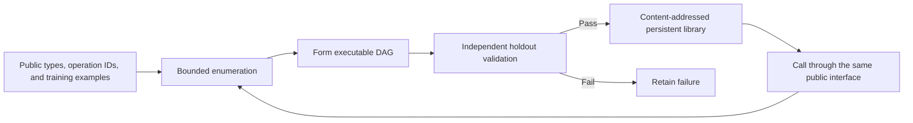
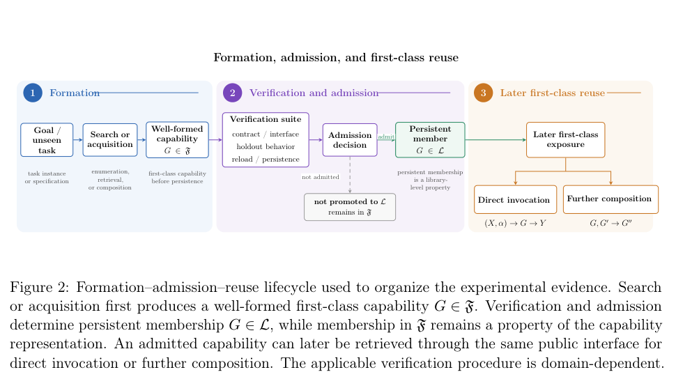

<!-- source-sha256: 4a209903df8a0fc1fbf8779f00e589aa9ee3dd5e22e51cbe9ec4d4a88aa54e78 -->

[简体中文](README.md) · English

# FormCraft: Verifiable recursive composition and first-class reuse of capabilities

> An independent CPU implementation of the paper's sequence-domain mechanism with fixed local tasks. No upstream code with unspecified licensing is copied. This is not a reproduction of every domain, the authors' original targets, or LLM capabilities, and it does not qualify for Evolve promotion.

## Paper information

| Field | Details |
| --- | --- |
| Paper | [Recursive Formation and First-Class Reuse of Compositional Capabilities](https://arxiv.org/abs/2610.19414) |
| Institution | First author: Hang Lin. The paper lists no affiliation; none is inferred. |
| First public release | 2026-10-14, arXiv v1 at 02:02:03 UTC |
| Original source code | [Public f-system/V9.4 implementation](https://github.com/lancelot138505-cpu/f-system/tree/b6199c88148a0c8dec1eb649eb2315c377e2fc6a/04_depth_control_V9-4_complete_baseline); no clear reuse license was found, so no code was vendored. |
| Local adapter | None (`adapter: null`); `formcraft` is a standalone sequence mechanism. |
| Local reproduction code | `src/auto_research/agent_research/formcraft.py`; `scripts/run_formcraft.py` |

## Original paper summary

### Background and main changes

A composed capability should not exist only as a derivation. It should be callable on its own, composable with other operations, and persistable. FormCraft distinguishes three stages: type- and interface-compatible formation, durable admission after independent validation, and direct reuse through the same public interface. A composite becomes an ordinary candidate for later search, which need not revisit its formation history. The composite's internal computations still execute at runtime.



<!-- paper-figure:start -->
### Key figure from the paper

[](https://arxiv.org/pdf/2610.19414v1#page=9)

> Figure 2 (PDF page 9): First-class identity is assigned at formation. Independent verification controls admission to the persistent library, and admitted operations remain callable or composable through the public interface. From the [paper](https://arxiv.org/pdf/2610.19414v1#page=9); copyright belongs to the authors.
<!-- paper-figure:end -->

### Core equations

For sequence operators $f,g:X\to X$, the composition $(g\circ f)(x)=g(f(x))$ remains in the same public capability space. Formation does not guarantee admission: $\operatorname{admit}(F)=\bigwedge_{x\in V}[F(x)=O(x)]$. Only the independent verifier uses reference $O$; the composer sees only training inputs and outputs and callable IDs.

Identity is the SHA256 of canonical JSON containing the type, operation kind, and parent IDs. Direct reuse retains this identity. Reloading a persisted record verifies its hash, reference integrity, and acyclicity. Search work counts candidates actually attempted; it does not estimate speedup by skipping real execution.

### Paper results

The paper's persistent sequence library grows from 12 to 26 to 38 records. In paired D01–D12 runs, candidate attempts decrease from 16,570 to 144 due to how history depth is handled. FULL and ACTIVE expose the same width, so the paper does **not** establish a width-governance reduction. It also includes proof checks in a Lean microdomain. The local implementation does not reproduce those figures or the full Lean experiment. No production A/B test is reported.

## Local reproduction

### Fixed tasks and isolation

The local `local-fixed-sequence-D01-D12-v1` reuses the D names only to indicate depths 1–12, **not the authors' target files**. Primitives append 0 or 1 to integer sequences, and seeds fix the target suffix. Each target has four training examples. The composer enumerates actual operator chains from these examples without access to the target suffix or holdout. After selection, validate on 128 independently seeded inputs. Failures cannot be admitted. Final paired measurement generates 128 separate test inputs not used for search or admission.

After admission, each seed writes its final library to a new JSON file with exclusive creation, discards the original object, then cold-loads from disk and rechecks identity, parent references and acyclicity. Both final arms use the **same cold-loaded snapshot**: expanded exposes just the two primitives and must form the capability again; first-class exposes ordinary library operation IDs. Both have the same public training examples and isolated final-test inputs, a cap of 20,000 candidates, and maximum history depth 12. The search never receives the target verifier. Real recursive operators execute to produce final outputs, not cached answers. Each result records the snapshot SHA256 and verifies that the snapshot did not change during testing.

```bash
PYTHONPATH=src python scripts/run_formcraft.py --seeds 42,43,44 \
  --output runs/formcraft/sequence-three-seed.json

python -m pytest tests/agent_research/test_oct16_cpu_components.py
```

The command creates `runs/formcraft/sequence-three-seed.libraries/seed42.json`, `seed43.json` and `seed44.json` next to the specified result. It refuses to run if either the result or adjacent library directory already exists; deleting the result alone cannot silently overwrite the library. Failures retain a failure JSON, completed seed reports and snapshots already written. Choose a fresh output path for a follow-up experiment.

### Measured CPU results

| Seed | Admitted targets | Expanded candidates | First-class candidates | 24 paired holdouts |
| --- | ---: | ---: | ---: | --- |
| 42 | 12 | 9,216 | 89 | All passed |
| 43 | 12 | 11,096 | 89 | All passed |
| 44 | 12 | 12,911 | 90 | All passed |

Actual persistence and cold loading across all three seeds took **1.28 seconds** in one local measurement, not a general timing guarantee. Each final library has 13 records: two primitives and 11 composites, with depth 1 directly using an existing primitive. The earlier approximately 1.25-second run used an in-memory library; `save/load` had only unit-test coverage and should not be regarded as a persistence experiment. The corrected run does not expand the tasks. Candidate counts match the old three-seed protocol exactly; the old counts and protocol differences remain in `prior_protocol` in the metrics.

See the [CPU mechanism experiment](metrics/sequence-cpu-seeds42-44.json) and [actual per-target run results](validation/persistent-cpu-v2/result.json). The committed cold-load inputs are [seed 42](validation/persistent-cpu-v2/result.libraries/seed42.json), [seed 43](validation/persistent-cpu-v2/result.libraries/seed43.json), and [seed 44](validation/persistent-cpu-v2/result.libraries/seed44.json). Paths and SHA256 are recorded without relying on a temporary machine directory. These are controlled search and execution results, not general agent completion rates; multiple seeds do not upgrade L1 to L2.

### Code map, verification, and scope

`Library.form` only forms valid DAGs; `admit` independently validates and retains failures. `save/load` persists and cold-loads data JSON without eval/exec. Final pairs in `run_sequence_study` explicitly execute from the cold-loaded object, not the original in-memory object. `compose_from_examples` performs real bounded enumeration, rejects unknown public operations, and records exhausted search budgets. Tests also cover semantically invalid compositions, tampered hashes, actual disk persistence and cold loads, snapshot and result no-overwrite, retained cold-load failures, and insufficient budgets. Injected failures are regression tests, not paper experiments.

The authors' full continuous, discrete and Lean domains, automatic abstraction discovery, automatic equivalence detection, and width governance are not implemented. There is no learned proposer or LLM. The CPU sequence mechanism was affordable and run. The LLM long-trajectory extension has no verifiable public low-cost setup and is **too costly to reproduce (review DONE)**. A static registry label is not claimed as Evolve integration.
