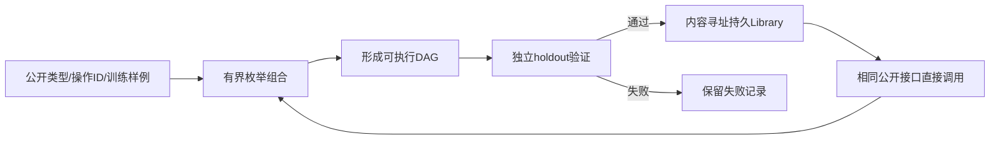
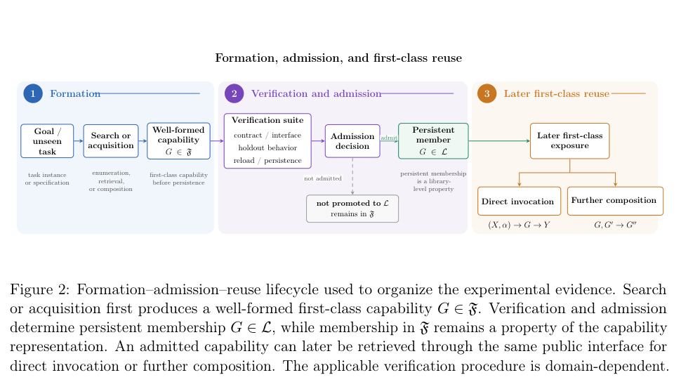

# FormCraft：可验证的递归能力组合与一等复用

> 本页是从论文独立实现的 CPU 序列域机制与本地固定任务实验，不复制未声明许可的上游源码。不声称复现原论文全部领域、原始目标或 LLM 能力，不进入 Evolve 晋级。

## 论文信息

| 字段 | 内容 |
| --- | --- |
| 论文链接 | [Recursive Formation and First-Class Reuse of Compositional Capabilities](https://arxiv.org/abs/2610.19414) |
| 公司/机构 | 一作 Hang Lin；论文未列机构/公司/学校，不推测 |
| 首次公开日期 | 2026-10-14，arXiv v1 02:02:03 UTC |
| 原文开源代码 | [已公开实现 f-system/V9.4](https://github.com/lancelot138505-cpu/f-system/tree/b6199c88148a0c8dec1eb649eb2315c377e2fc6a/04_depth_control_V9-4_complete_baseline)；未发现明确复用许可，因此本地未 vendor |
| 本地 Adapter | 无（`adapter: null`）；`formcraft` 独立序列机制 |
| 本地复现代码 | `src/auto_research/agent_research/formcraft.py`；`scripts/run_formcraft.py` |

## 原始论文总结

### 背景与主要改动

一次合成出的能力不应只留下推导历史，而应成为可独立调用、继续组合、持久保存的一等操作。FormCraft 区分三个阶段：类型与接口相容的形成、独立验证后的持久准入、通过相同公开接口直接复用。已形成的复合操作可作为普通候选，后续搜索不用重走其历史形成链，运行时内部计算并未消失。



<!-- paper-figure:start -->
### 原论文关键图

[](https://arxiv.org/pdf/2610.19414v1#page=9)

> 原论文 Figure 2（PDF 第 9 页）：形成时已有 first-class 身份，独立验证决定是否进入持久库，后续仍以公开接口调用或进一步组合。图片来自[原论文](https://arxiv.org/pdf/2610.19414v1#page=9)，版权归原作者所有。
<!-- paper-figure:end -->

### 核心公式

对序列算子 $f,g:X\to X$，复合 $(g\circ f)(x)=g(f(x))$ 仍属于同一公开能力空间。形成不自动准入：$\operatorname{admit}(F)=\bigwedge_{x\in V}[F(x)=O(x)]$；参考 $O$ 只在独立验证器中使用，Composer 只读取训练输入输出和可调用 ID。

身份为类型、操作种类与父操作 ID 的规范 JSON 的 SHA256。直接复用保留该身份，持久化后重新加载必须重验 hash、引用完整性与无环性。搜索工作量是实际尝试的候选数，不是省略真实执行的估计加速。

### 论文离线与线上效果

原论文序列域持久库从 12→26→38 条记录增长；D01–D12 配对中 candidate attempts 从 16,570→144，作用来自历史深度处理。原文 FULL 与 ACTIVE 暴露宽度相同，**没有**证明宽度治理缩小。另有 Lean 微领域证明检查；本地没有复现这些原始数值或完整 Lean 实验。未报告生产线上 A/B。

## 本地复现

### 本地固定任务与隔离

本地 `local-fixed-sequence-D01-D12-v1` 与论文同名 D 编号仅表示深度 1–12，**不是作者原始目标文件**。原语为整数序列追加 0/1，种子冻结目标后缀。每目标有四个训练样例；Composer 根据样例枚举真实算子链，不能读取目标后缀或 holdout。选中后用独立种子生成的 128 条 validation 输入验证，失败不能准入。最终配对测量另外生成 128 条隔离 test 输入，不参与搜索或准入。

完成准入后，每个 seed 把最终 Library 以独占创建方式保存为实际 JSON 文件，销毁原内存对象，再从磁盘冷加载并复核身份、父引用与无环性。所有最终配对测试使用这个**同一个冷加载快照**：expanded 只暴露两个原语、必须重新形成；first-class 暴露库内普通操作 ID。两组公开训练样例和隔离 final-test 输入相同，候选上限 20,000，最大历史深度 12。目标验证器不会被交给搜索过程；最终输出由真实递归算子执行，不返回缓存答案。每组结果绑定快照 SHA256，测试前后还核对快照没有变化。

```bash
PYTHONPATH=src python scripts/run_formcraft.py --seeds 42,43,44 \
  --output runs/formcraft/sequence-three-seed.json

python -m pytest tests/agent_research/test_oct16_cpu_components.py
```

这个命令会在用户指定结果旁创建 `runs/formcraft/sequence-three-seed.libraries/seed42.json`、`seed43.json`、`seed44.json`。结果路径或相邻库目录只要已有一个就拒绝重跑，不能通过删掉结果文件隐式覆盖库。运行中失败会保留失败 JSON、已完成 seed 报告和已落盘快照；继续试验应指定一个新的输出位置。

### 本轮 CPU 实测

| seed | 准入目标 | expanded 候选数 | first-class 候选数 | 24 组配对 holdout |
| --- | ---: | ---: | ---: | --- |
| 42 | 12 | 9,216 | 89 | 全通过 |
| 43 | 12 | 11,096 | 89 | 全通过 |
| 44 | 12 | 12,911 | 90 | 全通过 |

本次真实持久化 + 冷加载三种子合计 **1.28 秒**（单次本机实测，不保证其他机器耗时），每种子最终 Library 13 条：两个原语与 11 个复合能力，深度 1 直接使用已有原语。此前约 1.25 秒的版本只在研究中使用内存库，`save/load` 仅被单测覆盖，不能视为持久化实验；这里明确更正。新流程没有扩大任务，搜索计数与旧版三 seed 完全一致，旧计数及协议差异保留在指标的 `prior_protocol`。

稳定指标见 [CPU 机制实验](metrics/sequence-cpu-seeds42-44.json)，完整逐目标记录见 [真实运行结果](validation/persistent-cpu-v2/result.json)。已提交的冷加载输入为 [seed 42 库快照](validation/persistent-cpu-v2/result.libraries/seed42.json)、[seed 43 库快照](validation/persistent-cpu-v2/result.libraries/seed43.json)、[seed 44 库快照](validation/persistent-cpu-v2/result.libraries/seed44.json)，均记录路径和 SHA256，不依赖临时机器目录。这些是小型受控领域的搜索与执行结果，不是通用 Agent 完成率；多种子不把 L1 升为 L2。

### 代码映射、验证与边界

`Library.form` 只形成合法 DAG，`admit` 独立校验并保留失败；`save/load` 用数据 JSON 保存和冷加载，不 eval/exec；`run_sequence_study` 的最终配对明确从冷加载对象执行，不能再使用原内存对象；`compose_from_examples` 真实有界枚举、拒绝未知公开操作，搜索预算耗尽保留失败。单测另覆盖语义错误拒绝、篡改 hash、真正落盘/冷加载、快照与结果不可覆盖、冷加载失败保留及预算不足；注入失败仅为回归测试，不算论文实验。

未实现原作者 continuous/discrete/Lean 全领域、自动抽象发现、自动等价检测和宽度治理，也没有 learned proposer 或 LLM。此 CPU 序列机制本身可负担且已运行；其 LLM 长轨迹扩展没有公开低成本可核配置，**成本过高，不复现（审查 DONE）**，不以静态 registry label 声称接入 Evolve。
