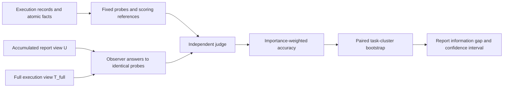
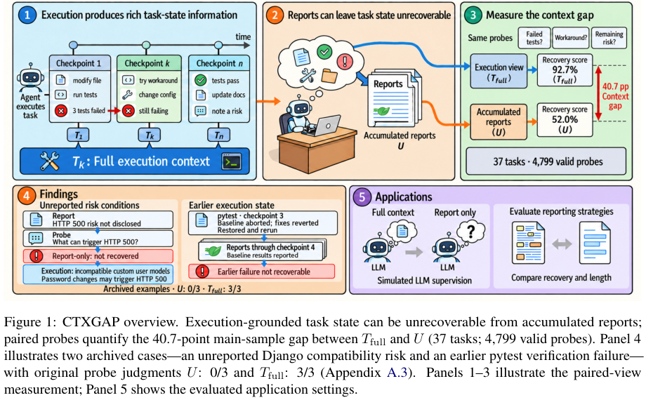

<!-- source-sha256: ed66b5cd42504e543e7a2e43357d7d115de5a60da44bd7f6ee9adb9c733eeb99 -->

[简体中文](README.md) · English

# CTXGAP: What coding agents did and what they left out of their reports

> The local deliverable is a **CPU recomputation from the official frozen tables and a public evaluation interface**, not a new agent capability evaluation. Full private execution views and large-scale model calls are **too costly to reproduce (review DONE)**.

## Paper information

| Field | Details |
| --- | --- |
| Paper | [What Coding Agents Leave Unsaid: Measuring Task-State Gaps Between Execution and Reports](https://arxiv.org/abs/2610.20003) |
| Institution | First author: Guoyang Xu, Tencent, as listed in the paper |
| First public release | 2026-10-14, arXiv v1 at **11:20:15 UTC** |
| Original source code | [CTXGAP release](https://github.com/Kaguraaaaaa/Ctxgap/tree/04d8c618238923c1e797b9b154b977091222c1a2); code MIT, original benchmark data and prompts CC BY 4.0. Some private evidence will never be released. |
| Local adapter | None (`adapter: null`); `ctxgap` is an `evaluation_protocol_interface` / `l0_interface`. |
| Local reproduction code | `src/auto_research/agent_research/ctxgap.py`; `scripts/run_ctxgap.py` |

## Original paper summary

### Background and main changes

A coding agent's final report can sound comprehensive without letting users recover the actual task state. Instead of using task completion as a proxy for information quality, CTXGAP extracts atomic facts from execution records, writes probes with reference answers, and asks **the same questions** of an observer that sees accumulated reports only ($U$), one that sees the full execution view ($T_{full}$), and the acting agent itself. Category weights for important facts keep large numbers of easy questions from masking omissions.

The main sample has 37 tasks, 148 checkpoints, and 4,855 probes, of which 4,799 are valid. Released text probes and execution materials are only a subset. Evidence for 282 probes and 21 atomic facts exists solely in private reasoning or agent memory and will never be released. Thus **$T_{public}\ne T_{full}$**; a download of the public materials cannot be relabeled as the full view to calculate the paper's private gap.



<!-- paper-figure:start -->
### Key figure from the paper

[](https://arxiv.org/pdf/2610.20003v1#page=2)

> Figure 1, PDF page 2. The paired-view measurement and examples of omissions. Reference answers in the figure illustrate the paper and are not given to evaluated observers. From the [paper](https://arxiv.org/pdf/2610.20003v1#page=2); copyright belongs to the authors.
<!-- paper-figure:end -->

### Core equations and statistical unit

For category $c$, probe weight is $w_i=N_{\text{important atoms},c}/N_{\text{probes},c}$, counting facts with `importance >= 2` as important. Valid probes have weighted score

$$
A(V)=\frac{\sum_i w_i s_i(V)}{\sum_i w_i},\qquad
\Delta=A(T_{full})-A(U),\qquad s_i\in\{0,0.5,1\}.
$$

Confidence intervals resample **task/run clusters** while preserving pairing across conditions; probes within one task are not independent samples. The primary cross-harness gap gives every task equal weight. Pooled accuracy is separately reported per arm and its subtraction cannot stand in for the equal-task gap. Report rewriting comparisons pair identical probes that are valid in all three arms and have identical weights.

### Paper results and interpretation

| Paper statistic | Result | Interpretation |
| --- | ---: | --- |
| Main-sample $U$ / $T_{full}$ / actor | 52.05% / 92.71% / 93.64% | State recoverability on fixed tasks, not coding task success |
| Main-sample information gap | 40.66 percentage points; 95% CI 37.33–43.81 | 37 tasks, 4,799 valid probes |
| Final-checkpoint gap for 30 successful tasks | 34.79 percentage points | Reports omit important state even after the task is solved |
| Natural rewrite B / targeted rewrite C vs. A | +8.29 / +8.50 percentage points | Paired report rewriting with equal length budgets |
| C−B | +0.20 percentage points; CI −1.48–1.78 | The interval includes zero; no significant advantage of targeted rewrites is established |

This is an offline measurement study with no production A/B report. Local recomputation matches the authors' table, validating the statistical implementation on the frozen inputs, not that a local model achieved those accuracies.

## Local implementation and measurements

### Two separate paths

1. **Frozen statistical recomputation:** Download only five pinned numeric tables (approximately 1.65 MB) and verify each SHA256. Independently organize the computation following the authors' `reproduce_all.py` protocol. With 10,000 cluster-bootstrap resamples and fixed seed 0, the output matches pinned `data/reproduced_all.json` **field for field**. No model calls or full trajectory downloads.
2. **New public measurement interface:** `PublicProbe` holds the reference on the scoring side. `observer_input` exports only the question, public view and identifiers, never the reference, importance or cached verdict. Callers must inspect free-text public inputs themselves; field isolation alone cannot prove that free text has no answer leaks. `evaluate_public` uses only real observer and judge callbacks supplied by the caller. None were provided or executed in this batch.

New measurements freeze the full plan and a positive total weight first. Missing, invalid and failed calls remain in the planned denominator, and coverage, scored-only accuracy and intention-to-evaluate accuracy are all reported. This path measures $U_{public}$ only and never outputs a $T_{full}$ gap.

```bash
PYTHONPATH=src python scripts/run_ctxgap.py fetch --release-dir .cache/ctxgap-release
PYTHONPATH=src python scripts/run_ctxgap.py reproduce \
  --release-dir .cache/ctxgap-release --bootstrap 10000 \
  --output runs/ctxgap/reference.json

# Supply and audit your own inputs and real external judge labels; these commands do not call a model.
PYTHONPATH=src python scripts/run_ctxgap.py export-observer-inputs \
  --probes runs/ctxgap/public-probes.json --output runs/ctxgap/observer-inputs.json
PYTHONPATH=src python scripts/run_ctxgap.py score-labels \
  --probes runs/ctxgap/public-probes.json --labels runs/ctxgap/labels.json \
  --output runs/ctxgap/public-measurement.json

python -m pytest tests/test_ctxgap.py
```

Output must not already exist, so earlier failures and results cannot be overwritten. See the [CPU recomputation acceptance record](validation/official-statistics-cpu.json). Author reference scores are stored under `official_reference_statistics` and are not local capability scores on the dashboard or Evolve rewards. The input revision, five hashes, bootstrap rules, and original run-result hash are retained. There is no CUDA path or need for a GPU receipt.

### Cost, licensing, and scope

The full study involves 228,939 frozen judgments, private model execution and irretrievable private evidence. Recreating it on one A100/A30 or a Mac is beyond this small interface, and the public subset cannot replicate the information conditions. It is **too costly to reproduce (review DONE)**, will not retry automatically, and is not an Evolve candidate.

See [UPSTREAM-LICENSE.txt](UPSTREAM-LICENSE.txt) for attribution and reuse. Local changes include bounded downloads, hash verification, statistical organization, and explicit public-view and scoring interfaces. Numeric data comes from the authors' CC BY 4.0 release; the statistical logic retains the upstream MIT license. No third-party source excerpts were copied or relicensed, and permanently private records were not accessed.
