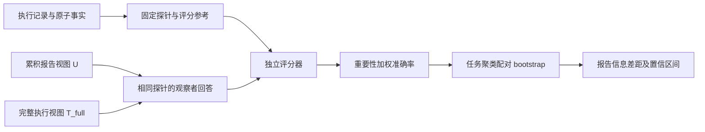
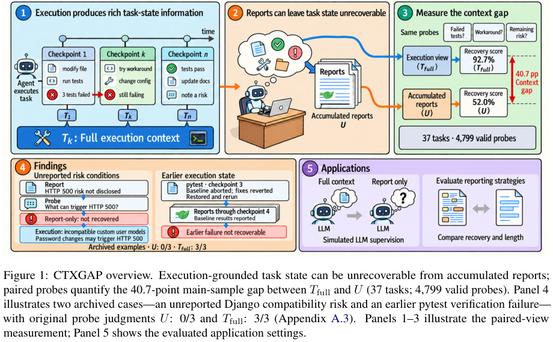

# CTXGAP：编码 Agent 执行了什么，报告又遗漏了什么

> 本地完成的是**官方冻结数值表的 CPU 复算与公开评测协议接口**，不是新 Agent 的能力评测。完整私有执行视图和大规模模型调用不在本轮复现范围：**成本过高，不复现（审查 DONE）**。

## 论文信息

| 字段 | 内容 |
| --- | --- |
| 论文链接 | [What Coding Agents Leave Unsaid: Measuring Task-State Gaps Between Execution and Reports](https://arxiv.org/abs/2610.20003) |
| 公司/机构 | 一作 Guoyang Xu；Tencent，以论文作者署名为准 |
| 首次公开日期 | 2026-10-14，arXiv v1 **11:20:15 UTC** |
| 原文开源代码 | [已开源 CTXGAP](https://github.com/Kaguraaaaaa/Ctxgap/tree/04d8c618238923c1e797b9b154b977091222c1a2)；代码 MIT，原始基准数据与提示 CC BY 4.0；部分私有证据永久不公开 |
| 本地 Adapter | 无（`adapter: null`）；`ctxgap` 为 `evaluation_protocol_interface` / `l0_interface` |
| 本地复现代码 | `src/auto_research/agent_research/ctxgap.py`；`scripts/run_ctxgap.py` |

## 原始论文总结

### 背景与主要改动

编码 Agent 的最终报告可能“听起来完整”，却不足以让用户恢复真实任务状态。CTXGAP 不用任务完成率替代信息质量，而是从执行记录抽取原子事实，生成有参考答案的探针，在**同一问题**上比较只读累积报告的观察者 $U$、读取完整执行视图的观察者 $T_{full}$，以及直接询问执行 Agent 的条件。重要事实的类别权重防止“多生成简单问题”稀释遗漏。

37 个主任务包含 148 个检查点、4,855 个探针，其中 4,799 个有效；公开文本探针及公开执行材料只是子集。原文有 282 个探针与 21 个原子事实的证据只存在于私有推理或 Agent 记忆中，永久不发布。因此 **$T_{public}\ne T_{full}$**，不能用下载到的公开材料重命名为完整视图后计算原文私有差距。



<!-- paper-figure:start -->
### 原论文关键图

[](https://arxiv.org/pdf/2610.20003v1#page=2)

> 原论文 Figure 1，PDF 第 2 页。图示配对视图测量与实际遗漏案例；图中的参考答案仅用于论文说明，不交给被测观察者。图片来自[原论文](https://arxiv.org/pdf/2610.20003v1#page=2)，版权归原作者所有。
<!-- paper-figure:end -->

### 核心公式与统计单位

对类别 $c$，探针权重为 $w_i=N_{\text{important atoms},c}/N_{\text{probes},c}$，其中重要原子事实按原文 `importance >= 2` 计数；有效探针的加权分数为：

$$
A(V)=\frac{\sum_i w_i s_i(V)}{\sum_i w_i},\qquad
\Delta=A(T_{full})-A(U),\qquad s_i\in\{0,0.5,1\}.
$$

置信区间必须按 **task/run 聚类**重采样，并在条件间保持配对，不把同一任务内探针视作独立样本。跨 harness 主差距采用任务等权平均；各组 pooled accuracy 单列，不能相减后冒充任务等权差距。报告改写实验只对三臂都有效、权重一致的相同 probe 配对比较。

### 原文结果与含义

| 原文统计 | 结果 | 可解释范围 |
| --- | ---: | --- |
| 主样本 $U$ / $T_{full}$ / actor | 52.05% / 92.71% / 93.64% | 固定任务上的状态可恢复性，不是代码任务成功率 |
| 主样本信息差距 | 40.66 个百分点；95% CI 37.33–43.81 | 37 任务、4,799 有效探针 |
| 30 个成功任务的最终检查点差距 | 34.79 个百分点 | 即使任务已解决，报告仍遗漏重要状态 |
| 自然改写 B / 定向改写 C 相对 A | +8.29 / +8.50 个百分点 | 等长度预算的配对报告改写 |
| C−B | +0.20 个百分点；CI −1.48–1.78 | 区间含零，不能宣称定向改写显著更好 |

这是离线测量研究，未报告生产线上 A/B。本地复算与表中作者结果一致，只能证明统计实现和冻结输入一致，不能证明本地模型达到这些准确率。

## 本地实现与实测

### 两条严格区分的路径

1. **冻结统计复算**：只下载五份固定数值表（约 1.65 MB），逐文件 SHA256 核验。按作者 `reproduce_all.py` 的统计口径独立组织复算；10,000 次聚类 bootstrap、固定 seed 0，结果与固定版本 `data/reproduced_all.json` **逐项相同**。没有调用模型、没有下载完整轨迹。
2. **新公开测量接口**：`PublicProbe` 的 reference 留在评分侧；`observer_input` 仅输出问题、公开视图和标识，不导出参考答案、重要性或缓存 verdict。调用方必须自行审核公开自由文本，字段隔离不能证明文本中绝无答案泄漏。`evaluate_public` 只使用调用方提供的真实 observer/judge；本轮没有提供或执行模型回调。

新测量先冻结完整计划和正的总权重。缺失、错误或失败调用保留在计划分母，同时报告 coverage、scored-only accuracy 和 intention-to-evaluate accuracy；不能只统计成功返回。它只测 $U_{public}$，始终不输出 $T_{full}$ 差距。

```bash
PYTHONPATH=src python scripts/run_ctxgap.py fetch --release-dir .cache/ctxgap-release
PYTHONPATH=src python scripts/run_ctxgap.py reproduce \
  --release-dir .cache/ctxgap-release --bootstrap 10000 \
  --output runs/ctxgap/reference.json

# 以下要求调用方自行准备、审核输入和真实外部评分标签；不会调用模型。
PYTHONPATH=src python scripts/run_ctxgap.py export-observer-inputs \
  --probes runs/ctxgap/public-probes.json --output runs/ctxgap/observer-inputs.json
PYTHONPATH=src python scripts/run_ctxgap.py score-labels \
  --probes runs/ctxgap/public-probes.json --labels runs/ctxgap/labels.json \
  --output runs/ctxgap/public-measurement.json

python -m pytest tests/test_ctxgap.py
```

输出路径须不存在，防止覆盖先前失败或结果。本轮稳定记录见 [CPU 数值复算验收](validation/official-statistics-cpu.json)；作者参考分数放在 `official_reference_statistics`，不作为看板本地能力分数或 Evolve reward。输入版本、五个 hash、bootstrap 规则和原始运行结果 hash 均保留；本实现无 CUDA 路径，无需 GPU 回执。

### 成本、许可与边界

完整研究涉及 228,939 份冻结判定、私有模型执行与不可恢复的私有证据；单卡 A100/A30 或 Mac 上重建完整评测既非当前小接口，也不能靠公开子集得到相同信息条件。按成本门槛标为 **成本过高，不复现（审查 DONE）**，不会自动重试，不进入 Evolve。

归属与复用说明见 [UPSTREAM-LICENSE.txt](UPSTREAM-LICENSE.txt)。本地修改包括有界下载、hash 校验、统计组织与显式公开/评分接口；数值来自 CTXGAP 作者公开 CC BY 4.0 数据，统计逻辑保留上游 MIT 许可。未复制或重新授权第三方项目源片段，未获取永久不公开的记录。
