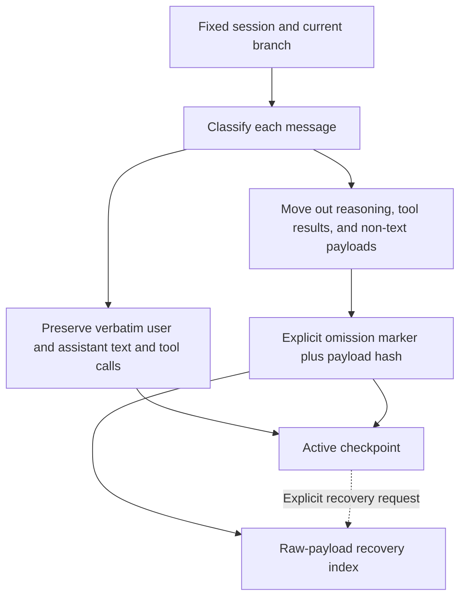
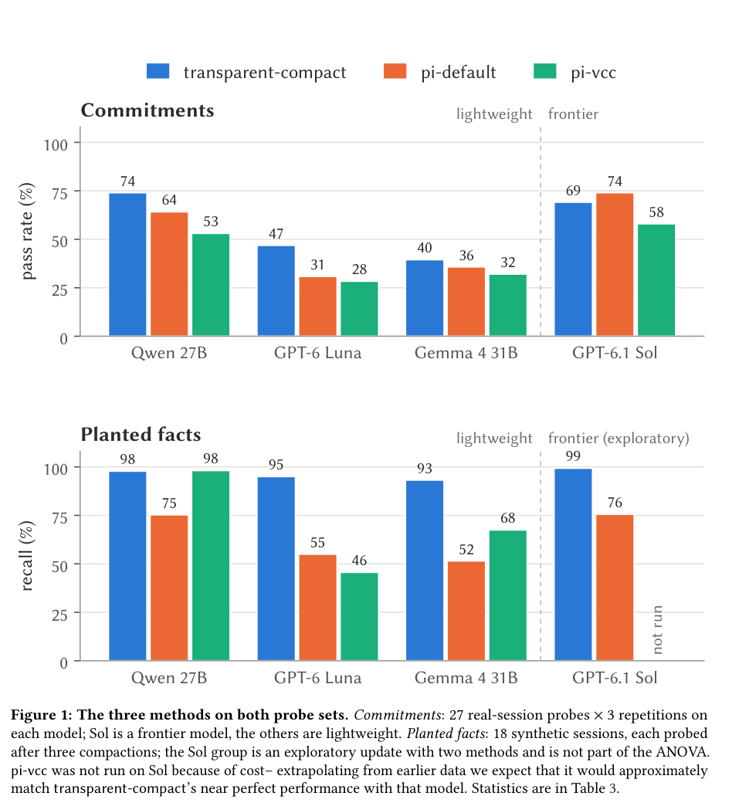

# Transparent-compact: Verbatim Text, Explicit Omissions, and Recoverable Context

<!-- source-sha256: 599010fae0e72c007cd142900822da1b21fd54f11dd604074d91f12659e9191f -->

[简体中文](README.md) · English

> The local implementation is a deterministic CPU compaction component and raw-payload recovery index, not a byte-for-byte Pi plugin or a reproduction of model memory capability. No LLM calls, answer-accuracy claims, or Evolve promotion.

## Paper information

| Field | Details |
| --- | --- |
| Paper | [Maximising Transparency in Context Compaction Improves Retention of Facts and Commitments for Lightweight Coding Agents](https://arxiv.org/abs/2610.20116) |
| Affiliation | First author Felix Woolford: CHAIN (Center for Human Nature, Artificial Intelligence, and Neuroscience), Hokkaido University |
| First public release | 2026-10-14, arXiv v1 12:43:44 UTC; software release date is not the paper's first publication date. |
| Authors' open-source code | [transparent-compact-pi](https://github.com/felixwoolford/transparent-compact-pi) and the [experiment package](https://github.com/felixwoolford/compaction-study-replication), both MIT. The paper pins plugin commit `6b970d3`. |
| Local adapter | None (`adapter: null`); `transparent-compact` is a standalone component, not a stand-in agent. |
| Local implementation | `src/auto_research/agent_research/transparent_compact.py`; `scripts/run_transparent_compact.py` |

## Original paper summary

### Background and main changes

Long-session compaction often uses model-generated summaries, which can drop commitments found only in the conversation or silently reword them. This method preserves user and assistant text verbatim. It removes reasoning and tool output from active context, leaves explicit omission markers, and provides a way to recover the complete original conversation. Compaction does not call a model, but the paper's `context_lookup` uses a model subagent to search history. These are not a single model-free full recovery capability.



<!-- paper-figure:start -->
### Key figure from the paper

[](https://arxiv.org/pdf/2610.20116v1#page=8)

> Figure 1 (PDF page 8) shows commitments and planted facts separately, not a single accuracy metric. These are author results, not local component scores. The figure comes from the [original paper](https://arxiv.org/pdf/2610.20116v1#page=8), © the original authors.
<!-- paper-figure:end -->

### Core equations

The compacted view is $C(H)=P(H)\cup S(H)\cup M(H)$: $P$ is verbatim prose, $S$ call records, and $M$ omission declarations. For the default uncapped component, $P(C(H))=P(H)$ holds segment by segment. Removed payloads satisfy $\operatorname{SHA256}(R_k)=h_k$; recovery must verify $h_k$.

The optional prose cap is a character budget, not an exact token budget. When exceeded, the oldest **complete prose block** is removed with a recovery marker. The active context no longer retains all original prose. The recovery index stays outside the model view and is not evidence that a model retrieved anything.

### Reported offline and online results

The paper compares Pi's default summarization, pi-vcc, and transparent compaction on fact and commitment probes, counting errors, failures to recall, and confidently wrong answers. Benefits are more pronounced for lightweight models. This is not one universal memory success rate. No production online A/B test was reported. The local component did not re-evaluate these capability claims.

## Local reproduction

### Data protocol and execution

Supports standard message JSON arrays and Pi JSONL. For Pi, `id/parentId` selects only the ancestors of the chosen leaf. Missing parents, cycles, and duplicate IDs are rejected, and sibling branches are not mixed into context. Commands in the session are never executed. Prose preserves Unicode and line breaks, and unknown/non-text blocks become recoverable payloads.

```bash
PYTHONPATH=src python scripts/run_transparent_compact.py \
  --input .cache/oct16-components/public-pi-session.jsonl --fetch-public-example \
  --output runs/oct16-components/transparent-metadata-fixed/public-session.json

PYTHONPATH=src python scripts/run_transparent_compact.py \
  --input /absolute/path/to/session.jsonl --leaf-id chosen-event-id \
  --max-prose-characters 80000 --output runs/transparent-compact/capped.json
```

Downloads require explicit `--fetch-public-example`. It fetches only one MIT-licensed public session from the paper's selection list, capped at 4 MiB, with pinned data revision `8c59325` and SHA256. It does not read local private Codex conversations. Output contains original recovery material. **Treat output from private inputs as private too; do not commit or upload it.**

### Actual results

A Mac CPU processed a real 1,181,680-byte public Pi session with SHA256 `ccc9199e0af18c80f15960f9239dcdc7873d619f06ae17197e624cb62f8d5990`. The current branch had 196 messages. All 54 prose segments stayed verbatim, and 145 removed payloads recovered exactly by hash. In an independent rerun after the fix, active serialized JSON shrank from **1,149,805 → 138,550 characters**. The recovery archive is separate; **this does not imply the same reduction in total storage or token count**. See [CPU component acceptance](validation/public-session-cpu.json). The artifact lives in `validation/`, and the deterministic transformation does not invent training seeds or enter a model-capability dashboard.

The rerun explicitly checked `toolCallId`, `toolName`, and `isError` for 68 Pi `toolResult` messages, and exit codes, cancellation, truncation, and context flags for `bashExecution`. `false` values were preserved verbatim. Both first and repeated compaction retained **208 metadata fields exactly**. Recompaction with no added messages left the active messages identical, and all 145 original payloads still passed hash checks. Tool text can be omitted, but call pairing and error states cannot disappear with it.

The earlier `runs/oct16-components/transparent-public-session.json` remains a pre-fix record: its `129,010`-character figure did not preserve the Pi top-level pairing/status metadata above and cannot be used for final acceptance. The new artifact lives in a separate `runs/oct16-components/transparent-metadata-fixed/` directory, without overwriting old results. The stable acceptance file records the new artifact hash, executed source hash, and before/after difference. Hand-built test messages cover error paths only and are not real sessions or model scores.

### Code mapping and limits

- `load_session`: parse sessions and isolate branches; no claim to match all Pi SDK meta-event semantics.
- `compact`: preserve prose and tool calls, explicitly move out payloads, and optionally cap prose. Full call arguments are retained rather than reproducing all Pi signature-abbreviation policies.
- `Checkpoint.recover`: recover archived payloads exactly by ID and verify their hashes. It **does not** implement the paper's model subagent `context_lookup` or judge the correctness of recovered answers.
- `recompact`: preserve recovery IDs and payload hashes across rounds without mistaking old omission markers for restored original content. Unit tests cover repeat compaction and new messages.
- No shared agent policy, CUDA path, model accuracy, or Evolve operator. Feeding the compacted view and recovery index to a model together is not evidence of successful compaction.

The original full experiments use 27B models, long context of at least 128k, multiple arms × repeated inference, and blinded evaluation. This exceeds the budget and **was not reproduced (review complete)**. Component completion is recorded separately from full paper capability.
