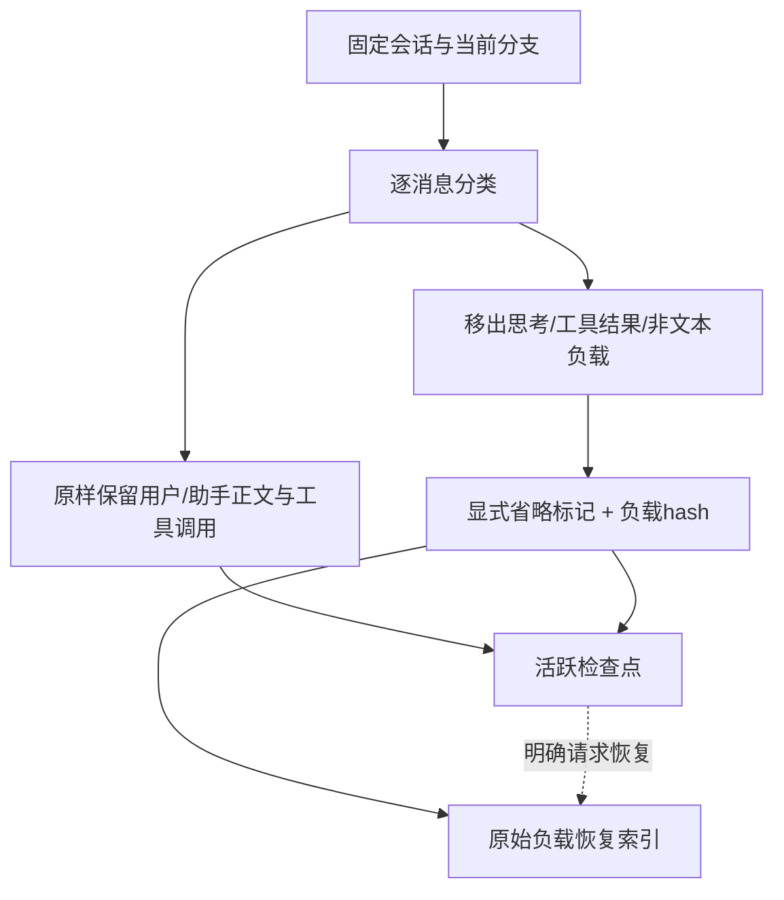
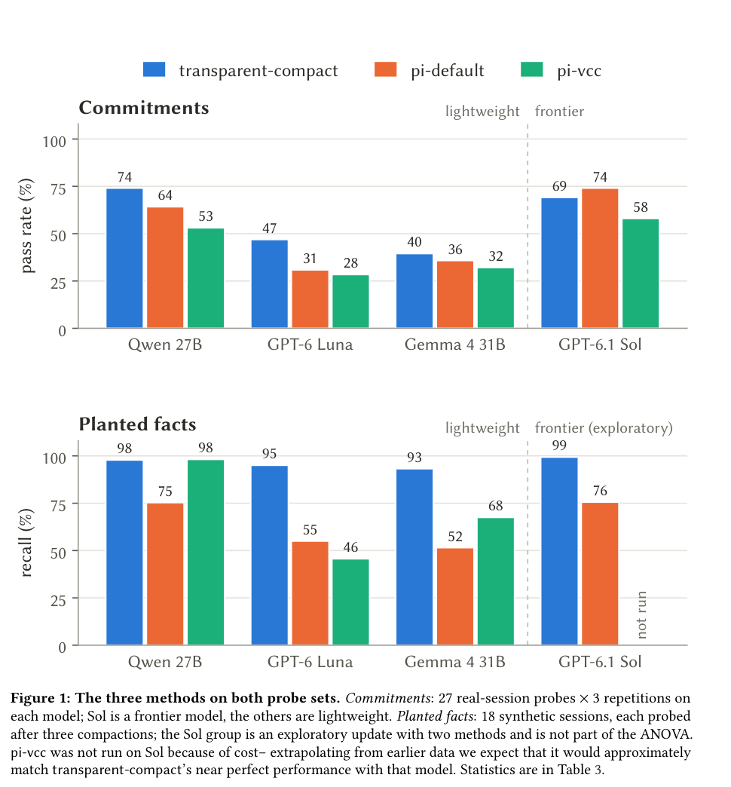

# Transparent-compact：保留原话、显式删减与可恢复上下文

> 本地实现的是纯 CPU 确定性压缩组件和原始负载恢复索引，不是 Pi 插件逐字节复刻，不是模型记忆能力复现；未调用 LLM，不报告回答准确率，不进入 Evolve 晋级。

## 论文信息

| 字段 | 内容 |
| --- | --- |
| 论文链接 | [Maximising Transparency in Context Compaction Improves Retention of Facts and Commitments for Lightweight Coding Agents](https://arxiv.org/abs/2610.20116) |
| 公司/机构 | 一作 Felix Woolford：北海道大学 CHAIN（Center for Human Nature, Artificial Intelligence, and Neuroscience） |
| 首次公开日期 | 2026-10-14，arXiv v1 12:43:44 UTC；软件版本的发布日不等于论文首发日 |
| 原文开源代码 | [transparent-compact-pi](https://github.com/felixwoolford/transparent-compact-pi)、[实验包](https://github.com/felixwoolford/compaction-study-replication)，均 MIT；论文固定插件提交 `6b970d3` |
| 本地 Adapter | 无（`adapter: null`）；`transparent-compact` 独立组件，不注册伪 Agent |
| 本地复现代码 | `src/auto_research/agent_research/transparent_compact.py`；`scripts/run_transparent_compact.py` |

## 原始论文总结

### 背景与主要改动

长会话压缩通常依赖模型重写摘要，可能丢失只在对话出现的承诺或悄悄改变其措辞。本方法保留用户与助手原话，将思考和工具输出移出活跃上下文，留下明确删减标记，并提供到完整原始会话的恢复路径。压缩不调用模型；论文的 `context_lookup` 则由模型子代理搜索历史，二者不能混成“零模型完整恢复能力”。



<!-- paper-figure:start -->
### 原论文关键图

[](https://arxiv.org/pdf/2610.20116v1#page=8)

> 原论文 Figure 1（PDF 第 8 页）：分别展示 commitments 和 planted facts，不应混成同一准确率；这些是作者结果，不是本地组件成绩。图片来自[原论文](https://arxiv.org/pdf/2610.20116v1#page=8)，版权归原作者所有。
<!-- paper-figure:end -->

### 核心公式

压缩视图 $C(H)=P(H)\cup S(H)\cup M(H)$：$P$ 为原文正文，$S$ 为调用记录，$M$ 为删减声明。对默认无正文上限的组件，逐段要求 $P(C(H))=P(H)$；移出负载满足 $\operatorname{SHA256}(R_k)=h_k$，恢复必须校验 $h_k$。

可选正文上限是字符预算而非精确 token 预算；超限时删除最旧**完整正文块**并保留恢复标记，不能继续声称原文全部仍在活跃上下文。恢复索引保存在模型视图之外，不能当作已经完成模型检索。

### 论文离线与线上效果

论文比较 Pi 默认摘要、pi-vcc 与透明压缩，在事实与承诺探针上考察错误、未回忆和自信误答，轻量模型获益更明显；这不是单一通用记忆成功率。原文未报告生产线上 A/B。本地未复测这些能力结论。

## 本地复现

### 数据协议与运行

支持标准消息 JSON 数组及 Pi JSONL。Pi 按 `id/parentId` 只读取选定叶节点的祖先分支，拒绝缺父、循环和重复 ID，不将兄弟分支混入上下文；不执行会话中的命令。正文保留 Unicode 和换行，未知/非文本块移入可恢复负载。

```bash
PYTHONPATH=src python scripts/run_transparent_compact.py \
  --input .cache/oct16-components/public-pi-session.jsonl --fetch-public-example \
  --output runs/oct16-components/transparent-metadata-fixed/public-session.json

PYTHONPATH=src python scripts/run_transparent_compact.py \
  --input /absolute/path/to/session.jsonl --leaf-id chosen-event-id \
  --max-prose-characters 80000 --output runs/transparent-compact/capped.json
```

下载必须显式给 `--fetch-public-example`；只取原论文选择清单中的一份 MIT 公开会话，最多 4 MiB，固定数据 revision `8c59325` 和 SHA256。不会读取本机私人 Codex 对话。输出包含原始恢复材料，**私人输入的输出也应视为私人文件，不提交或上传**。

### 本轮实际结果

在 Mac CPU 上读取一份 1,181,680 字节真实公开 Pi 会话，SHA256 `ccc9199e0af18c80f15960f9239dcdc7873d619f06ae17197e624cb62f8d5990`。当前分支有 196 条消息，54 段正文全部原样保留，145 项移出负载通过 hash 精确恢复。修复后独立重跑的活跃序列化 JSON 字符数为 **1,149,805 → 138,550**；恢复归档另存，**这不意味着总存储缩小或 token 数同比缩小**。结果见 [CPU 组件验收](validation/public-session-cpu.json)；产物放在 `validation/`，确定性转换不伪造训练seed，也不作为模型能力看板成绩。

本次重跑显式验证 68 条 Pi `toolResult` 消息的 `toolCallId`、`toolName`、`isError`，以及 `bashExecution` 的退出码、取消、截断和上下文标记；`false` 也原样保留。首次压缩和再次压缩各有 **208 项 metadata 字段逐项一致**；再次压缩未增加消息时活跃消息完全不变，145 项原始负载仍逐一通过 hash 校验。工具正文可以省略，但调用配对和错误状态不能随正文一起消失。

先前产物 `runs/oct16-components/transparent-public-session.json` 保留为修复前记录：其 `129,010` 字符统计没有保留上述 Pi 顶层配对/状态 metadata，不能作为最终验收。新产物写入独立的 `runs/oct16-components/transparent-metadata-fixed/`，未覆盖旧结果；稳定验收文件记录新产物 hash、实际执行源码 hash 及前后差异。手工消息单测仅用于异常分支，不记为真实会话或模型评测成绩。

### 代码映射与边界

- `load_session`：会话解析和分支隔离；不保证与 Pi SDK 的全部元事件语义一致。
- `compact`：正文保留、工具调用保留、显式移出与可选正文 cap；当前保留完整调用参数，不复刻 Pi 的全部签名缩写策略。
- `Checkpoint.recover`：按 ID 精确恢复已归档负载并验 hash；**没有**实现论文的模型子代理 `context_lookup`，没有对恢复结果作回答正确判断。
- `recompact`：跨多轮保留既有恢复 ID 和负载 hash，不将旧省略标记误当成已恢复原文；单测验证重复压缩和新增消息。
- 目前无统一 Agent 策略、无 CUDA、无模型准确率、无 Evolve operator。压缩视图和恢复索引不能打包后直接一起喂模型而声称压缩成功。

原论文 27B/长上下文（至少 128k）、多臂×多次推理及盲评完整实验超出本轮预算，**成本过高，不复现（审查 DONE）**。组件完成与完整论文能力实验分开记录。
