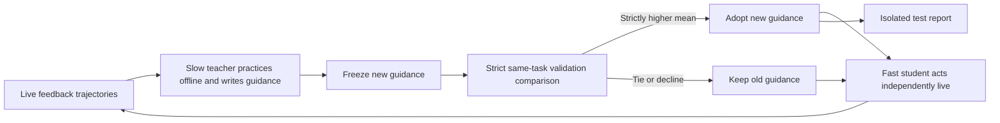
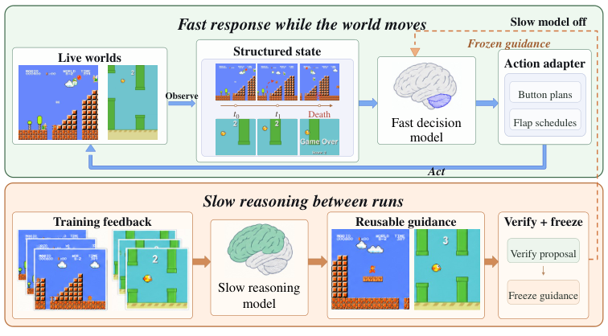

# TORSI: A Slow Teacher Learns Offline, a Fast Student Acts in Real Time

<!-- source-sha256: 14959b19326a9a3486bec11a496cc21fc28c659ffb1251462af06b37d673856c -->

[简体中文](README.md) · English

> `evaluation_protocol_interface` / L1 CPU. Only clock, feedback isolation, and guidance acceptance contracts. No real-time game or model-capability reproduction.

## Paper information

| Field | Details |
| --- | --- |
| Paper | [The World Won't Wait](https://arxiv.org/abs/2610.20665) |
| Affiliations | First author Ningxin Pan; Peking University / Samsung Research |
| First public release | 2026-10-14, arXiv v1; overlap backfill for the 10-16 announcement |
| Authors' open-source code | The paper lists underlying game repositories and revisions. No unified RealtimeBench/TORSI author implementation repository link was found. |
| Local adapter | None (`adapter: null`); protocol key `torsi` |
| Local implementation | `src/auto_research/agent_research/torsi.py`; `scripts/run_oct18_agent_components.py` |

## Original paper summary

### Background and main changes

Games advance while the model thinks. An action that was correct at observation can be obsolete when applied. [§§3–4](https://arxiv.org/html/2610.20665v1) propose RealtimeBench comparisons under paused, live, and accelerated clocks, and Two-Timescale Offline Recursive Self-Improvement. The fast student acts independently live. Between attempts, the slow teacher reads failure trajectories, practices offline on saved feedback states, and rewrites reusable guidance. After it is frozen, only independent validation decides whether the new guidance replaces the old. Test data never participates in revision or selection.



<!-- paper-figure:start -->
### Key figure from the paper

[](https://arxiv.org/html/2610.20665v1/figure-3-fast-slow.png)

> **Figure 5 from the paper:** Overall method design and key components. The figure comes from the [original paper](https://arxiv.org/abs/2610.20665), © the original authors. Select the image to see the source.
<!-- paper-figure:end -->

### Core equations

Response latency $L$ and action age $A$ differ:

$$
L_i=t_i^r-t_i^o,\quad A_i=t_i^a-t_i^o,\quad
\Delta_V={1\over |V|}\sum_{j\in V}[s_j(\widetilde h)-s_j(h)].
$$

Adopt $\widetilde h$ only when $\Delta_V>0$; ties are rejected. `ActionTiming` enforces finite and ordered observation, response, and application times. `select_guidance` requires complete paired task IDs and separate feedback/test sets. `propose_guidance` gives feedback trajectories only to a trusted teacher callback, with no built-in LM or hidden simulator search.

### Reported offline and online results

The authors use 180 tasks across six game types, with ten feedback, ten validation, and ten test tasks per type. GPT-6.1-sol exceeds Jev in most games when paused, but their live means are 1.51 versus 13.51. After validation selection in two TORSI rounds, Jev's mean test progress increases from 13.51 to 24.19. Scores on 0–100 are normalized game progress, not task accuracy. No production online A/B test was reported. Structured text observations are not raw visual inputs. [Tables 1–4](https://arxiv.org/html/2610.20665v1)

## Local reproduction

```bash
PYTHONPATH=src python scripts/run_oct18_agent_components.py \
  --methods torsi --seeds 42,43,44 --device cpu \
  --output runs/oct18-agent/torsi.json
```

Each seed generates 16 timing events and 12 numeric validation rows. Independent checks verify that action age includes extra scheduling time beyond response latency, that gains must be strict, and that ties and declines are rejected. The teacher sees only synthetic feedback traces. See the [CPU artifact](metrics/component-cpu-seeds42-44.json) for per-seed measurements and source hashes. These do not represent game progress or Jev improvements.

### Cost and limits

The complete protocol includes 180 tasks, multiple models and clocks, three runs, and offline teacher/student practice. Table 14 reports hundreds of thousands to tens of millions of input tokens per task. Together with slow-teacher API calls and game execution, this exceeds the low-cost budget and **was not reproduced (review complete)**. The local runner did not execute Mario, Snake, other engines, Jev, a teacher, or asynchronous control. Numeric fixtures are not real-time capability evaluations. `promotion_eligible=false`, `evolve_integrated=false`; no CUDA path.
