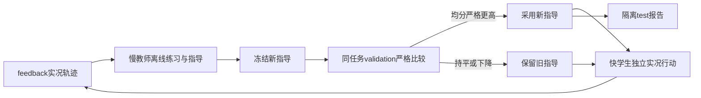
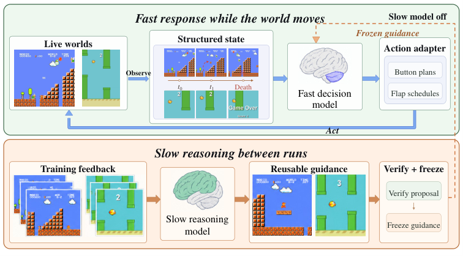

# TORSI：慢教师离线学习、快学生实时执行

> `evaluation_protocol_interface` / L1 CPU。只有时钟、反馈隔离与指导接受协议，没有实时游戏或模型能力复现。

## 论文信息

| 字段 | 内容 |
| --- | --- |
| 论文链接 | [The World Won't Wait](https://arxiv.org/abs/2610.20665) |
| 公司/机构 | 一作 Ningxin Pan；Peking University / Samsung Research |
| 首次公开日期 | 2026-10-14，arXiv v1；10-16 公告重叠补漏 |
| 原文开源代码 | 原文列出底层游戏仓库与 revision；未找到统一 RealtimeBench/TORSI 作者实现仓库链接 |
| 本地 Adapter | 无（`adapter: null`）；协议 key：`torsi` |
| 本地复现代码 | `src/auto_research/agent_research/torsi.py`；`scripts/run_oct18_agent_components.py` |

## 原始论文总结

### 背景与主要改动

游戏在模型推理时继续前进，观测时正确的动作在执行时可能已失效。[原文 §3–4](https://arxiv.org/html/2610.20665v1)提出 RealtimeBench 的 paused／live／accelerated 时钟比较，及 Two-Timescale Offline Recursive Self-Improvement：快学生在实况中独立行动，慢教师只在两次尝试之间读失败轨迹、在 feedback 保存状态上离线练习，并改写可复用指导。指导冻结后只由独立 validation 决定是否替换；test 不参与修订或选择。



<!-- paper-figure:start -->
### 原论文关键图

[](https://arxiv.org/html/2610.20665v1/figure-3-fast-slow.png)

> **原论文 Figure 5（关键图）**：展示原论文方法的总体设计和关键组成。图片来自[原论文](https://arxiv.org/abs/2610.20665)，版权归原作者所有；点击图片可查看来源。
<!-- paper-figure:end -->

### 核心公式

响应延迟 $L$ 与动作年龄 $A$ 不同：

$$
L_i=t_i^r-t_i^o,\quad A_i=t_i^a-t_i^o,\quad
\Delta_V={1\over |V|}\sum_{j\in V}[s_j(\widetilde h)-s_j(h)].
$$

仅当 $\Delta_V>0$ 采用 $\widetilde h$，持平也拒绝。`ActionTiming` 强制有限且有序的 observation／response／application 时间；`select_guidance` 要求完整相同 task ID 配对并与 feedback/test 分离。`propose_guidance` 只给可信 teacher callback 反馈轨迹，不内置语言模型或隐藏模拟器搜索。

### 论文离线与线上效果

作者用六类游戏共 180 任务，每类 feedback／validation／test 各十个。GPT-6.1-sol 在 paused 设置多数游戏强于 Jev，但 live 平均分为 1.51 对 13.51；两轮 TORSI 的 validation 选择后 Jev test 平均 progress 从 13.51 到 24.19。0–100 是归一化游戏进展，不是任务准确率。未报告生产线上 A/B；结构化文本观测不是原始视觉输入。[实验表 1–4](https://arxiv.org/html/2610.20665v1)

## 本地复现

```bash
PYTHONPATH=src python scripts/run_oct18_agent_components.py \
  --methods torsi --seeds 42,43,44 --device cpu \
  --output runs/oct18-agent/torsi.json
```

每 seed 随机生成 16 个计时事件和 12 个数值 validation 行；独立检查 action age 比只统计响应延迟多出的调度时间、严格增益、平局与下降拒绝。teacher 仅收到人工 feedback 轨迹。逐 seed 实测和来源 hash 见 [CPU 产物](metrics/component-cpu-seeds42-44.json)，不代表游戏进展或 Jev 改善。

### 成本与边界

完整协议包含 180 任务、多模型、多个时钟、三次运行及离线教师／学生练习；原文表 14 的单任务输入量可达数十万乃至千万 token，加上慢教师 API 和游戏运行，超出本轮低成本预算。**成本过高，不复现（审查 DONE）**。本地未运行 Mario/Snake 等引擎、Jev、教师或异步控制，不把数值 fixture 当实时能力评测；`promotion_eligible=false`、`evolve_integrated=false`，无 CUDA 路径。
