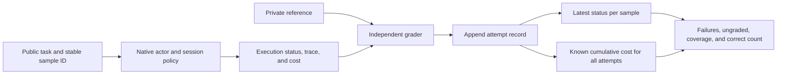
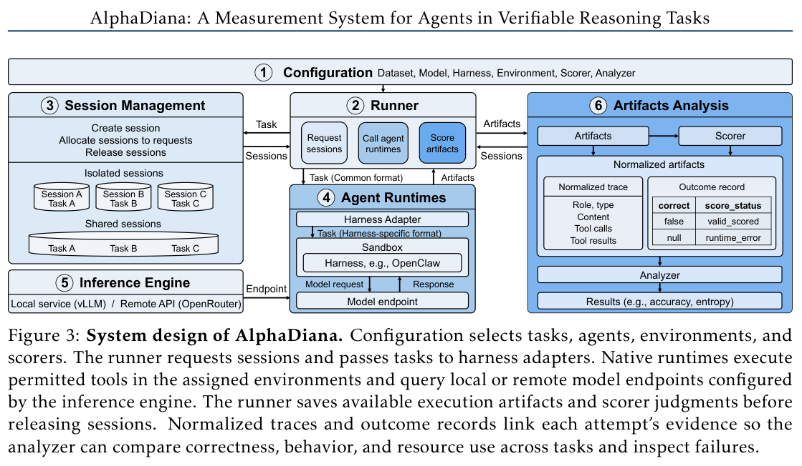

# AlphaDiana: Measuring Agent Execution, Grading, and Cost Separately

<!-- source-sha256: c66acec6eec8038a9b92932f6a68ac617cb883ba925aa1ac565adf372878e093 -->

[简体中文](README.md) · English

> `evaluation_protocol_interface` / L1 CPU. Implements record, status, and measurement contracts, not a new reasoning agent or official benchmark integration.

## Paper information

| Field | Details |
| --- | --- |
| Paper | [AlphaDiana: A Measurement System for Agents in Verifiable Reasoning Tasks](https://arxiv.org/abs/2610.20675) |
| Affiliation | First author Zhanke Zhou; TMLR Group, Hong Kong Baptist University |
| First public release | 2026-10-14 14:04:48 UTC, arXiv v1; overlap backfill for the 10-16 announcement, not a first release on 10-19 |
| Authors' open-source code | [tmlr-group/AlphaDiana](https://github.com/tmlr-group/AlphaDiana) provides the framework, configurations, scripts, and license. |
| Local adapter | None (`adapter: null`); protocol key `alpha-diana` |
| Local implementation | `src/auto_research/agent_research/alpha_diana.py`; `scripts/run_oct19_agent_components.py` |

## Original paper summary

### Background and main changes

The same model can perform differently in different harnesses because prompts, tools, recovery policies, and memory change. Reporting only successful tasks or mean tokens can hide missing grades, execution failures, and retry costs. AlphaDiana compares complete model–harness systems under common tasks, sampling, and resource policies while retaining each harness's native execution. [§2 and Appendices A–B](https://arxiv.org/pdf/2610.20675)

The local implementation retains four independently executable protocols:

- Each logical sample has a stable `(task_id, sample_id)`. Retries add attempts, not denominator samples. Reports select the latest record, not the best one.
- `execution_status` and grading status are separate. A successful run without an available grader remains ungraded, not correct or silently removed.
- The workspace resets each time. Memory follows an isolated, within-task, cross-task, or frozen policy. Shared state requires serial execution. Shared writable memory forbids automatic retries because a failed attempt may already have written to it.
- Known tokens from all attempts count toward cost. Missing token collection is reflected in coverage, not a seemingly complete tokens-per-correct number.



<!-- paper-figure:start -->
### Key figure from the paper

[](https://arxiv.org/pdf/2610.20675v1#page=3)

> **Figure 3 from the paper:** Boundaries between configuration, runner, session management, native agents, inference endpoints, and artifact analysis. Grading status and its links to trace evidence are retained; the official runtime was not accepted locally. The figure comes from the [original paper](https://arxiv.org/abs/2610.20675), © the original authors. Select the image to see the source.
<!-- paper-figure:end -->

### Core equations

Let $\ell(t,s)$ be the latest record for sample $(t,s)$ and $N$ the number of requested logical samples:

$$
\widehat p_{\mathrm{known}}={\sum_{t,s} I[\ell(t,s)\text{ is graded and correct}]\over N},\qquad
C_{\mathrm{per\ correct}}={\sum_{t,s,a}\mathrm{tokens}_{t,s,a}\over\sum_{t,s}I[\ell(t,s)\text{ is correct}]}.
$$

The first statistic keeps missing and ungraded samples in the denominator. It measures confirmed successes without implying that unknown grades are necessarily wrong. The second denominator counts **confirmed-correct logical samples**. Its numerator includes all recorded cost from failures and earlier attempts, not a true success cost after filling unknown grades. `complete_output_tokens_per_correct` returns `None` if there are no confirmed-correct samples, an attempt is missing a token count, or a requested sample has no execution record. Known token totals and record coverage are still reported separately.

### Reported results and negative findings

The paper finds that a harness can fix tasks that Direct misses, yet can lose even more tasks that Direct gets right. Loading skills or keeping persistent memory does not guarantee gains. Fewer output tokens can come with lower accuracy and higher cost per correct answer. These are observations for specified models, tasks, and native configurations, not a causal claim that tools or memory are generally harmful. No production online A/B test was reported. [Experiments and measurement limits](https://arxiv.org/pdf/2610.20675)

## Local reproduction

```bash
PYTHONPATH=src python scripts/run_oct19_agent_components.py \
  --methods alpha-diana --seeds 42,43,44 --device cpu \
  --output runs/oct19-agent/alpha-diana.json
```

In the CPU fixture, the actor computes from a public expression and a separate grader holds the reference. The runner injects execution failure, grading interruption, and incorrect answers, then actually runs retries, state handling, and aggregation. Negative controls show that discarding ungraded records inflates success, keeping only the last attempt undercounts cost, and retrying side-effectful writes changes later state. It retains per-attempt records, seeds, fixture summaries, and module/runner SHA256 values and refuses output overwrite. See the [CPU protocol artifact](metrics/component-cpu-seeds42-44.json). Fixture token counts are declared accounting units, not model tokenizer counts or actual inference charges.

### Gold isolation and limits

Final CPU acceptance reran seeds 42/43/44 at frozen commit `39e912c1124c49b7d3a85957909fb143d8c9ba3c`. Every seed retained the injected ungraded sample, exposed 0 gold fields to the actor, and had 0 error against an independent correct-count reference. The last-attempt-only negative control underestimated cumulative cost. A missing-request regression returns unknown complete cost rather than presenting partial known cost as complete. These are synthetic protocol diagnostics, not new model capability or true tokenizer cost.

The paper's example `BenchmarkTask` contains `ground_truth`. The local interface intentionally differs: the actor receives only `PublicTask(task_id, problem)` and the session; references go only to the grader. The grader has no writable session, and the actor cannot see grading records. Python callbacks are trusted integration code, not a security sandbox against hostile closures or global variables.

No real worker pool, container, model, or external API is scheduled. `workers` only validates the requested scheduling contract. The paper's multi-model, multi-harness, multi-task matrix uses **16×A100-80GB**, 27B/31B models, and remote models. **The full experiments exceed the cost budget and were not reproduced (review complete)**. `diagnostic_only=true`, `promotion_eligible=false`, `evolve_integrated=false`.
