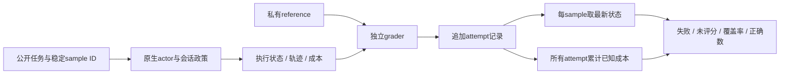
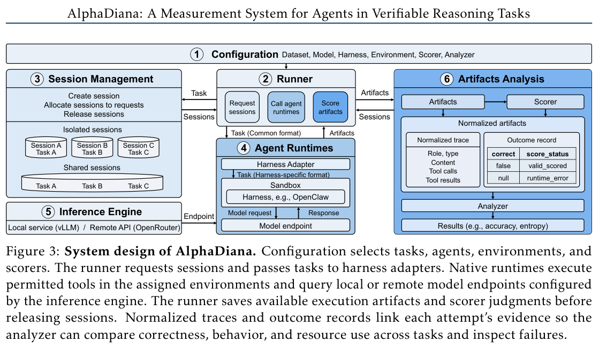

# AlphaDiana：把 Agent 执行、评分与成本分开测量

> `evaluation_protocol_interface` / L1 CPU。实现记录、状态和计量合同，不实现新的推理 Agent，不冒充官方 benchmark 接入。

## 论文信息

| 字段 | 内容 |
| --- | --- |
| 论文链接 | [AlphaDiana: A Measurement System for Agents in Verifiable Reasoning Tasks](https://arxiv.org/abs/2610.20675) |
| 公司/机构 | 一作 Zhanke Zhou；TMLR Group, Hong Kong Baptist University |
| 首次公开日期 | 2026-10-14 14:04:48 UTC，arXiv v1；10-16 公告中的重叠补漏，不是10-19首发 |
| 原文开源代码 | [tmlr-group/AlphaDiana](https://github.com/tmlr-group/AlphaDiana)，已有框架、配置、脚本与许可证 |
| 本地 Adapter | 无（`adapter: null`）；协议 key：`alpha-diana` |
| 本地复现代码 | `src/auto_research/agent_research/alpha_diana.py`；`scripts/run_oct19_agent_components.py` |

## 原始论文总结

### 背景与主要改动

同一模型装进不同 Harness 后，提示、工具、恢复策略和记忆都会影响结果。只报告成功任务或平均 token，容易把丢失评分、运行失败、反复重试的成本掩盖掉。AlphaDiana 用统一任务、采样和资源政策比较完整的“模型—Harness”系统，同时保留各 Harness 的原生执行方式。[原文 §2、附录 A–B](https://arxiv.org/pdf/2610.20675)

本地保留四项可独立执行的协议：

- 每个逻辑样本使用稳定的 `(task_id, sample_id)`；重试只增加 attempt，不增加样本分母。报告选最新记录，不挑最好的一次。
- `execution_status` 与评分状态分开。运行成功但 grader 不可用仍是未评分，不能写成正确或静默移除。
- 工作区每次重置，指定记忆按 isolated、within-task、cross-task 或 frozen 分别管理。共享状态必须串行；共享可写记忆禁自动重试，因为失败可能已经写入记忆。
- 所有尝试的已知 token 均计入成本；token 采集缺失时报告覆盖率，不输出看似完整的 tokens/correct。



<!-- paper-figure:start -->
### 原论文关键图

[](https://arxiv.org/pdf/2610.20675v1#page=3)

> **原论文 Figure 3（关键图）**：AlphaDiana 的配置、运行器、会话管理、原生 Agent、推理端点和产物分析系统边界；完整保留评分状态及其与轨迹证据的关联，不代表本地已验收官方运行时。图片来自[原论文](https://arxiv.org/abs/2610.20675)，版权归原作者所有；点击图片可查看来源。
<!-- paper-figure:end -->

### 核心公式

令 $\ell(t,s)$ 为样本 $(t,s)$ 最新的一条记录，$N$ 为全部请求的逻辑样本数：

$$
\widehat p_{\mathrm{known}}={\sum_{t,s} I[\ell(t,s)\text{已评分且正确}]\over N},\qquad
C_{\mathrm{per\ correct}}={\sum_{t,s,a}\mathrm{tokens}_{t,s,a}\over\sum_{t,s}I[\ell(t,s)\text{正确}]}.
$$

第一个量保留缺失和未评分样本的分母，是已确认成功的比例，不把未知评分解释为模型必然错误。第二个量的分母是**已确认正确的逻辑样本数**，分子包括失败及早先重试的全部已记录消耗，不是补齐未知评分后的真实成功成本。没有已确认正确样本、任何 attempt 的 token 缺失，或有请求样本尚无执行记录时，`complete_output_tokens_per_correct` 返回 `None`，不虚构完整成本；已知 token 总量和记录覆盖率仍单独报告。

### 论文效果与负结果

论文发现，Harness 能修复 Direct 失败的题，也可能丢掉更多 Direct 本能做对的题；加载技能或持续记忆不保证提升。更少的输出 token 也可能伴随更低正确率，导致每个正确答案的实际成本反而增加。这些是指定模型、任务和原生配置下的观察，不是“工具/记忆普遍有害”的因果结论；未报告生产线上 A/B。[实验与测量限制](https://arxiv.org/pdf/2610.20675)

## 本地复现

```bash
PYTHONPATH=src python scripts/run_oct19_agent_components.py \
  --methods alpha-diana --seeds 42,43,44 --device cpu \
  --output runs/oct19-agent/alpha-diana.json
```

CPU fixture 让 actor 从公开算式计算答案，单独 grader 持有 reference；注入执行失败、评分中断和错误答案，实际运行重试、状态管理和汇总。负对照分别演示：丢弃未评分会抬高成功率、只保留最后 attempt 会少算成本、重复执行有副作用的写入会改变后续状态。保存逐 attempt 记录、seed、fixture 摘要和模块/runner SHA256；输出拒绝覆盖。结果入口：[CPU 协议产物](metrics/component-cpu-seeds42-44.json)。fixture 中 token 数仅为声明的会计单位，不是模型 tokenizer 或真实推理费用。

### 无 gold 边界与限制

最终 CPU 验收按 seeds42/43/44 在冻结提交 `39e912c1124c49b7d3a85957909fb143d8c9ba3c` 重跑。每个seed均保留注入的未评分样本，actor暴露gold字段数为0，独立正确数参考误差为0；只取最后attempt的成本负对照会低估实际累计消耗。缺失请求记录的额外回归会返回未知完整成本，不把已知部分补成完整结果。这些是合成协议诊断，不是新模型能力或真实tokenizer费用。

原文接口示例的 `BenchmarkTask` 含 `ground_truth`。本地特意不照搬：actor 只收到 `PublicTask(task_id, problem)` 和会话；reference 只进入 grader。grader 不持有可写会话，actor 不见评分记录。Python 回调仍是受信任集成代码，本接口不是防止恶意闭包/全局变量越权的安全沙箱。

这里没有调度真实并行池、容器、模型或外部 API；`workers` 只验证请求的调度合同。原文多模型、多 Harness、多任务矩阵使用 **16×A100-80GB**，并包含27B/31B模型和远程模型，**完整实验成本过高，不复现（审查 DONE）**。`diagnostic_only=true`、`promotion_eligible=false`、`evolve_integrated=false`。
