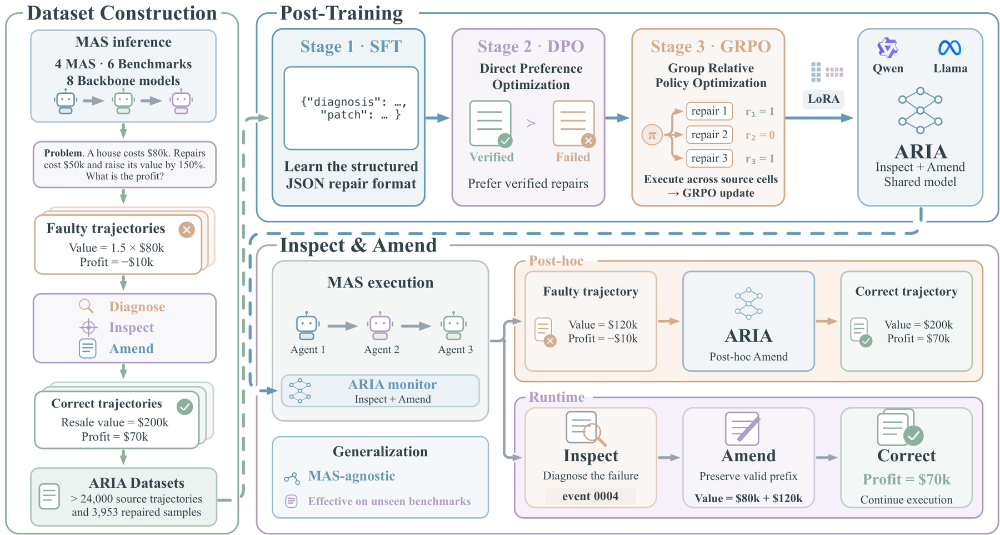

<!-- source-sha256: e28706952774b5189f7b4ba16164b98e928852f0cc437dcc27702783e404703d -->

[简体中文](README.md) · English

# ARIA: Structured continuation repair for multi-agent runs

> `component_only` / L1 CPU. Implements the cut-and-continuation data contract, not training of the inspection gate or repair policy.

## Paper information

| Field | Details |
| --- | --- |
| Paper | [ARIA](https://arxiv.org/abs/2610.20780) |
| Institution | First author: Bolin Shen, Florida State University |
| First public release | 2026-10-14, arXiv v1; picked up in the 10-16 overlapping announcement review |
| Original source code | [LabRAI/ARIA](https://github.com/LabRAI/ARIA), MIT; training and serving need CUDA, and frameworks and data have separate dependencies or access terms. |
| Local adapter | None (`adapter: null`); component key `aria` |
| Local reproduction code | `src/auto_research/agent_research/aria_repair.py`; `scripts/run_oct18_agent_components.py` |

## Original paper summary

### Background and main changes

Early errors in a multi-agent run propagate through messages and tool results. ARIA does not just explain failure afterward. It turns execution-verified repairs into training data so a model can decide when to intervene, where to cut, and how to continue a partial trajectory. [Section 2 and Appendix B](https://arxiv.org/html/2610.20780v1) describe structure SFT, repair DPO, diagnosis transfer, repair GRPO and gate GRPO. The local component extracts a testable patch contract; it does not substitute heuristics for those learning stages.

```mermaid
flowchart LR
    E[Observed event prefix] --> G[Learned inspection and localization in the paper]
    G --> P[Diagnosis, cut ID, and replacement]
    P --> C[Check ID, length, cut, and tool-result constraints]
    C --> R[Keep the cut event and replace its suffix]
    R --> X[Continue actual execution in the paper]
    X --> V[Repair passes and fresh control fails]
    V --> D[Admit training example]
```



<!-- paper-figure:start -->
### Key figure from the paper

[](https://arxiv.org/html/2610.20780v1/framework.png)

> **Figure 2 from the paper:** The training workflow and key optimization steps. From the [paper](https://arxiv.org/abs/2610.20780); copyright belongs to the authors. Click the image for the source.
<!-- paper-figure:end -->

### Core equations

A cut at event $e_k$ keeps that event:

$$
\tau'=(e_1,\ldots,e_k)\Vert(\hat e_1,\ldots,\hat e_L),\qquad
\mathrm{verified}=I[\mathrm{patched\ pass}]I[\neg\mathrm{fresh\ control\ pass}].
$$

A null cut keeps an empty prefix. A nonempty cut must reference an observed event before the identified bad event. A patch has at most eight new events and 12,000 characters of canonical JSON. IDs cannot collide with retained prefix IDs, and changing only IDs cannot disguise an unchanged old suffix. The model may propose assistant messages or tool calls to execute, but not fabricated tool results. Structural validity proves neither correct attribution nor successful recovery.

### Paper results

The authors collect more than 24,000 successful and failed trajectories and obtain 3,953 execution-verified repair pairs across four multi-agent frameworks, six benchmarks and eight host models. The Qwen2.5-7B runtime table reports overall SR of 21.4% and HIR of 2.00%; different experimental subsets should not be directly compared. No production A/B is reported. Continuation uses reconstructed context, not exact causal replay from a complete framework checkpoint. See [method, experiments and limitations](https://arxiv.org/html/2610.20780v1).

## Local reproduction

```bash
PYTHONPATH=src python scripts/run_oct18_agent_components.py \
  --methods aria --seeds 42,43,44 --device cpu \
  --output runs/oct18-agent/aria.json
```

Random event sequences exercise valid cuts and replacement with new tool requests. Negative controls inject unknown cuts, retained-prefix ID collisions and fabricated tool observations. Random paired verdicts show how accepting on patched pass alone can admit the wrong examples. Verdicts are artificial scorer fixtures supplied by the caller, not agent answers. The module does not pass gold labels to a model. See the [CPU artifact](metrics/component-cpu-seeds42-44.json).

### Cost and scope

The full multi-framework execution, more than 24,000 trajectories, model scales from 1.5B–14B, and five post-training stages require real environments and substantial execution. Some data needs approval, and SWE-bench-Lite needs Docker. **Too costly to reproduce (review DONE).** There is no local model or CUDA path and no claim about official task recovery rates. `diagnostic_only=true`, `promotion_eligible=false`, `evolve_integrated=false`.
