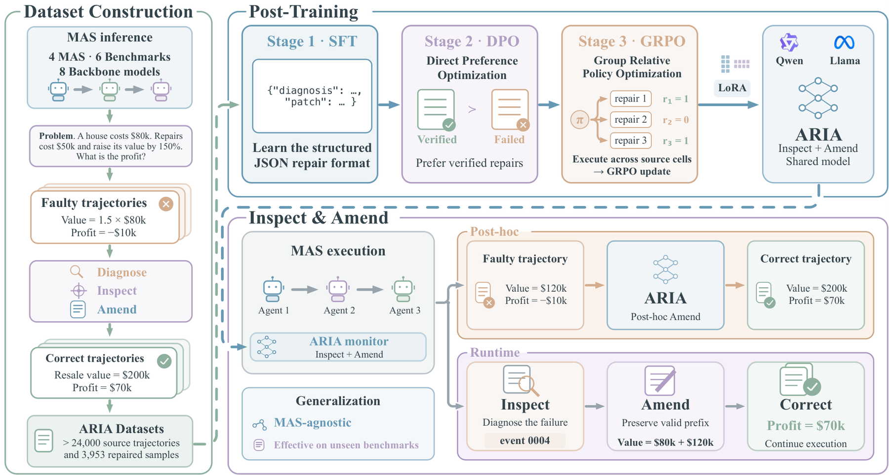

# ARIA：多 Agent 运行中的结构化续写修复

> `component_only` / L1 CPU。实现 cut-and-continuation 数据合同，不训练 inspection gate 或修复策略。

## 论文信息

| 字段 | 内容 |
| --- | --- |
| 论文链接 | [ARIA](https://arxiv.org/abs/2610.20780) |
| 公司/机构 | 一作 Bolin Shen；Florida State University |
| 首次公开日期 | 2026-10-14，arXiv v1；10-16 公告重叠补漏 |
| 原文开源代码 | [LabRAI/ARIA](https://github.com/LabRAI/ARIA)，MIT；训练/serving 需 CUDA，框架和数据另有依赖/授权 |
| 本地 Adapter | 无（`adapter: null`）；组件 key：`aria` |
| 本地复现代码 | `src/auto_research/agent_research/aria_repair.py`；`scripts/run_oct18_agent_components.py` |

## 原始论文总结

### 背景与主要改动

多 Agent 的早期错误会沿消息和工具结果传播。ARIA 不只在结束后解释失败，而是把执行验证过的修复转成训练数据，让模型在部分轨迹上决定何时干预、在哪里切断及如何续写。[原文 §2、附录 B](https://arxiv.org/html/2610.20780v1)的训练链包括结构 SFT、repair DPO、diagnosis transfer、repair GRPO 和 gate GRPO。本地没有以人工 heuristic 冒充这些学习阶段，只抽出可独立检验的补丁合同。


<!-- paper-figure:start -->
### 原论文关键图

[](https://arxiv.org/html/2610.20780v1/framework.png)

> **原论文 Figure 2（关键图）**：展示原论文的训练流程与关键优化环节。图片来自[原论文](https://arxiv.org/abs/2610.20780)，版权归原作者所有；点击图片可查看来源。
<!-- paper-figure:end -->

### 核心公式

在事件 $e_k$ 处切断时保留该事件：

$$
\tau'=(e_1,\ldots,e_k)\Vert(\hat e_1,\ldots,\hat e_L),\qquad
\mathrm{verified}=I[\mathrm{patched\ pass}]I[\neg\mathrm{fresh\ control\ pass}].
$$

空 cut 保留空前缀；非空 cut 必须引用已观察事件并早于已定位坏事件。补丁最多八个新事件、规范 JSON 最多 12,000 字符，ID 不与保留前缀冲突，不能只改 ID 原样重贴旧后缀。模型只能提出 assistant message 或待执行 tool call，不能伪造 tool result。结构合法不代表归因正确，也不代表后续执行一定恢复。

### 论文离线与线上效果

原文收集 24,000＋成功／失败轨迹，形成 3,953 个执行验证修复对；覆盖四种多 Agent 框架、六 benchmark、八种 host model。Qwen2.5-7B 的 runtime 表报告 overall SR 21.4%、HIR 2.00%，不同实验子集不能互相直接比较。未报告生产线上 A/B。正文明确续写是在重建的 continuation context 上执行，不等于完整框架 checkpoint 的精确因果重放。[方法、实验和局限](https://arxiv.org/html/2610.20780v1)

## 本地复现

```bash
PYTHONPATH=src python scripts/run_oct18_agent_components.py \
  --methods aria --seeds 42,43,44 --device cpu \
  --output runs/oct18-agent/aria.json
```

随机事件序列实际执行合法 cut 与新 tool request 替换；负对照注入未知 cut、保留前缀 ID 冲突和伪造工具观察。另以随机成对执行 verdict 检查“只看 patched pass”会产生的错误样本接纳。verdict 是调用方 scorer 的人工 fixture，不是 Agent 推出的答案；模块不把 gold 传给模型。详见 [CPU 产物](metrics/component-cpu-seeds42-44.json)。

### 成本与边界

完整多框架工具执行、24,000＋轨迹、1.5B–14B 多规模和五阶段后训练需真实环境及大量运行；部分数据还需授权、SWE-bench-Lite 需 Docker。**成本过高，不复现（审查 DONE）**。本地没有模型或 CUDA 路径、没有对官方任务恢复成功率的主张，`diagnostic_only=true`、`promotion_eligible=false`、`evolve_integrated=false`。
