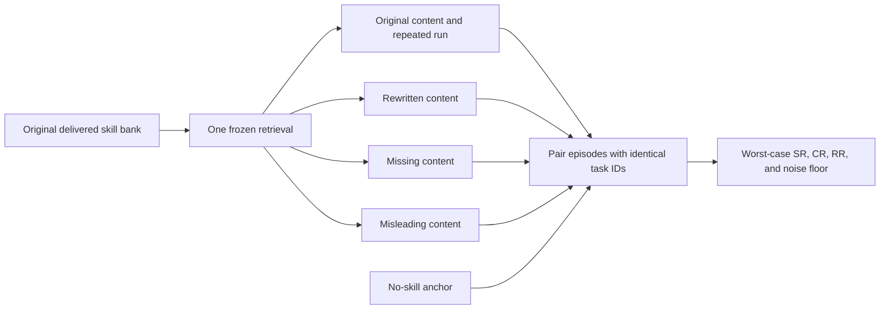
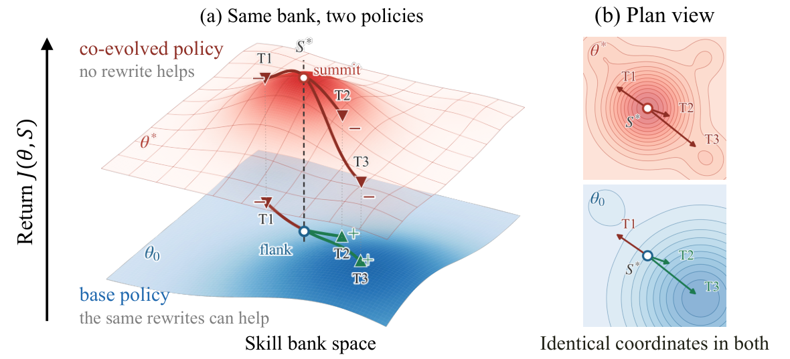

<!-- source-sha256: 528cc58baecfba2f9191af79cb0b5f150820fa708f327e140f94c09a5d8084f0 -->

[简体中文](README.md) · English

# CODA: Auditing co-evolution robustness after skill-bank drift

> `evaluation_protocol_interface` / L1 CPU. Implements content-rewrite boundaries and paired metrics, not co-evolved policy retraining or guarantees of semantic preservation.

## Paper information

| Field | Details |
| --- | --- |
| Paper | [Evolving Together, Failing Apart](https://arxiv.org/abs/2610.20845) |
| Institution | First author: Yujie Feng, Alibaba Token Hub, Alibaba Group |
| First public release | 2026-10-14, arXiv v1; picked up in the 10-16 overlapping announcement review |
| Original source code | The paper says the rewriting suite and per-episode results are released; no verifiable author repository URL was found in this review. |
| Local adapter | None (`adapter: null`); protocol key `coda` |
| Local reproduction code | `src/auto_research/agent_research/coda.py`; `scripts/run_oct18_agent_components.py` |

## Original paper summary

### Background and main changes

A policy jointly trained with its skill bank may rely on original wording and degrade when skills are rewritten after deployment. CODA does not report only peak delivered-bank performance. On the same tasks it evaluates T1 meaning-preserving rewrites, T2 omissions, T3 misleading content, and a no-skill anchor. [Sections 3–4 and Appendix E](https://arxiv.org/html/2610.20845v1) retrieve once from the original bank and freeze selected IDs and retrieval-side fields. Only content is replaced; retrieving again would introduce a confound.



<!-- paper-figure:start -->
### Key figure from the paper

[](https://arxiv.org/html/2610.20845v1/fig2_landscape.png)

> **Figure 2 from the paper:** Overall design and components. From the [paper](https://arxiv.org/abs/2610.20845); copyright belongs to the authors. Click the image for the source.
<!-- paper-figure:end -->

### Core equations

Let $c_i(S)$ be the binary result for task $i$ using skill bank $S$:

$$
\mathrm{CR}={1\over N}\sum_i I[c_i(S)=c_i(S_{T1})],\qquad
\mathrm{RR}_a={1\over N}\sum_i I[c_i(\varnothing)=1\land c_i(S_a)=1].
$$

The RR denominator is **all the paired tasks**, not just those that the no-skill condition solves. CR detects flips in both directions that can cancel in aggregate SR. Agreement between two unperturbed runs estimates the stochastic noise floor. The local interface reports that reference, not a paper-style statistical significance pass inferred from a single difference. Formal T1 requires an independently pinned suite and auditable rewrite bank; string similarity does not prove semantic equivalence.

### Paper results

Across six settings covering four co-evolution methods and five benchmarks, worst-case success fell roughly 5–13 percentage points below the delivered peak, consuming 52–93% of the skill benefit. Absolute scores across different backbones are not a fair algorithm comparison. Worst-case results still beat the no-skill anchor, so the finding is not that skills must be harmful. No production A/B is reported. See the [experiments and reproducibility statement](https://arxiv.org/html/2610.20845v1).

## Local reproduction

```bash
PYTHONPATH=src python scripts/run_oct18_agent_components.py \
  --methods coda --seeds 42,43,44 --device cpu \
  --output runs/oct18-agent/coda.json
```

Each seed generates 32 binary-result fixtures with identical IDs across all six conditions. The runner actually replaces content fields and computes paired statistics. Independent counts check full-denominator RR; a negative control switches to the conditional denominator and records the resulting bias. Missing tasks, changed retrieval fields and edits to unselected skills are rejected. See the [CPU artifact](metrics/component-cpu-seeds42-44.json); it measures no real policy's robustness.

### Cost and scope

Full evaluation would require four types of trained policy/skill pairs, five real environments, and repeated perturbations. It is too expensive for a single A100/A30 or Mac and is **not reproduced (review DONE)**. There is no local training or LLM rewriting. Scorer outputs are not exposed to the policy. `diagnostic_only=true`, `promotion_eligible=false`, `evolve_integrated=false`.
