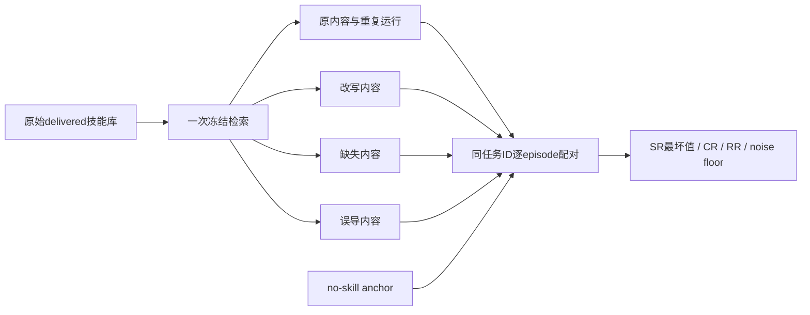
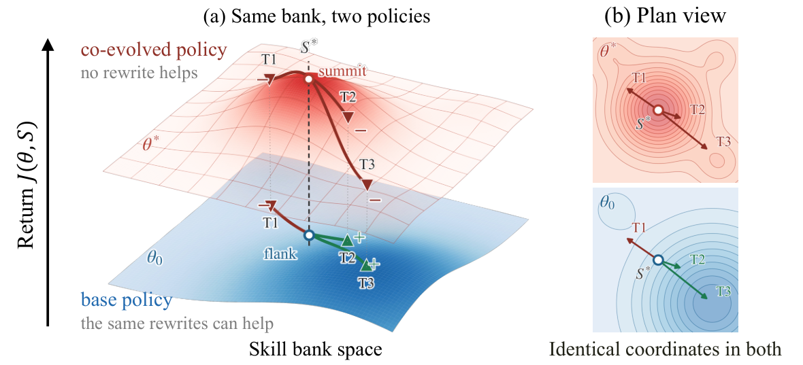

# CODA：技能库漂移后的共进化稳健性审计

> `evaluation_protocol_interface` / L1 CPU。实现内容改写边界和配对指标，不重训共进化策略，不生成“语义保持”保证。

## 论文信息

| 字段 | 内容 |
| --- | --- |
| 论文链接 | [Evolving Together, Failing Apart](https://arxiv.org/abs/2610.20845) |
| 公司/机构 | 一作 Yujie Feng；Alibaba Token Hub, Alibaba Group |
| 首次公开日期 | 2026-10-14，arXiv v1；10-16 公告重叠补漏 |
| 原文开源代码 | 正文称发布 rewriting suite 和逐 episode 结果，但本轮未找到可核验作者仓库 URL |
| 本地 Adapter | 无（`adapter: null`）；协议 key：`coda` |
| 本地复现代码 | `src/auto_research/agent_research/coda.py`；`scripts/run_oct18_agent_components.py` |

## 原始论文总结

### 背景与主要改动

策略与技能库共同训练后的最高成绩可能依赖技能原有措辞，一旦部署后技能被改写就退化。CODA 不把 delivered bank 的峰值当唯一结果，而是在相同任务上评估 T1 意义保持改写、T2 内容缺失、T3 误导内容及 no-skill anchor。[原文 §3–4、附录 E](https://arxiv.org/html/2610.20845v1)要求先在原始库检索一次，固定选中集合和 retrieval-side 字段，只替换内容；不能重新检索引入额外混杂。



<!-- paper-figure:start -->
### 原论文关键图

[](https://arxiv.org/html/2610.20845v1/fig2_landscape.png)

> **原论文 Figure 2（关键图）**：展示原论文方法的总体设计和关键组成。图片来自[原论文](https://arxiv.org/abs/2610.20845)，版权归原作者所有；点击图片可查看来源。
<!-- paper-figure:end -->

### 核心公式

令 $c_i(S)$ 为任务 $i$ 在技能库 $S$ 下的二值结果：

$$
\mathrm{CR}={1\over N}\sum_i I[c_i(S)=c_i(S_{T1})],\qquad
\mathrm{RR}_a={1\over N}\sum_i I[c_i(\varnothing)=1\land c_i(S_a)=1].
$$

RR 的分母是**全体相同任务**，不是 no-skill 成功任务的数量。CR 能发现 aggregate SR 抵消的双向 outcome flip；两次未扰动运行的一致率提供随机性噪声参照。本地仅报告噪声底线，不凭一个差值擅自生成论文式统计显著“通过”结论。正式 T1 需要独立固定 suite 和可审查改写库，字符串相似度不能证明语义等价。

### 论文离线与线上效果

原文在四种共进化方法、五 benchmark 的六设置中报告 worst-case 成功率较 delivered peak 下降约 5–13 个百分点，消耗 52–93% 的技能收益；绝对成绩跨 backbone 不构成公平算法比较。最坏结果仍高于 no-skill anchor，结论不是“技能必然有害”。未报告生产线上 A/B。[实验与可复现声明](https://arxiv.org/html/2610.20845v1)

## 本地复现

```bash
PYTHONPATH=src python scripts/run_oct18_agent_components.py \
  --methods coda --seeds 42,43,44 --device cpu \
  --output runs/oct18-agent/coda.json
```

每 seed 生成 32 个二值结果 fixture，在全部六条件上保留同一 ID 集合，实际执行内容字段替换和配对计算。独立计数验证全分母 RR；负对照故意改成条件分母，保存偏差。拒绝漏任务、修改检索字段和改写未选中技能。结果见 [CPU 产物](metrics/component-cpu-seeds42-44.json)，不代表任何策略的真实稳健性。

### 成本与边界

完整评测需要四类训练后的策略／技能对、五个真实环境和多种扰动重复，整体对单 A100/A30 或 Mac 成本过高，**不复现（审查 DONE）**。本地没有训练或 LLM 改写；scorer 结果不供策略读取，`diagnostic_only=true`、`promotion_eligible=false`、`evolve_integrated=false`。
