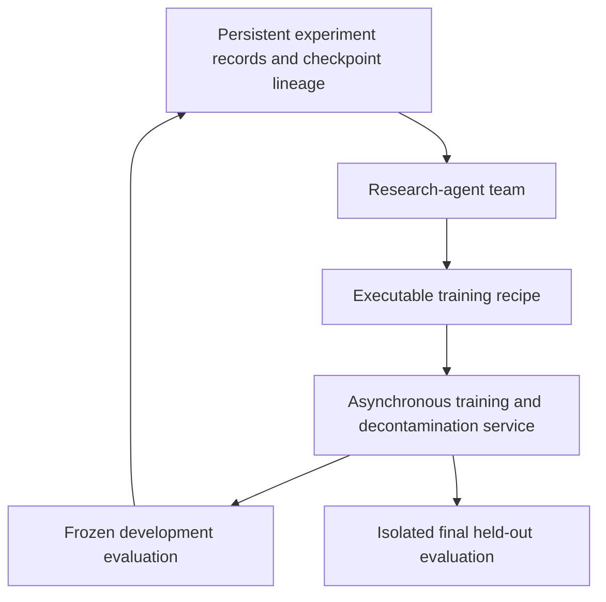
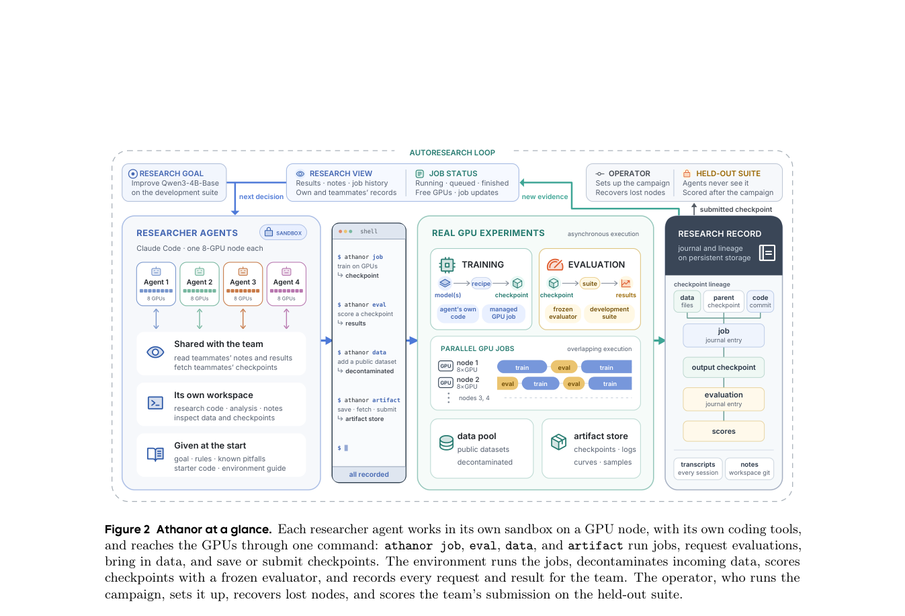

# Athanor: An Agent System for Autonomous Post-Training Research

<!-- source-sha256: 5b06c0a401676a58a36eae5bce62ca3aee5b4ef1e1de0ba1a98960f78faf72b1 -->

[简体中文](README.md) · English

> **Research reference only. The full experiments exceed the cost budget and were not reproduced (review complete).** No complete research campaign is run, and the existing Evolve controller is not relabeled as Athanor.

## Paper information

| Field | Details |
| --- | --- |
| Paper | [arXiv 2610.21055](https://arxiv.org/abs/2610.21055); [pinned v1 PDF](https://arxiv.org/pdf/2610.21055v1) |
| Affiliations | First author Yufa Zhou: ByteDance / Duke University; additional collaboration with University of Chicago and Virginia Tech. |
| First public release | 2026-10-15 00:56:33 UTC (arXiv v1; announced on 10-16) |
| Authors' code | The paper describes the system as open. A usable complete official source repository and license were not verified during this review, so it is not marked as open source. |
| Local adapter / stable key | `athanor` (reference key, no executable adapter) |
| Local implementation | No algorithm implementation; only this write-up and [catalog metadata](https://github.com/daiwk/auto-research/blob/main/src/auto_research/paper_specs/catalog/agent-research/athanor.json). |
| Acceptance status | Full experiments not reproduced, review complete; no local model scores. |

## Original paper summary

### Background and main changes

Research agents choose data, training algorithms, and combinations of training stages. A separate service executes asynchronous jobs, decontaminates data, freezes evaluation, and records checkpoint lineage. The team shares experiment records and models and combines SFT, RL, model merging, and self-distillation. Calls to external teachers are prohibited.

### Architecture and data flow

<!-- paper-figure:start -->
### Key figure from the paper

> **Figure 2 from the paper:** Overall method design and key components. The figure comes from the [original paper](https://arxiv.org/abs/2610.21055), © the original authors. Select the image to see the source.
<!-- paper-figure:end -->

### Core equations

Section 2 separates outer-loop research from inner-loop training:

$$
r_t\sim\pi(\cdot\mid H_{t-1}),\quad M_t=\operatorname{Exec}(r_t),\quad
\hat p_t=\operatorname{Eval}_{B}(M_t;\xi_t).
$$

Development scores are noisy, so the highest single score is not true capability. The final held-out data is not exposed to research agents.

### Reported offline and online results

The authors report a 104-hour research process with four agents. A formal comparison must distinguish the campaign protocol, three-seed means of submissions, and later re-evaluation under unified decoding. Do not conflate the best single search score with the final result. The paper also notes insufficient data-correctness checks.

No production online A/B test was reported. An autonomous research campaign is not a production deployment experiment.

## Local reproduction

This entry provides only the paper explanation and the original figure. The paper uses four commercial research agents, each with an eight-GPU node, at a total cost of about USD 12,000. This exceeds the available single A100/A30 resources, so no probe was launched. **The full experiments were not reproduced (review complete)**.

## Reproduction limits

There is no implementation of research automation, benchmark score, or GPU receipt. A reference link does not establish Evolve integration. See the [batch acceptance contract (Chinese)](../../research-audits/oct17-supplement/README.md) for scope.
