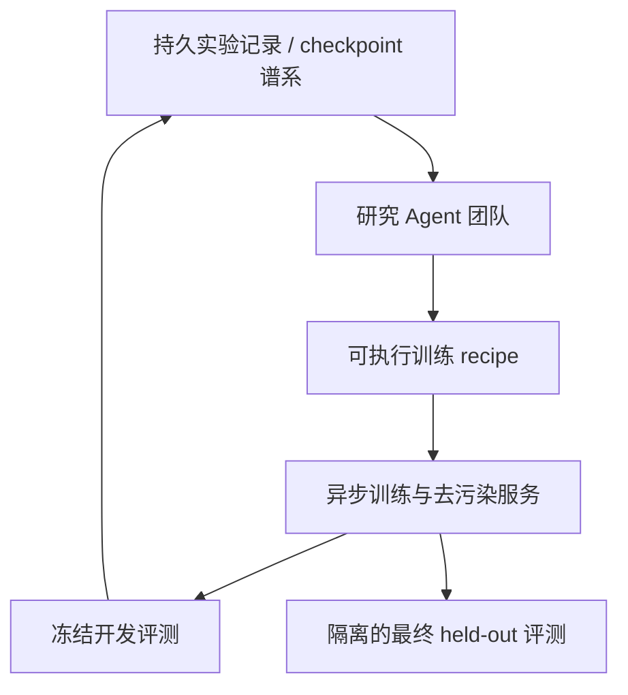
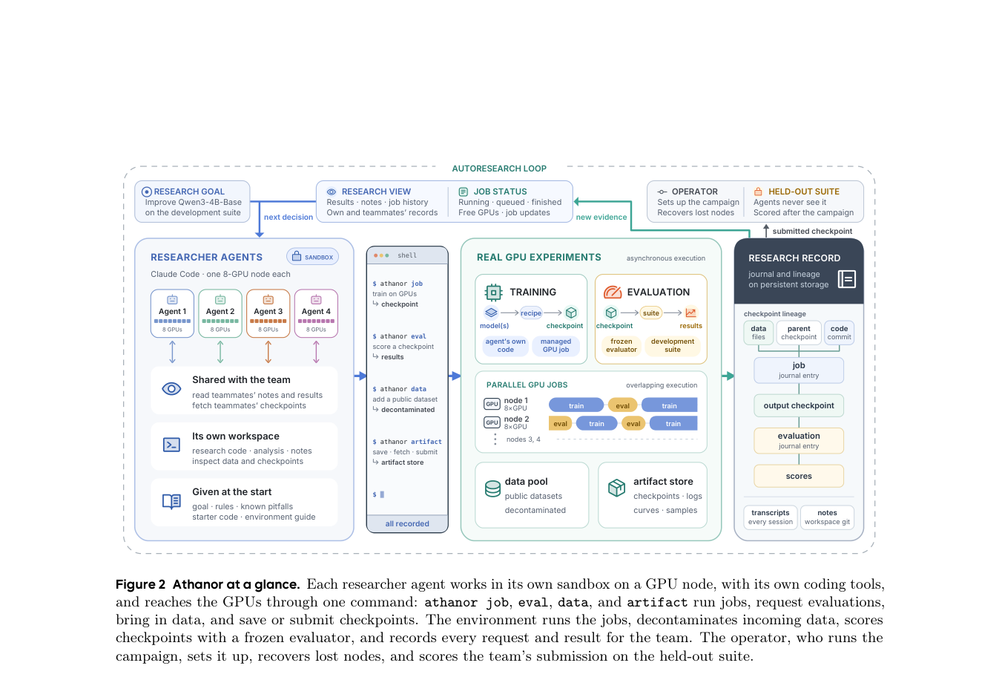

# Athanor：面向自主后训练研究的 Agent 系统

> **仅研究资料；成本过高，不复现（审查 DONE）。** 不运行完整研究 campaign，不将现有 Evolve 改名冒充 Athanor。

## 论文信息

| 字段 | 内容 |
| --- | --- |
| 论文链接 | [arXiv 2610.21055](https://arxiv.org/abs/2610.21055)；[固定 v1 PDF](https://arxiv.org/pdf/2610.21055v1) |
| 公司 / 机构 | 一作 Yufa Zhou：ByteDance / Duke University；另有 University of Chicago、Virginia Tech 合作 |
| 首次公开日期 | 2026-10-15 00:56:33 UTC（arXiv v1；10-16 公告） |
| 原作者代码 | 论文称系统开放；本轮未核实可用的官方完整源码仓库及许可证，不据此标为已开源 |
| 本地 adapter / 稳定键 | `athanor`（资料键，无可执行 adapter） |
| 本地复现代码 | 无算法实现；仅本文及 [catalog 元数据](https://github.com/daiwk/auto-research/blob/main/src/auto_research/paper_specs/catalog/agent-research/athanor.json) |
| 验收状态 | 完整实验不复现 / 审查 DONE；无本地模型分数 |

## 原始论文总结

### 背景与主要改动

研究 Agent 选择数据、训练算法和阶段组合；独立服务执行异步任务、去污染、冻结评测并保存 checkpoint 谱系。团队共享实验记录与模型，组合 SFT、RL、模型合并及自蒸馏；外部教师调用被禁止。

### 架构与数据流

<!-- paper-figure:start -->
### 原论文关键图

> **原论文 Figure 2（关键图）**：展示原论文方法的总体设计和关键组成。图片来自[原论文](https://arxiv.org/abs/2610.21055)，版权归原作者所有；点击图片可查看来源。
<!-- paper-figure:end -->

### 核心公式

原文§2将外层研究与内层训练区分：

$$
r_t\sim\pi(\cdot\mid H_{t-1}),\quad M_t=\operatorname{Exec}(r_t),\quad
\hat p_t=\operatorname{Eval}_{B}(M_t;\xi_t).
$$

开发分数有噪声，单次最高值不等于真实能力；最终 held-out 不向研究 Agent暴露。

### 论文离线与线上效果

作者报告四名 Agent 的104小时研究过程。正式比较应区分 campaign 协议、三种子提交均值和后续统一解码重测，不能把搜索中的最大单次分数混为最终结果；论文也指出数据正确性检查不足。

生产线上 A/B：未报告；自主研究 campaign 不是生产部署实验。

## 本地复现

只做论文解读和原图收录。原配置为四个商业研究 Agent 各占八卡节点，合计约12000美元；超过本轮单 A100/A30资源，不启动探跑。**成本过高，不复现（审查 DONE）**。

## 复现边界

无研究自动化实现、benchmark分数或 GPU回执；不把资料链接宣称为 Evolve 集成。范围见[本批验收合同](../../research-audits/oct17-supplement/README.md)。
