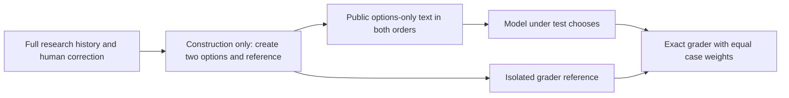
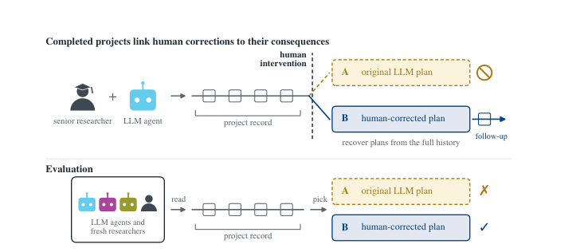

# SciΠvot: An Options-Only Evaluation Interface for Research Course Correction

<!-- source-sha256: 62e19ea6e3579caec3f44b18de4211e9b5c0dbbbb5f29195eba5a32414027cff -->

[简体中文](README.md) · English

> The local implementation covers only the released options-only protocol: separation of public inputs and grader references, a two-order plan, strict parsing, a complete failure denominator, equal case weights, and bootstrap scoring. No model calls, full project records, or local scientific-research capability scores. `adapter: null`, `evaluation_protocol_interface`, diagnostic only, not eligible for Evolve promotion.

## Paper information

| Field | Details |
| --- | --- |
| Paper | [SciΠvot: Benchmarking Principal-Investigator Judgment at Pivotal Moments of Scientific AutoResearch Agents](https://arxiv.org/abs/2610.21082) |
| Affiliations | Co-first authors Youran Sun¹, University of Maryland, College Park; Xingyu Ren², The Chinese University of Hong Kong; collaboration with Gradient Network and others. Superscripts were visually checked on the v1 PDF title page. |
| First public release | 2026-10-15, arXiv v1 01:34:44 UTC (09:34:44 Beijing time) |
| Authors' open-source code | [Released data, prompts, and scoring code](https://github.com/AutoResearch-Factory/SciPIvot/tree/94a47d391893ea392fd9bb9883a65d2c8834e6f2), CC-BY-4.0. Full project histories have not been released. |
| Local adapter | None (`adapter: null`); local key `scipivot` |
| Local implementation | `src/auto_research/agent_research/scipivot.py`; `scripts/run_scipivot.py` |

## Original paper summary

### Background and main changes

Six months of human course-correction records from 26 projects across six scientific fields produce 248 pivotal decisions. One option is the original LLM plan and the other the human correction. The model is evaluated on choosing the more appropriate next research plan, not predicting ultimate project success. Reference construction can use subsequent records. The evaluated model may see at most the project state before correction, never future traces, correct labels, or the origins of the options.



<!-- paper-figure:start -->
### Key figure from the paper

[](https://arxiv.org/pdf/2610.21082v1#page=3)

> Figure 1, v1 PDF page 3. Construction uses the full history, but evaluation does not receive post-correction information. The figure comes from the [original paper](https://arxiv.org/pdf/2610.21082v1#page=3), © the original authors.
<!-- paper-figure:end -->

### Core equations

Each case has two independent sessions. `ab` and `ba` reverse the positions of the two texts. Let $y_i$ be the original-order reference, $y_i^{ba}=\operatorname{swap}(y_i)$, and $s_i=\frac12[\mathbf1(\hat y_i^{ab}=y_i)+\mathbf1(\hat y_i^{ba}=y_i^{ba})]$. The total score is $\bar s=N^{-1}\sum_i s_i$. The 95% interval resamples cases, not the two orders of a case as independent samples. The official setting uses 10,000 resamples and seed 20261004.

### Reported offline and online results

In the paper's project condition, the best model/effort setting scores 63.5% and the fresh human baseline scores 73.4%. Four of five models at medium effort are below 50%. In released options-only medium effort, GPT-6 Astra scores 316/496=63.71%, while GPT-5.6 Sol scores 232/496=46.77%. These come from the paper or official aggregates, not local model runs. Project and options-only conditions must not be conflated. No production online A/B test was reported.

## Local reproduction

### Released data and sources

Pinned revision: `94a47d391893ea392fd9bb9883a65d2c8834e6f2`. The small official files are preserved unchanged as [questions](validation/upstream/questions.json) and [aggregate scores](validation/upstream/all_model_scores.csv), under [CC-BY-4.0](validation/upstream/LICENSE).

| Official path | SHA256 |
| --- | --- |
| `data/questions.json` | `87a7b05115ce3438ba3b62b30a21dbe6f618c8657527442b094b79f5b664fd9f` |
| `results/all_model_scores.csv` | `e53e68a571ead46f9334bc899904b7a0e1f8c0dd3fb323e7d90f9c5ad05ec458` |

Official questions contain references. **Never mount the original file or repository into the evaluated agent.** Trusted ingestion or the grader uses `partition_release` to read source data and emit only the allowlisted ID and two options into `PublicCase`. `export_options_only` creates separate, non-nested public and grader directories. The public directory contains only 496 prompts in both orders. The grader directory has mode 0700 and its reference file mode 0600. Exports refuse to overwrite an existing destination. For model runs, mount only the public directory, without the grader directory, repository, parent directory, or network access. This exporter is not an OS sandbox. No evaluated process was launched in this round.

```bash
PYTHONPATH=src python scripts/run_scipivot.py audit \
  --questions docs/agent-research/2610.21082-scipivot/validation/upstream/questions.json \
  --aggregates docs/agent-research/2610.21082-scipivot/validation/upstream/all_model_scores.csv \
  --output runs/scipivot/official-options-audit-cpu.json

# Export for a later independent sandbox; neither destination may already exist.
PYTHONPATH=src python scripts/run_scipivot.py export \
  --questions docs/agent-research/2610.21082-scipivot/validation/upstream/questions.json \
  --public-dir runs/scipivot/public --grader-dir runs/scipivot-private/grader \
  --output runs/scipivot/export-receipt.json

# After receiving external predictions, only the independent grader reads references.
PYTHONPATH=src python scripts/run_scipivot.py score \
  --references runs/scipivot-private/grader/references.json \
  --predictions runs/scipivot/predictions.jsonl --output runs/scipivot/scored.json
```

### CPU audit results and isolation contract

The run verified 248 cases and 496 options-only planned prompts and performed the full split export. The [export receipt](validation/options-export-receipt.json) binds hashes of the public and grader artifacts. No model ran. Grader references contain 124 A and 124 B labels. The arithmetic for `correct/n_runs`, case accuracy, and parsed-only denominators agrees across all 60 model/condition aggregate rows. This **does not recompute model scores from raw predictions**: upstream released aggregates but no case/order-level predictions. This audit does not reconstruct the paper's confidence intervals or fabricate responses. See the [CPU audit artifact](metrics/official-options-audit-cpu.json).

This arithmetic-only audit declares `deterministic: true` and `seeds: []`. It did not perform a seeded stochastic model run or bootstrap. The bootstrap seed above applies only to independent future scoring of externally supplied per-order predictions, not to this model-free audit.

`score_predictions` independently grades external records. Case/order pairs must be unique; unknown IDs or orders are rejected. A missing order remains in the denominator. Timeouts, truncations, provider failures, and unparseable outputs count as wrong. Only a complete A/B answer or complete JSON `response` is accepted, not a substring picked by regex. Duplicate JSON keys and ambiguous output are rejected. Both orders always have equal weight within each case, and the bootstrap weights all 248 cases equally. This strict failure denominator is more conservative than upstream averaging over surviving observed orders. The documentation does not claim byte-for-byte scorer reproduction.

Unit tests use injected predictions to check isolation and scoring, not to run a new model. Public projection retains neither references nor additional gold fields. There is no local `project`, reconsideration, or private-history fallback path, no model or data selection, and no executable Evolve operator.

Cost and resource decision: five frontier models × 12 conditions × two orders, long project histories, and a human baseline exceed this round's zero-API budget, and project histories are unreleased. **The full experiments were not reproduced (review complete)**; `full_experiment_status: not_reproduced_high_cost`. Restricted histories are an explicit scope boundary, not replaced with fabricated project fixtures.
