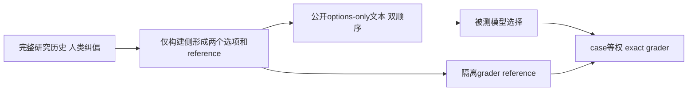
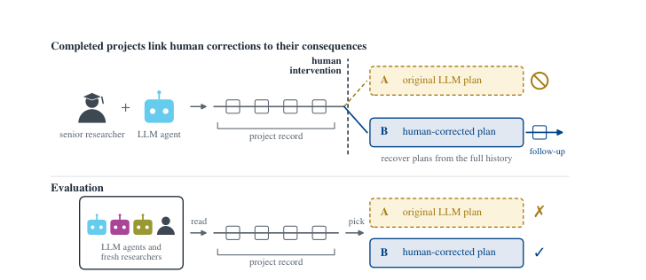

# SciPIvot：研究纠偏判断的 options-only 评测接口

> 本地只接入已发布的 options-only：公开输入与 grader references 分离、双顺序计划、严格解析、完整失败分母、case 等权与 bootstrap。没有调用模型、没有完整项目记录，也没有本地科学研究能力分数。`adapter: null`，`evaluation_protocol_interface`，仅诊断，不晋级 Evolve。

## 论文信息

| 字段 | 内容 |
| --- | --- |
| 论文链接 | [SciΠvot: Benchmarking Principal-Investigator Judgment at Pivotal Moments of Scientific AutoResearch Agents](https://arxiv.org/abs/2610.21082) |
| 公司/机构 | 共同一作 Youran Sun¹：University of Maryland, College Park；Xingyu Ren²：The Chinese University of Hong Kong；Gradient Network 等合作（已视觉核对 v1 PDF 首页上标） |
| 首次公开日期 | 2026-10-15，arXiv v1 01:34:44 UTC（北京时间 09:34:44） |
| 原文开源代码 | [已公开数据、prompts 与评分代码](https://github.com/AutoResearch-Factory/SciPIvot/tree/94a47d391893ea392fd9bb9883a65d2c8834e6f2)，CC-BY-4.0；完整项目历史尚未发布 |
| 本地 Adapter | 无（`adapter: null`）；本地 key：`scipivot` |
| 本地复现代码 | `src/auto_research/agent_research/scipivot.py`；`scripts/run_scipivot.py` |

## 原始论文总结

### 背景与主要改动

26 个跨六科学领域项目、六个月人类纠偏记录构成 248 个关键决策：一个选项是原 LLM 方案，另一个为人类纠正方案。评测器选择更适当的后续研究计划，不是预测项目最终成功。构建 reference 可以看后续记录，但被测模型最多只能看纠偏前项目状态，不能看未来轨迹、正确标签或方案来源身份。



<!-- paper-figure:start -->
### 原论文关键图

[](https://arxiv.org/pdf/2610.21082v1#page=3)

> Figure 1，v1 PDF 第 3 页；完整历史用于构建，评测侧不获得纠偏后的信息。图片来自[原论文](https://arxiv.org/pdf/2610.21082v1#page=3)，版权归原作者所有。
<!-- paper-figure:end -->

### 核心公式

每 case 两次独立会话，`ab` 与 `ba` 反转两个文本的位置。令 $y_i$ 是原顺序 reference，$y_i^{ba}=\operatorname{swap}(y_i)$，$s_i=\frac12[\mathbf1(\hat y_i^{ab}=y_i)+\mathbf1(\hat y_i^{ba}=y_i^{ba})]$；总分 $\bar s=N^{-1}\sum_i s_i$。95% interval 按 case 重采样，不把同 case 的两个顺序当成独立样本；官方设置 10,000 次、seed 20261004。

### 论文离线与线上效果

论文 project 条件中最佳模型/effort 为 63.5%，fresh human baseline 73.4%；中等 effort 五模型中四个低于 50%。公开 options-only 中等 effort 的 GPT-6 Astra 为 316/496=63.71%，GPT-5.6 Sol 为 232/496=46.77%。这些是原文/官方 aggregates，不是本地模型运行。项目条件与 options-only 不可混用；未报告生产线上 A/B。

## 本地复现

### 已发布数据与来源

固定 revision `94a47d391893ea392fd9bb9883a65d2c8834e6f2`。官方小文件原样保存在 [questions](validation/upstream/questions.json) 与 [aggregate scores](validation/upstream/all_model_scores.csv)，许可为 [CC-BY-4.0](validation/upstream/LICENSE)。

| 官方路径 | SHA256 |
| --- | --- |
| `data/questions.json` | `87a7b05115ce3438ba3b62b30a21dbe6f618c8657527442b094b79f5b664fd9f` |
| `results/all_model_scores.csv` | `e53e68a571ead46f9334bc899904b7a0e1f8c0dd3fb323e7d90f9c5ad05ec458` |

官方 questions 包含 references，因此**绝不能直接挂载原文件或仓库给被测 Agent**。`partition_release` 由可信 ingestion/grader 读取源数据，按 allowlist 只输出 id 与两个选项到 `PublicCase`。`export_options_only` 分开创建互不嵌套的 public/grader 目录，public 只含 496 个双顺序 prompt；grader 目录 0700、reference 文件 0600，拒绝覆盖已有导出。运行模型时只能挂载 public 目录，不能提供 grader/仓库/父目录或网络权限。此导出器不是 OS 隔离器，本轮没有启动任何被测进程。

```bash
PYTHONPATH=src python scripts/run_scipivot.py audit \
  --questions docs/agent-research/2610.21082-scipivot/validation/upstream/questions.json \
  --aggregates docs/agent-research/2610.21082-scipivot/validation/upstream/all_model_scores.csv \
  --output runs/scipivot/official-options-audit-cpu.json

# 导出给后续独立沙箱使用；两个目录都必须尚不存在
PYTHONPATH=src python scripts/run_scipivot.py export \
  --questions docs/agent-research/2610.21082-scipivot/validation/upstream/questions.json \
  --public-dir runs/scipivot/public --grader-dir runs/scipivot-private/grader \
  --output runs/scipivot/export-receipt.json

# 收到外部预测后，只有独立grader读取references
PYTHONPATH=src python scripts/run_scipivot.py score \
  --references runs/scipivot-private/grader/references.json \
  --predictions runs/scipivot/predictions.jsonl --output runs/scipivot/scored.json
```

### 本轮 CPU 审计结果与隔离合同

已验证 248 个 case、496 个 options-only 计划，并真实执行全量分离导出；[导出回执](validation/options-export-receipt.json) 绑定 public/grader 两份产物 hash，未运行模型。grader 侧 reference 为 A/B 各 124；60 行模型/条件 aggregate 的 `correct/n_runs`、case accuracy、parsed-only 分母算术一致。这**不是从原始预测复算模型分数**：上游只发布 aggregate，没有逐 case/order 预测，因此本轮不重建原论文 CI、不填造回答。见 [真实 CPU 审计产物](metrics/official-options-audit-cpu.json)。

这次纯算术审计声明 `deterministic: true`、`seeds: []`，没有需要设 seed 的随机模型运行或 bootstrap；上述 bootstrap seed 仅适用于未来拿到外部逐条预测后的独立评分，不是本轮模型实验。

`score_predictions` 独立评分外部记录：case/order 唯一，未知 ID/顺序拒绝，缺失两顺序任意一项仍占分母；timeout、truncated、provider failure、无法解析输出全计错。只接收完整 A/B 或完整 JSON `response`，不正则捞取片段，重复 JSON key/歧义输出拒绝。每 case 始终两顺序等权，再对 248 cases 等权 bootstrap。其严格失败分母比上游脚本按 surviving observed orders 平均更保守，文档不冒充 byte-for-byte scorer 复刻。

单测使用注入预测验证隔离与计分，不构成新模型实验。公共 projection 不保留 reference/额外 gold 字段；本轮没有 `project`、reconsideration 或私有历史回退入口，没有模型/数据选择，没有 executable evolve operator。

成本与资源决策：完整五前沿模型×12 conditions×双顺序、长项目历史与 human baseline 超出本轮零 API 预算，且项目历史未发布；完整实验 **成本过高，不复现（审查 DONE）**，`full_experiment_status: not_reproduced_high_cost`。发布受限历史是明确的范围边界，不以自造 project fixtures 代替。
