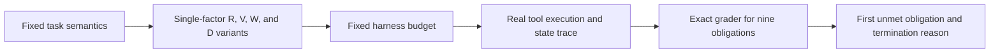
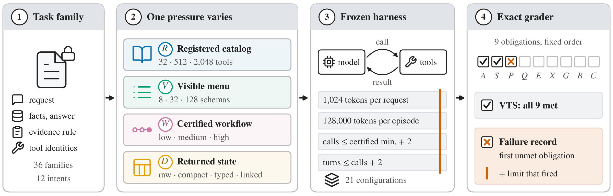

# ToolBottleneckBench: A Public Tool Evaluation Interface under Controlled Pressures and Fixed Budgets

<!-- source-sha256: d431c9b616dce17302c97896f2be14748b1e557dbdf863c3cb532317855ecb2d -->

[简体中文](README.md) · English

> The local status is `evaluation_protocol_interface`: a limited task compiler, a real state sandbox, an exact grader for nine obligations, and a CPU recomputation of a set of official historical rows. `adapter: null`, `diagnostic_only: true`, `promotion_eligible: false`, `evolve_integrated: false`. No new agent was evaluated.

## Paper information

| Field | Details |
| --- | --- |
| Paper | [ToolBottleneckBench: Measuring Tool-Agent Performance under Controlled Pressures and Fixed Harness Budgets](https://arxiv.org/abs/2610.21098) |
| Affiliations | First author Zichuan Xu: University of Osaka; collaborators from Initial S and Nagoya University. |
| First public release | 2026-10-15, arXiv v1 01:59:58 UTC (09:59:58 Beijing time) |
| Authors' open-source code | [Official repository](https://github.com/zichuanxu/tool-bottleneck-bench/tree/6f7fe7157c702c5c10937080f15bb3d48ce73d69), MIT. No upstream scripts were run. |
| Local adapter | None (`adapter: null`); local key `tool-bottleneck-bench` |
| Local implementation | `src/auto_research/agent_research/tool_bottleneck_bench.py`; `scripts/run_tool_bottleneck_bench.py` |

## Original paper summary

### Background and main changes

Tool-agent failure depends on more than the model. The tool registry, visible menu, workflow, and return-record encoding can interact with token, call, and turn limits. The paper holds the request, facts, and decision fixed and separately manipulates registry R, visible menu V, authentication workflow W, and returned state D. The original protocol has 36 task families and 12 enterprise intents. Routed menus use ground truth to narrow candidates, so they are not evidence of an oracle-free capability.



<!-- paper-figure:start -->
### Key figure from the paper

[](https://arxiv.org/html/2610.21098v1#S1.F1)

> Figure 1, the paper overview released in the official repository. The figure comes from the [original paper](https://arxiv.org/html/2610.21098v1), © the original authors. The repository asset is pinned to the revision in the table above.
<!-- paper-figure:end -->

### Core equations

Verified success is $Y=A\land S\land P\land Q\land E\land X\land G\land B\land C$. These terms check, in order, tool availability, selection, a dependency-valid program, a JSON answer, exact citations, exactly the permitted state changes, no unrequested state changes, budget, and completion integrity. The failure label is the first unmet obligation, **not a causal attribution**. Termination reasons use a separate ordering: completion cap, token/call budget, turn limit, infeasible early stopping, incorrect conclusion, and other contract violations.

Registry pressure uses intent-to-treat (ITT): $Y_R=A\cdot S$. Retrieval misses, missing responses, and infrastructure failures cannot be excluded from the planned denominator. The main paper clusters capacity comparisons by family and Discovery by 18 required-tool clusters. The local run recomputes only a single configuration from the latter category.

### Reported offline and online results

The paper covers 21 model/harness configurations and 26,576 scored conditions. As routed/fixed menus grew from 8→128, VTS fell by 12.3/17.5 percentage points, respectively. For six heavily truncated configurations, increasing the cap 16-fold narrowed the menu penalty from -43.7 to -2.7 percentage points. Of exact-graded failures, 91.5% terminated at a harness limit. These are paper-wide results, not local runs. No production online A/B test was reported.

## Local reproduction

### Data protocol and source

The only inputs are a Gemini 3.6 Flash Discovery frozen plan and its official scored rows from revision `6f7fe7157c702c5c10937080f15bb3d48ce73d69`. The small files are preserved unchanged as the [frozen plan](validation/upstream/gemini-36-flash-primary-discovery.json) and [scored rows](validation/upstream/gemini-36-flash-primary-discovery.jsonl). See [LICENSE](validation/upstream/LICENSE) for MIT terms.

| Official path | SHA256 |
| --- | --- |
| `results/prospective-plans/core-main/gemini-36-flash-primary-discovery.json` | `486ae15a5591645df4c6fffa9d47733f5225f45a1e19a197ce381a5b18074ac7` |
| `results/prospective-execution/core/gemini-36-flash-primary-discovery.jsonl` | `b5a57e002faed5f309d622cf82e5d32430599bce9c3e625776505b96c13eb6b0` |

The import checks each condition's content hash, the plan hash, condition uniqueness, and consistency of official `success` with A×S and status. All 216 planned conditions are in the denominator. Unknown conditions, duplicates, and mismatched hashes are rejected. Missing rows count as failures. If an entire case is missing and its required-tool cluster cannot be determined, the ITT point estimate is retained without inventing a clustered interval.

```bash
PYTHONPATH=src python scripts/run_tool_bottleneck_bench.py \
  --plan docs/agent-research/2610.21098-tool-bottleneck-bench/validation/upstream/gemini-36-flash-primary-discovery.json \
  --rows docs/agent-research/2610.21098-tool-bottleneck-bench/validation/upstream/gemini-36-flash-primary-discovery.jsonl \
  --resamples 10000 --seed 42 --output runs/tool-bottleneck-bench/official-discovery-cpu.json
```

### CPU recomputation results

| Subset | Successful / planned | ITT success | 95% required-tool cluster bootstrap |
| --- | ---: | ---: | --- |
| All six registry/retriever cells | 163/216 | 75.46% | No common interval pooled across heterogeneous cells |
| R=2048, flat | 7/36 | 19.44% | 5.56%–38.89% |
| R=2048, hierarchical | 28/36 | 77.78% | 58.33%–94.44% |

All 53 `capability_unavailable` rows were retained, with 0 missing rows. Each cell uses 18 required-tool clusters, 10,000 resamples, and statistical seed 42. The [CPU recomputation artifact](metrics/official-discovery-cpu.json) contains full pinned metrics and the actual executed command. This recomputes historical upstream outputs without calling Gemini again or validating a new model's capability. A statistical seed is not a training seed.

### Code mapping, verification, and limits

`compile_task` independently implements **only the escalation_assessment subset**, not the official 36-family compiler. It supports 2/4/6 reads, branching dependencies, opaque IDs, R/V levels, and four reversible encodings. The subset is read-only, so obligations X and G forbid any state change. The requested reversible writes in the paper are not implemented. `Sandbox` executes search/get and neighboring empty-return tools against real JSON state. It cannot execute arbitrary shell or network actions. `grade_episode` independently replays the trace, checks the hash chain, accepts any legal branch order, and checks citations, answers, budgets, and completion obligation by obligation. The public view does not contain facts, decisions, records, or hidden programs.

The model-free public-handoff controller in unit tests is only a sandbox and contract diagnostic, not the paper's agent. Tests cover reversed dependency order, forged traces, unseen citations, state tampering, missing tools, completion truncation, budget failure, missing and duplicate historical rows, and lossless encoding. There is no full retriever, complete set of enterprise intents, rerun of the 26,576 original experiments, API model call, or executable Evolve operator.

Cost decision: The paper's public cost estimate is approximately USD 768.38. Its 21 hosted configurations and multiple repair/cap sweeps exceed this round's zero-API, zero-training budget. **The full experiments were not reproduced (review complete)**; `full_experiment_status: not_reproduced_high_cost`. Completed work is a limited public interface and recomputation on selected historical data, not a full reproduction of the original paper.
