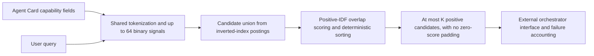
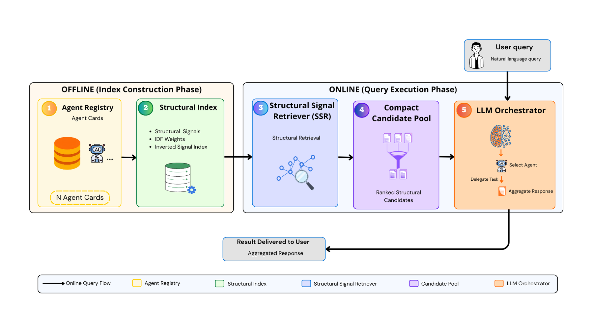

# SSR: Structural Signal Retrieval from Agent Capability Fields

<!-- source-sha256: 170badf150718026c6a4dd954ca652e477c5bc895cece044da46b79eb299ff82 -->

[简体中文](README.md) · English

## Paper information

| Field | Details |
| --- | --- |
| Paper | [arXiv 2610.21113](https://arxiv.org/abs/2610.21113); [v1 full text](https://arxiv.org/html/2610.21113v1) |
| Original title | SSR: Structural Signal Retriever for Scalable Agent Discovery in LLM-Orchestrated Multi-Agent Systems |
| Affiliation | First author Giancarlo Maldonado Cárdenas: Institute of Computing, State University of Campinas (UNICAMP), Brazil |
| First public release | 2026-10-15; `2026-10-15T02:16:12Z` |
| Authors' open-source code | The authors have a [public repository](https://github.com/gmaldonadoc/sscr-agent-routing), but no license was found during this review, so it cannot be assumed to be permissively licensed under MIT or similar terms. The local implementation follows the paper independently and does not copy its code. |
| Adapter | `structural-signal-retriever` (catalog key); `adapter: null`, no reproduction CLI adapter or Evolve integration |
| Local implementation | `src/auto_research/agent_research/structural_signal_retriever.py`; `scripts/run_oct17_supplement_protocols.py` |
| Implementation status | `component_only`, L1 retrieval/interface diagnostic; `diagnostic_only: true`, `promotion_eligible: false` |
| Full experiments | Above the cost budget and not reproduced (review complete); `not_reproduced_high_cost` |

## Original paper summary

### Background and main changes

As a multi-agent registry grows, putting every Agent Card into an LLM prompt increases both input and selection costs. SSR §III trains no additional model. It extracts interpretable lexical signals from explicit capability fields, then uses an inverted index to narrow the candidate pool before selection. “Structural” refers to the fields name, description, skills, tags, examples, and tools, not to syntactic graphs or latent vectors. Its core lexical mechanism is a specific integration of existing IDF retrieval, not a new semantic model.



<!-- paper-figure:start -->
### Key figure from the paper

[](https://arxiv.org/html/2610.21113v1/imagens/Agent_registry.png)

> **Figure 1 from the paper:** Overall workflow, key stages, and data flow. The figure comes from the [original paper](https://arxiv.org/abs/2610.21113), © the original authors. Select the image to see the source.
<!-- paper-figure:end -->

### Core equations

Lowercase the text, extract tokens with `[a-z0-9]+`, discard tokens shorter than two characters and fixed stopwords, and form unigrams and adjacent bigrams. Deduplicate signals as binary indicators. If there are more than 64, keep unigrams by descending frequency with lexicographic tie-breaking, then fill remaining slots with bigrams in lexicographic order:

$$
\operatorname{Score}(q,a)=\sum_{s\in S_q\cap S_a}\left[\log\frac{N+1}{df(s)+1}+1\right].
$$

The inverted-index candidate set is:

$$
\mathcal C_q=\bigcup_{s\in S_q}\operatorname{ISI}(s).
$$

All IDF weights are positive, so this excludes exactly the zero-score cards and preserves exhaustive positive-score ordering. Sort by descending score, then descending number of matched signals, then ascending card ID. If there is no match, return an empty pool without falling back to the full registry or fabricating options. The paper does not enumerate its stopwords. The local implementation publishes the explicit `ssr-local-explicit-stopwords-v1` list and accepts a fixed replacement list, without claiming byte-for-byte agreement with the authors' preprocessing.

### Reported offline and online results

The paper's SSR-AgentBench contains 1,000 cards and 250 queries and compares full-registry orchestration with preselection. Its MS MARCO comparison covers 8,841,823 passages and 6,980 dev queries across BM25, lexical retrieval, and exhaustive IDF. End-to-end SSR and BM25 use the same K, prompt, and parser. Empty pools, retrieval misses, API failures, and invalid indices still count as end-to-end failures. The independent K=20 validation was retrospective, not fully prospective selection. The reported 98.8% input reduction and related results come from the paper's API setup, not local measurements. No production online A/B test was reported.

## Local reproduction

### Data protocol and execution

No data download, LLM call, or GPU is required. The pinned revision is `synthetic-agent-cards-and-validation-trajectories@oct17-supplement-protocols-v1`. Seeds 42/43/44 each generate 64 synthetic capability cards and 12 queries. The retriever receives only capability text; its interface has no gold-answer or target-card parameter.

```bash
PYTHONPATH=src python scripts/run_oct17_supplement_protocols.py \
  --papers structural-signal-retriever --seeds 42,43,44 \
  --output runs/oct17-supplement/ssr-cpu.json
```

### Results and independent comparison

Three-seed CPU runs and targeted tests passed. For seed 42, all 12 query rankings matched the independent full scan, with maximum score error 0. Additional tests check that term frequency affects truncation but not repeated weighting, and cover the cap, ties, an empty registry, and no matches. All four explicit interface fixtures are retained: selected, empty_pool, api_failure, and invalid_index. Actual orchestration-model calls were 0. These are interface and failure cases, not agent success rates. The [local CPU diagnostic record](metrics/component-cpu-seeds42-44.json) contains auditable per-seed data.

### Code mapping and limits

`structural_signals` and `StructuralSignalIndex` implement extraction, inverted indexing, and exact sorting. `validate_orchestrator_selection` only validates an external 1-based index, with no provider call for an empty pool. `outcome_counts` does not allow unknown statuses to be silently dropped. Tests are in `tests/agent_research/test_structural_signal_retriever.py`.

There is no real LLM, port of the official SSR-AgentBench generator, full MS MARCO data, or capability comparison on public tasks. The paper's large retrieval experiment uses about 124 GiB RAM and the end-to-end experiment also uses paid APIs. **The full experiments exceed the cost budget and were not reproduced (review complete)**. Local statistics do not establish the paper's token, latency, or selection-accuracy gains, and the component is not integrated into Evolve promotion.
