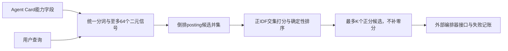
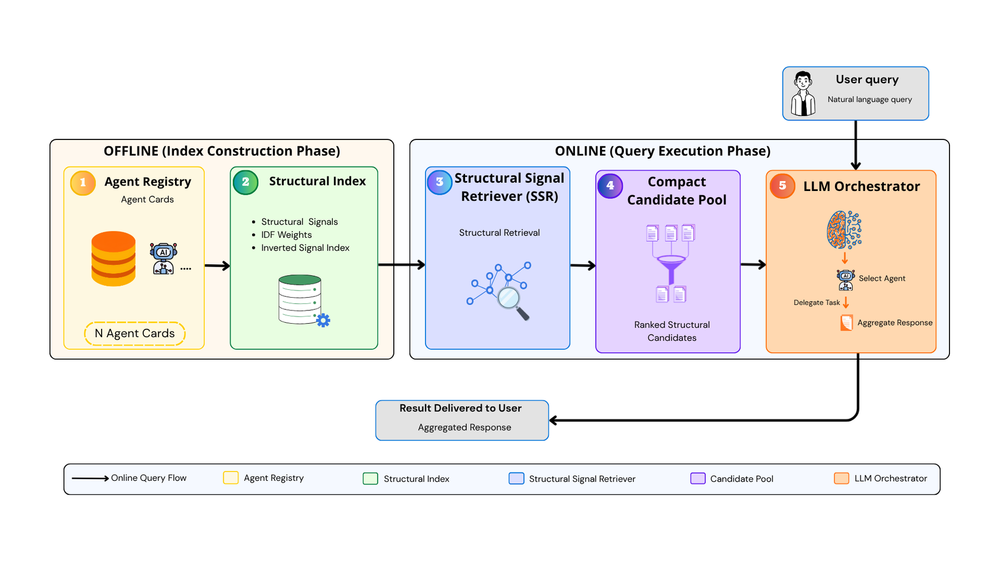

# SSR：Agent能力字段的结构信号检索

## 论文信息

| 字段 | 内容 |
| --- | --- |
| 论文链接 | [arXiv 2610.21113](https://arxiv.org/abs/2610.21113)；[v1 全文](https://arxiv.org/html/2610.21113v1) |
| 原文标题 | SSR: Structural Signal Retriever for Scalable Agent Discovery in LLM-Orchestrated Multi-Agent Systems |
| 公司/机构 | 一作 Giancarlo Maldonado Cárdenas：Institute of Computing, State University of Campinas（UNICAMP），Brazil |
| 首次公开日期 | 2026-10-15；`2026-10-15T02:16:12Z` |
| 原文开源代码 | 有[原作者公开仓库](https://github.com/gmaldonadoc/sscr-agent-routing)，但本轮未见许可证，不能视为MIT等宽松授权；本地仅按论文独立实现，未复制代码 |
| Adapter | `structural-signal-retriever`（目录键）；`adapter: null`，无 reproduction CLI adapter，未接入 evolve |
| 本地复现代码目录 | `src/auto_research/agent_research/structural_signal_retriever.py`；`scripts/run_oct17_supplement_protocols.py` |
| 实现状态 | `component_only`，L1 检索/接口诊断；`diagnostic_only: true`、`promotion_eligible: false` |
| 完整实验 | 成本过高，不复现（审查 DONE）；`not_reproduced_high_cost` |

## 原始论文总结

### 背景与主要改动

多 Agent 注册表扩大后，把全部 Agent Card 塞给 LLM 会增加输入和选择成本。SSR §III 不训练额外模型，而是从明确的能力字段提取可解释词法信号，以倒排表预先缩小候选池。这里 structural 指来源于 name、description、skills、tags、examples、tools 的字段，不是句法图或隐向量。核心词法机制是已有IDF检索的特定集成，不应包装为新语义模型。



<!-- paper-figure:start -->
### 原论文关键图

[](https://arxiv.org/html/2610.21113v1/imagens/Agent_registry.png)

> **原论文 Figure 1（关键图）**：展示原论文的整体流程、关键阶段及其数据流向。图片来自[原论文](https://arxiv.org/abs/2610.21113)，版权归原作者所有；点击图片可查看来源。
<!-- paper-figure:end -->

### 核心公式

文本转小写，以 `[a-z0-9]+` 提取token，去掉少于2字符与固定stopwords，再形成 unigram 和相邻 bigram。信号二元去重；超出64个时先按词频降序、字典序打破平局保留unigram，然后按字典序补bigram：

$$
\operatorname{Score}(q,a)=\sum_{s\in S_q\cap S_a}\left[\log\frac{N+1}{df(s)+1}+1\right].
$$

倒排候选为：

$$
\mathcal C_q=\bigcup_{s\in S_q}\operatorname{ISI}(s).
$$

所有IDF为正，因此恰好排除零分card，保持与穷举相同的正分排序。排序依次为分数降序、匹配信号数降序、card ID升序。无命中时返回空池，不回退全量或伪造选项。原文未枚举stopword表；本地发布显式 `ssr-local-explicit-stopwords-v1`，允许冻结替代表，**不声称与作者预处理逐字节一致**。

### 论文离线与线上效果

原文 SSR-AgentBench 有1,000 cards、250查询，比较全量编排与预选；MS MARCO 使用8,841,823 passages、6,980条dev查询，比较BM25、词法和穷举IDF。端到端SSR/BM25采用相同K、提示和解析器；空池、检索遗漏、API失败、非法索引仍计为端到端失败。K=20的独立验证为事后核验，不是完全前瞻选择。原文98.8%输入缩减等为其API配置结果，不是本地实测。线上生产 A/B：未报告。

## 本地复现

### 数据协议与运行

无数据下载、LLM调用或GPU需求。固定 revision `synthetic-agent-cards-and-validation-trajectories@oct17-supplement-protocols-v1`；seeds42/43/44各生成64张合成能力card及12个查询，检索器只接收能力文本，接口没有gold answer或目标card参数。

```bash
PYTHONPATH=src python scripts/run_oct17_supplement_protocols.py \
  --papers structural-signal-retriever --seeds 42,43,44 \
  --output runs/oct17-supplement/ssr-cpu.json
```

### 结果与独立对照

CPU三种子运行和定向测试通过。seed42的12条查询与独立full-scan排序一致，最大分数误差0；额外测试覆盖词频只影响截断而非重复加权、上限/tie、空registry和未命中。四个显式接口fixture分别为selected、empty_pool、api_failure、invalid_index，全部保留，实际编排模型调用数为0。这些是接口失败样例，不是Agent成功率。[本地CPU诊断记录](metrics/component-cpu-seeds42-44.json)保存可审计逐seed数据。

### 代码映射与边界

`structural_signals` 与 `StructuralSignalIndex` 实现提取、倒排和精确排序；`validate_orchestrator_selection` 只验证外部1-based索引，空池无需调用provider；`outcome_counts` 不允许未知状态被静默丢弃。测试在 `tests/agent_research/test_structural_signal_retriever.py`。

没有真实LLM、官方SSR-AgentBench生成器移植、MS MARCO全量数据或公共任务能力比较。原文大规模检索使用约124GiB RAM，端到端还涉及付费API；**完整实验成本过高，不复现（审查 DONE）**。本地统计不证明论文的token/延迟或选择准确率收益，不接入evolve自动晋级。
