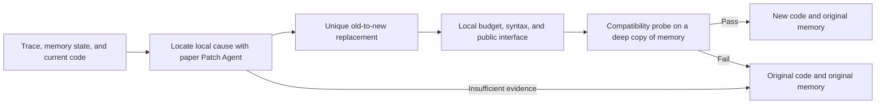
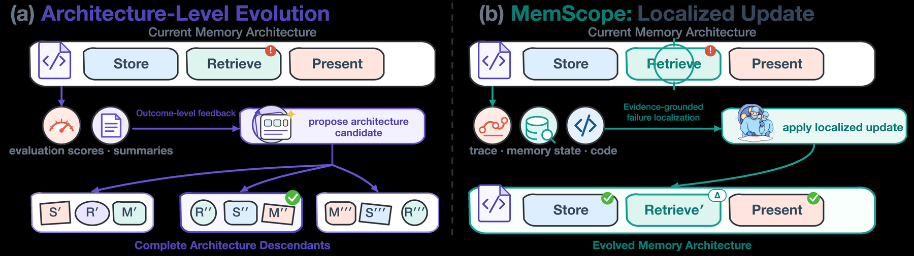

# MemScope: Local Provider Repairs That Preserve Memory

<!-- source-sha256: aa1b1549215e468e6c678bff56961dcfec9fc9f606cf69099e3542b311468278 -->

[简体中文](README.md) · English

> `component_only` / L1 CPU. Implements local code-replacement transactions with failure rollback. No language-model Patch Agent or arbitrary code execution.

## Paper information

| Field | Details |
| --- | --- |
| Paper | [MemScope](https://arxiv.org/abs/2610.21170) |
| Affiliations | First author Miao Su, Institute of Computing Technology, Chinese Academy of Sciences / University of Chinese Academy of Sciences; collaborators include Meituan. |
| First public release | 2026-10-15, arXiv v1; overlap backfill for the 10-16 announcement |
| Authors' open-source code | No link to a public author implementation was found on the title page or in the method or appendix. |
| Local adapter | None (`adapter: null`); component key `memscope` |
| Local implementation | `src/auto_research/agent_research/memscope.py`; `scripts/run_oct18_agent_components.py` |

## Original paper summary

### Background and main changes

A drop in score or a compressed summary is not enough to tell whether a long-horizon agent should change memory writes, retrieval, or downstream use. MemScope's Patch Agent inspects the raw execution trace, runtime memory, and current provider code together. It locates a cause and makes a bounded in-place change that preserves provider identity and compatibility with existing memory. If evidence is insufficient, it can explicitly select no patch instead of forcing an edit every round. [§3 and Appendices A–B](https://arxiv.org/html/2610.21170v1)



<!-- paper-figure:start -->
### Key figure from the paper

[](https://arxiv.org/html/2610.21170v1/figs/memscope_abstract_comparison_branching_draft_20260728_from_svg.png)

> **Figure 1 from the paper:** Core architecture, main modules, and connections. The figure comes from the [original paper](https://arxiv.org/abs/2610.21170), © the original authors. Select the image to see the source.
<!-- paper-figure:end -->

### Core equations

The local contract describes a patch transaction, not a new learning objective:

$$
P' = \operatorname{replaceOnce}(P,o,n),\quad
(P_{next},M_{next})=
\begin{cases}
(P',M)&\text{if locality, syntax, interface, and probe checks pass}\\
(P,M)&\text{otherwise}.
\end{cases}
$$

`patch_provider` preserves `provider_id` and `schema_version` and compares public function signatures using the AST. The default character-edit difference budget of 0.25 is a conservative local limit, not a fixed threshold claimed by the paper. The probe receives only a deep copy, so failures and mutations within the probe cannot alter existing memory. Identical syntax and signatures **do not prove semantic compatibility**. A trusted probe for the actual memory format is still the caller's responsibility. This interface is not an OS sandbox for malicious Python.

### Reported offline and online results

With DeepSeek V3.2, the paper reports MemScope + Flash-Searcher at 83.64% on GAIA validation and 78% on full xBench. On ALFWorld disjoint unseen, performance rose from 50.75% for original DynamicCheatsheet to 71.64%. The median code-change ratio over 14 archived provider transitions was 4.4%. GAIA's 86.67% refers to a diagnostic ablation subset and must not be conflated with 83.64% on the full validation set. Online xBench memory receives only task-level correctness afterward, not the judge's reference answer. No production online A/B test was reported. [Experiments](https://arxiv.org/html/2610.21170v1)

## Local reproduction

```bash
PYTHONPATH=src python scripts/run_oct18_agent_components.py \
  --methods memscope --seeds 42,43,44 --device cpu \
  --output runs/oct18-agent/memscope.json
```

Each seed randomizes threshold strings in the provider and memory records. The run executes a successful local replacement, an intentionally failing compatibility probe, and a signature change. It checks code rollback on failure, existing memory retention, and absence of persisted probe side effects. It measures the transaction contract, not the effectiveness of threshold tuning. The [CPU artifact](metrics/component-cpu-seeds42-44.json) retains per-seed provenance and negative controls.

### Cost and limits

The paper uses DeepSeek/Kimi, full GAIA/xBench search suites (40 steps for xBench), an LLM Patch Agent, and multi-round online ALFWorld memory. The full experiments entail many API calls and tool executions, beyond the available single-GPU or Mac budget, and **were not reproduced (review complete)**. There is no claim that the provider intelligently evolved, no real retrieval or model, and no CUDA path. `diagnostic_only=true`, `promotion_eligible=false`, `evolve_integrated=false`.
