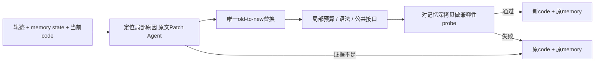
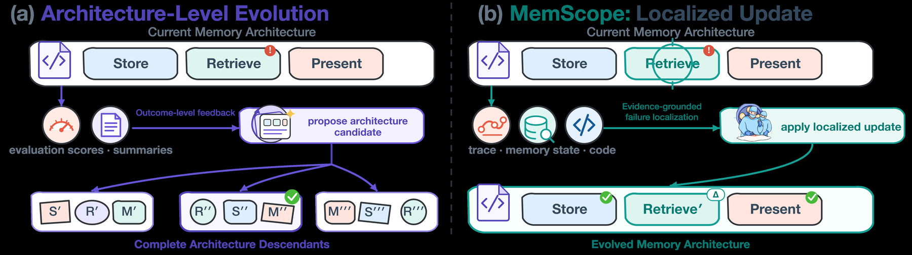

# MemScope：保留记忆的局部 provider 修复

> `component_only` / L1 CPU。实现局部代码替换事务和失败回滚，没有语言模型 Patch Agent，也不执行任意代码。

## 论文信息

| 字段 | 内容 |
| --- | --- |
| 论文链接 | [MemScope](https://arxiv.org/abs/2610.21170) |
| 公司/机构 | 一作 Miao Su；中科院计算所／国科大；合作者包括美团 |
| 首次公开日期 | 2026-10-15，arXiv v1；10-16 公告重叠补漏 |
| 原文开源代码 | 本轮未在论文首页、方法及附录找到作者公开实现仓库链接 |
| 本地 Adapter | 无（`adapter: null`）；组件 key：`memscope` |
| 本地复现代码 | `src/auto_research/agent_research/memscope.py`；`scripts/run_oct18_agent_components.py` |

## 原始论文总结

### 背景与主要改动

只给“分数下降”或压缩总结，很难知道长链 Agent 该改记忆写入、检索还是下游使用。MemScope 让 Patch Agent 联合检查原始执行轨迹、运行时记忆和当前 provider 代码，定位后做有界原位修改，保留 provider identity 与现有记忆兼容性；证据不足时可以明确 no-patch，而不是每轮都强行修改。[原文 §3、附录 A–B](https://arxiv.org/html/2610.21170v1)



<!-- paper-figure:start -->
### 原论文关键图

[](https://arxiv.org/html/2610.21170v1/figs/memscope_abstract_comparison_branching_draft_20260728_from_svg.png)

> **原论文 Figure 1（关键图）**：展示原论文提出的核心架构、主要模块及其连接关系。图片来自[原论文](https://arxiv.org/abs/2610.21170)，版权归原作者所有；点击图片可查看来源。
<!-- paper-figure:end -->

### 核心公式

本地表达的是补丁事务约束，而非新的学习目标：

$$
P' = \operatorname{replaceOnce}(P,o,n),\quad
(P_{next},M_{next})=
\begin{cases}
(P',M)&\text{局部、语法、接口和probe均通过}\\
(P,M)&\text{否则}.
\end{cases}
$$

`patch_provider` 保持 `provider_id` 和 `schema_version`，以 AST 比较公共函数签名；默认字符编辑差异预算 0.25 是本地保守限制，不声称原文固定阈值。probe 只拿深拷贝，失败和内部修改不会污染既有记忆。语法和签名相同**不证明语义兼容**，可信 probe 仍需调用方针对实际记忆格式实现；本接口不是恶意 Python 的 OS 沙箱。

### 论文离线与线上效果

作者报告 DeepSeek V3.2 的 MemScope＋Flash-Searcher 在 GAIA validation 达 83.64%，完整 xBench 78%；ALFWorld disjoint unseen 从原 DynamicCheatsheet 的 50.75% 到 71.64%。14 个归档 provider transition 的 median code-change ratio 为 4.4%。GAIA 的 86.67% 是诊断消融子集，不得与全量 83.64% 混用。xBench 每次在线记忆只接任务后正确性，不接 judge reference answer。未报告生产线上 A/B。[实验](https://arxiv.org/html/2610.21170v1)

## 本地复现

```bash
PYTHONPATH=src python scripts/run_oct18_agent_components.py \
  --methods memscope --seeds 42,43,44 --device cpu \
  --output runs/oct18-agent/memscope.json
```

每 seed 随机化 provider 中阈值字符串及记忆记录，实际执行成功局部替换、故意失败的兼容性 probe 和签名改变；校验失败 code 回滚、既有 memory 保留及 probe 副作用不持久化。测量的是事务合同，不是阈值调参有效性；[CPU 产物](metrics/component-cpu-seeds42-44.json)保留逐 seed 来源和负对照。

### 成本与边界

原文使用 DeepSeek／Kimi、GAIA／xBench 全套搜索任务（xBench 四十步预算）、LLM Patch Agent 和 ALFWorld 多轮在线记忆。完整实验包含大量 API／工具执行，对现有单卡或 Mac 成本过高，**不复现（审查 DONE）**。本地不声称 provider 已被智能进化、无真实检索或模型，`diagnostic_only=true`、`promotion_eligible=false`、`evolve_integrated=false`，无 CUDA 路径。
