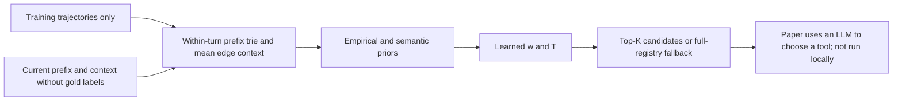
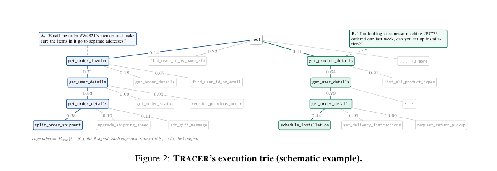

# TRACER: A Trajectory-Aware Front End for Tool Retrieval

<!-- source-sha256: 64466356c8e737899afefc8c3d198740c74a3f884e29b0e5ccd725b631f7f86b -->

[简体中文](README.md) · English

> The local implementation is `component_only`, a CPU operator diagnostic. It genuinely optimizes a learnable mixture and temperature, but uses synthetic three-dimensional representations instead of the original semantic encoder. No LLM selects or executes tools. High fixture recall is not evidence of agent capability; `promotion_eligible: false`.

## Paper information

| Field | Details |
| --- | --- |
| Paper | [TRACER: Trajectory-Aware Tool Retrieval for LLM Agents](https://arxiv.org/abs/2610.21267) |
| Affiliation | First author Tanish Kher; the paper's title page lists Microsoft for all authors and a footnote says the work was completed during an internship. |
| First public release | 2026-10-15, arXiv v1 05:00:58 UTC (13:00:58 Beijing time that day) |
| Authors' open-source code | **Not released.** Appendix A.13 explicitly says “We release no artifacts here.” No author repository for the method or synthetic data was found. The cited tau/BFCL repositories are not TRACER code. |
| Local adapter | None (`adapter: null`); component key `tracer` |
| Local implementation | `src/auto_research/agent_research/tracer.py`; `scripts/run_oct17_agent_components.py` |

## Original paper summary

### Background and main changes

Putting the full tool registry into a prompt consumes substantial context, while similarity against tool descriptions alone ignores the execution history. TRACER uses the **complete tool-call prefix within the turn** to look up an execution trie. Candidates are the next tools actually seen after that prefix during training. Each edge records its frequency and the mean of the complete conversation context when the transition occurred. Two five-dimensional linear heads learn a state-dependent weight between the empirical and contextual priors and a temperature. For unseen prefixes or low confidence, retrieval falls back to vector search across the full registry.



Original diagram: [Figure 6, complete TRACER architecture](https://arxiv.org/html/2610.21267v1#A1.F6).

<!-- paper-figure:start -->
### Key figure from the paper

[](https://arxiv.org/pdf/2610.21267v1#page=4)

> **Figure 2 from the paper:** The full execution-prefix trie illustrates how the same tool can have different successors and transition frequencies under different complete prefixes. This is not a local capability-evaluation trajectory. The figure comes from the [original paper](https://arxiv.org/abs/2610.21267), © the original authors. Select the image to see the source.
<!-- paper-figure:end -->

### Core equations

The empirical signal is $P(t)=\log(P_{trie}(t\mid S)+\epsilon)$. For the context signal, compute $R(t)=\cos(e(ctx),m(S\to t))$, then normalize the positive values to $\widehat R(t)$. Use a uniform distribution if none are positive. With $L(t)=\log\widehat R(t)$:

$$
s(t)=\frac{(1-w)L(t)+wP(t)}{T},\quad w=\sigma(a^Tz+b_w),\quad T=\operatorname{softplus}(c^Tz+b_T)+10^{-3}.
$$

Locally, the logarithm of a zero probability uses an explicit $10^{-12}$ floor to avoid floating-point infinity; this does not change the learnable definition of empirical and semantic weighting. The five features correspond exactly to prior margin, log-support of the edge with greatest similarity, maximum cosine, query words, and prior turns. The standardizer is fitted only on cross-fitted training examples, then frozen.

Training follows Eq. 4: NLL on the correct next tool plus $10^{-3}$ L2 regularization on both slope vectors, without bias penalties. For each training step, the trie and edge memory used to compute its signals **exclude that step's entire trajectory fold**. Building a full index and masking only the label would not suffice. Temperature changes neither candidate ordering nor ranks, but it changes the maximum softmax probability and gate behavior. The local operator preserves this distinction.

### Reported offline and online results

For GPT-5.4 on Mixed Tau2 Large, tool-selection accuracy rose from 57.2% with the full registry to 61.9% with TRACER, reducing prompt input by about 80%. Free-running success was 58.3% versus 58.2% for the full registry, with 61% fewer input tokens. Of 24 combinations across six environments and four models, 21 improved. Negative results remain; improvement is not guaranteed in every environment. No production online A/B test was reported.

## Local reproduction

### Data protocol and command

Each seed uses 40 training trajectories and 20 held-out trajectories, each three steps long, for 120 training steps and 60 test steps. Five-fold cross-fitting within training is grouped by trajectory. The index and edge means exclude the target fold. Steps whose prefix or correct child is missing in the held-out index count under `unseen_prefix_or_child_steps` rather than being silently reported as trained examples. All 60 steps are retained in the final test, with retriever parameters and standardization frozen.

```bash
PYTHONPATH=src python scripts/run_oct17_agent_components.py \
  --methods tracer --device cpu --seeds 42,43,44 \
  --output runs/oct17-agent/tracer-cpu.json
```

The registry and context use explicitly labeled synthetic three-dimensional vectors, not a public tool benchmark. The core heads run 150 actual Adam epochs in NumPy with learning rate 0.05, less than the paper's 500 epochs and intended only for bounded component verification. Unit tests use independent finite differences to check analytic gradients for all 12 parameters. A negative control swaps two semantic context dimensions to verify the operator reads context rather than simply returning the correct tool.

### CPU mechanism results (42/43/44)

| Metric | Mean |
| --- | ---: |
| Cross-fitted training NLL, initial → final | 0.102733 → 0.000663 |
| L2 change in trained parameters | 1.541091 |
| Overlap between inner index and target trajectory | 0 |
| Fixture held-out next-tool recall@1 | 1.000000 |
| Swapped-semantic-context negative-control recall@1 | 0.666667 |
| Minimum temperature | 0.100997 |
| Fraction of full test denominator retained | 1.000000 |

These are geometric classification results on a mechanism fixture, not a reproduction of the paper's six environments. Independent tests cover global fallback for an unseen prefix, forced low-confidence fallback, and the high-entropy global extension. Test labels were not used to select a model or hyperparameters. The [CPU metrics](metrics/component-cpu-seeds42-44.json) include per-seed results and a code checksum.

### Code mapping and limits

`TransitionIndex` builds a real prefix index and averages edge context. `crossfit_examples` records the trajectories in each index for leakage checks. `fit_blend` actually trains the weights rather than blending with hand-tuned constants. The inference entry point, `TracerRetriever.retrieve`, does not accept `next_tool` or gold labels. It returns only candidates, fallback status, w/T, and confidence.

Optional `global_tools(count)` selects tools with high prefix entropy $H(S\mid t)$ in training, breaking ties by tool name. `global_extension` is a union implementing Tracer+G; it can exceed the base budget k and reports the returned count explicitly instead of silently truncating it. The base TRACER path does not enable this extension by default.

The original synthetic trajectories and generalization policy were not released. The frozen semantic encoder, four hosted large models, six environments × five folds × multiple budgets, free-running evaluation, and full paper statistics were not rerun. **They exceed the budget of one A100, A30, or Mac and were not reproduced (review complete)**. Synthetic embeddings and retrieval scores do not override this disposition, and no executable Evolve operator was registered.
