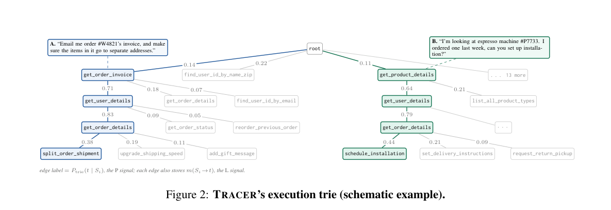

# TRACER：轨迹感知的工具检索前端

> 本地仅 `component_only` / CPU 算子诊断。真正优化的是可学习混合与温度；使用合成三维表示而非原始语义 encoder，也没有 LLM 选择或执行工具。高 fixture recall 不是 Agent 能力，`promotion_eligible: false`。

## 论文信息

| 字段 | 内容 |
| --- | --- |
| 论文链接 | [TRACER: Trajectory-Aware Tool Retrieval for LLM Agents](https://arxiv.org/abs/2610.21267) |
| 公司/机构 | 一作 Tanish Kher；论文首页统一 Microsoft，脚注注明实习期间完成 |
| 首次公开日期 | 2026-10-15，arXiv v1 05:00:58 UTC（北京时间同日 13:00:58） |
| 原文开源代码 | **未发布**。附录 A.13 明确 “We release no artifacts here”；未发现原作者方法代码/合成数据仓库，不能把引用的 tau/BFCL 仓库当作 TRACER 代码 |
| 本地 Adapter | 无（`adapter: null`）；组件 key：`tracer` |
| 本地复现代码 | `src/auto_research/agent_research/tracer.py`；`scripts/run_oct17_agent_components.py` |

## 原始论文总结

### 背景与主要改动

把完整工具目录塞进 prompt 会占用大量上下文，纯工具描述相似度又忽略历史执行路径。TRACER 用 **turn 内完整调用前缀**索引执行 trie，候选是该前缀在训练中实际出现过的下一工具；边上记录频率和发生该转移时的完整 conversation context 均值。训练两个五维线性 head，逐状态决定经验频率/上下文先验的权重和温度；未知前缀或低置信时回到全目录向量检索。


原图出处：[原文 Figure 6：完整 TRACER 架构](https://arxiv.org/html/2610.21267v1#A1.F6)。

<!-- paper-figure:start -->
### 原论文关键图

[](https://arxiv.org/pdf/2610.21267v1#page=4)

> **原论文 Figure 2（关键图）**：完整执行前缀树示意：同一工具在不同完整前缀下拥有不同后继与转移频率；不是本地能力评测轨迹。图片来自[原论文](https://arxiv.org/abs/2610.21267)，版权归原作者所有；点击图片可查看来源。
<!-- paper-figure:end -->

### 核心公式

经验信号 $P(t)=\log(P_{trie}(t\mid S)+\epsilon)$。上下文信号先求 $R(t)=\cos(e(ctx),m(S\to t))$，再将正值归一化为 $\widehat R(t)$；全非正时用 uniform。令 $L(t)=\log\widehat R(t)$，

$$
s(t)=\frac{(1-w)L(t)+wP(t)}{T},\quad w=\sigma(a^Tz+b_w),\quad T=\operatorname{softplus}(c^Tz+b_T)+10^{-3}.
$$

本地为零概率 log 加明确数值下界 $10^{-12}$，避免浮点无穷；不修改经验/语义权重的可学习定义。五维特征严格对应 prior margin、最大相似度边的 log-support、最大 cosine、query words、prior turns。standardizer 只在 crossfit training examples 拟合并冻结。

训练按原文 Eq.4 对正确下一工具做 NLL，并对两个 slope 向量加 $10^{-3}$ L2（bias 不惩罚）。每个训练步计算信号时，trie 和 edge memory **排除该步所属整个 trajectory fold**，不能先建全索引再只遮标签。温度不改变候选排序，但改变 softmax 最大概率与 gate；本地保留此区别。

### 论文离线与线上效果

原文 Mixed Tau2 Large、GPT-5.4 的 tool-selection accuracy 从 full-registry 57.2% 到 TRACER 61.9%，prompt 输入约减 80%；free-running success 58.3% 对 full-registry 58.2%，输入 token 减 61%。六环境×四模型中 21/24 组合有提升，也存在负结果，不能称所有环境必然更好。未报告生产线上 A/B。

## 本地复现

### 数据协议与命令

每 seed 使用 40 train trajectories / 20 held-out trajectories，每条三步，120 个训练步和 60 个测试步。训练内部 5-fold 按 trajectory 分组，索引、边均值不含目标 fold；无法在留出索引找到前缀/正确 child 的训练步计入 `unseen_prefix_or_child_steps`，不隐瞒为已训练样本。最终测试全部 60 步保留，retriever 参数和标准化都已冻结。

```bash
PYTHONPATH=src python scripts/run_oct17_agent_components.py \
  --methods tracer --device cpu --seeds 42,43,44 \
  --output runs/oct17-agent/tracer-cpu.json
```

注册表/上下文为清晰标注的合成三维向量，不是公开工具 benchmark。核心 head 用 NumPy 真实执行 150 epoch Adam，lr 0.05；比原文 500 epoch 更小，仅为有界组件验证。单测用独立有限差分检查全部 12 个参数的解析梯度。负对照交换上下文两个语义维度，验证算子确实读取 context，而非恒等返回正确工具。

### CPU 机制结果（42/43/44）

| 指标 | 均值 |
| --- | ---: |
| Crossfit train NLL，初始 → 最终 | 0.102733 → 0.000663 |
| 训练参数变化 L2 | 1.541091 |
| Inner index 与目标 trajectory 交叠 | 0 |
| Fixture held-out next-tool recall@1 | 1.000000 |
| 交换语义 context 的负对照 recall@1 | 0.666667 |
| 最低温度 | 0.100997 |
| 完整测试分母保留率 | 1.000000 |

这些是机制 fixture 的几何分类，不是论文六环境复现。未见前缀 global fallback、强制低置信 fallback 与高熵 global extension 均有独立测试；没有用测试标签选模型或超参数。[CPU 指标](metrics/component-cpu-seeds42-44.json)包含逐 seed 和代码校验值。

### 代码映射与边界

`TransitionIndex` 建真实前缀索引并均值聚合边 context；`crossfit_examples` 保存索引的 trajectory 集供泄漏检查；`fit_blend` 实际训练，非手调常量融合。`TracerRetriever.retrieve` 的推理入口不接受 `next_tool`/gold，只返回候选、fallback、w/T 和置信度。

可选 `global_tools(count)` 按训练中 $H(S\mid t)$ 选高前缀熵工具，按工具名打破同分；`global_extension` 作为 Tracer+G 的并集可能超过基础预算 k，返回数会显式报告，不悄悄截掉它。基础 TRACER 默认不启用扩展。

原始合成轨迹/广化政策未发布；冻结语义 encoder、四个托管大模型、六环境×五折×多 budget、自由运行和论文完整统计均未重跑。以单 A100/A30/Mac 的预算，**成本过高，不复现（审查 DONE）**；不以合成 embedding 或检索分数绕过这一终态，也未登记可执行 Evolve 算子。
