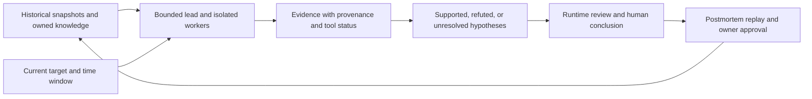
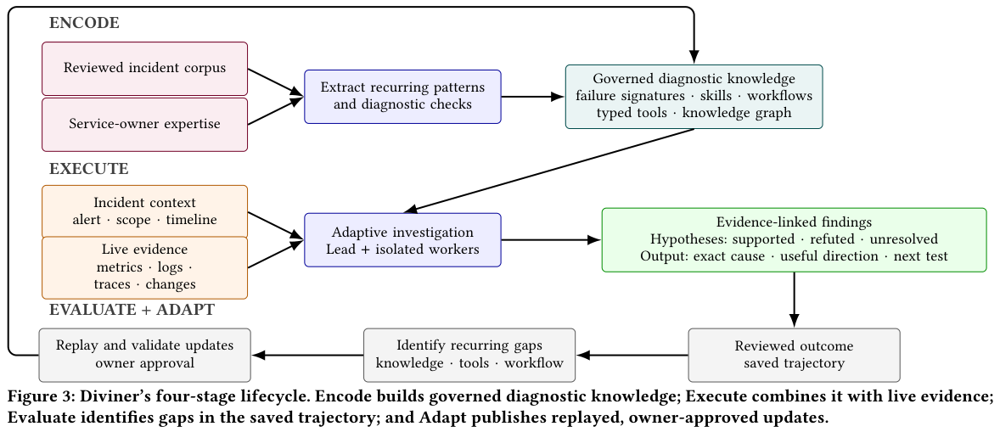

# Diviner: Evidence and Human Governance for Production Incident Diagnosis

<!-- source-sha256: 745f0875a9d5757353c8fd007feb2fec2cd52b34a5f2b185e32d256033f57939 -->

[简体中文](README.md) · English

> `component_only` / L1 CPU protocol component. Implements contracts for evidence admission, hypothesis state, and human approval. Does not run a production root-cause analysis agent or participate in Evolve promotion.

## Paper information

| Field | Details |
| --- | --- |
| Paper | [Diviner](https://arxiv.org/abs/2610.21281) |
| Affiliation | First author Pradipta Ghosh; Meta, as are all authors. |
| First public release | 2026-10-15, arXiv v1; overlap backfill for the 10-16 announcement, not a first release on 10-18 |
| Authors' open-source code | No public author repository for Diviner was found. Dependencies such as LangChain are not the paper's implementation. |
| Local adapter | None (`adapter: null`); component key `diviner` |
| Local implementation | `src/auto_research/agent_research/diviner.py`; `scripts/run_oct18_agent_components.py` |

## Original paper summary

### Background and main changes

Production incident symptoms can propagate across recommendation, ranking, data, configuration, and compute services. Tool access does not make an LLM a reliable diagnostician. A timeout does not mean there is no anomaly; a similar historical incident does not establish the current root cause; and a postmortem is not evidence available during the incident. [§§4–5](https://arxiv.org/html/2610.21281v1) define an Encode/Execute/Evaluate/Adapt loop for domain knowledge, lead–worker investigation, postmortem review, and owner-approved knowledge updates. Runtime adaptation can revise only the current investigation plan, not publish shared workflows or execute mitigation.



<!-- paper-figure:start -->
### Key figure from the paper

[](https://arxiv.org/pdf/2610.21281v1#page=6)

> **Figure 3 from the paper:** Diviner's Encode, Execute, Evaluate, and Adapt lifecycle, retaining evidence attribution, isolated workers, and owner-approved updates after replay. The figure comes from the [original paper](https://arxiv.org/abs/2610.21281), © the original authors. Select the image to see the source.
<!-- paper-figure:end -->

### Core equations

The local implementation expresses the paper's evidence contract as structured admission conditions, not a new root-cause analysis model:

$$
\operatorname{admit}(e)=I[\text{same incident and target}]I[W_e\subseteq W_q]
I[t_{\mathrm{available}}\leq t_{\mathrm{asof}}]
I[s_e\in\{\mathrm{data},\mathrm{valid\_empty}\}].
$$

Statuses such as `partial`, `timeout`, and `denied` cannot support or refute a hypothesis. `valid_empty` can be evidence of a valid absence or refutation, not a positive finding. This check verifies structure and temporal boundaries only; **it cannot establish semantic entailment or causality**. Publishing persistent knowledge requires the next version, a passed replay, and explicit artifact-owner approval.

### Reported offline and online results

The paper reports supporting thousands of incidents in Meta's recommendation and ranking infrastructure, with 45% Exact RCA, 60% useful Direction, and 80% mean Groundedness. In an observational cohort, assisted incidents had approximately 52% shorter detection-to-mitigation time and approximately 15% less upfront engineering effort. This was not a randomized online A/B test and cannot be interpreted as an isolated causal effect. A same-model paired historical replay reports an 11-percentage-point Exact RCA gain from the end-to-end harness, but Direction and Groundedness intervals included no change. The results use different cohorts and cannot be pooled. [Experiments and limitations](https://arxiv.org/html/2610.21281v1)

## Local reproduction

### Data protocol and execution

```bash
PYTHONPATH=src python scripts/run_oct18_agent_components.py \
  --methods diviner --seeds 42,43,44 --device cpu \
  --output runs/oct18-agent/diviner.json
```

Each seed generates 24 synthetic events with provenance, randomizing tool status, availability time, and values. An independent reference recomputes the number admitted. A negative control treats any nonempty tool response as evidence and retains its false admissions. Additional checks reject unapproved publication and allow a version advance after owner approval. The interface neither takes real incidents nor generates root-cause answers.

### Results and code mapping

`EvidenceLedger.admit` admits evidence and preserves rejection reasons. `update_hypothesis` checks citations and the three hypothesis states. `publish_update` enforces the owner gate. The [CPU component artifact](metrics/component-cpu-seeds42-44.json) has per-seed values, source hashes, negative controls, and aggregates. These are contract diagnostics, not RCA success rates.

### Cost and limits

The paper depends on private Meta incidents and production observability permissions, DRAMA-1B multiview retrieval, and actual multi-agent/API investigations. Time to a final conclusion is about 15 minutes p50 and 24 minutes p95 for an individual investigation. The full cohort study cannot be rerun cheaply on one A100, A30, or Mac. **It was not reproduced (review complete)**, and fabricated public incidents do not stand in for its findings. `diagnostic_only=true`, `promotion_eligible=false`, `evolve_integrated=false`. No CUDA path or GPU receipt is needed.
