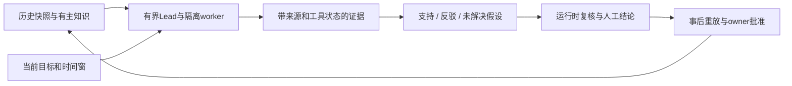
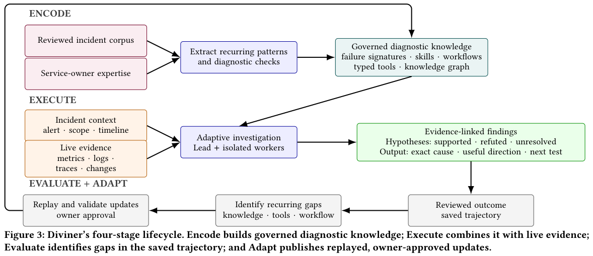

# Diviner：生产事故诊断中的证据与人工治理

> `component_only` / L1 CPU 协议组件。实现证据接纳、假设状态与人工批准合同，不运行生产 RCA Agent，不进入 Evolve 晋级。

## 论文信息

| 字段 | 内容 |
| --- | --- |
| 论文链接 | [Diviner 原文](https://arxiv.org/abs/2610.21281) |
| 公司/机构 | 一作 Pradipta Ghosh；Meta，全体作者属于 Meta |
| 首次公开日期 | 2026-10-15，arXiv v1；10-16 公告重叠补漏，不是 10-18 首发 |
| 原文开源代码 | 未找到作者公开 Diviner 仓库；LangChain 等依赖不是该论文实现 |
| 本地 Adapter | 无（`adapter: null`）；组件 key：`diviner` |
| 本地复现代码 | `src/auto_research/agent_research/diviner.py`；`scripts/run_oct18_agent_components.py` |

## 原始论文总结

### 背景与主要改动

生产事故的症状可能跨推荐、排序、数据、配置和算力服务传播。LLM 能调用工具并不代表它能可靠诊断：超时不等于无异常，历史相似事故不证明本次根因，事后总结也不能作为事故发生时的证据。[原文 §4–5](https://arxiv.org/html/2610.21281v1)用 Encode／Execute／Evaluate／Adapt 四阶段闭环组织领域知识、Lead–worker 调查、事后审查和 owner 批准的知识更新。运行中只调整本次调查计划，不能自行发布新的共享工作流或执行缓解操作。



<!-- paper-figure:start -->
### 原论文关键图

[](https://arxiv.org/pdf/2610.21281v1#page=6)

> **原论文 Figure 3（关键图）**：Diviner 的 Encode、Execute、Evaluate、Adapt 四阶段生命周期；保留证据关联、隔离工作者和回放后经负责人批准的更新。图片来自[原论文](https://arxiv.org/abs/2610.21281)，版权归原作者所有；点击图片可查看来源。
<!-- paper-figure:end -->

### 核心公式

本地把原文证据合同写成结构化接纳条件，而不是新的 RCA 模型：

$$
\operatorname{admit}(e)=I[\text{同incident/target}]I[W_e\subseteq W_q]
I[t_{\mathrm{available}}\leq t_{\mathrm{asof}}]
I[s_e\in\{\mathrm{data},\mathrm{valid\_empty}\}].
$$

`partial`、`timeout`、`denied` 等状态不能支持或反驳假设；`valid_empty` 仅能作为有效缺失或反驳证据，不能证明正向发现。该检查只验证结构与时间边界，**不证明内容语义蕴含或因果关系**。持久知识发布要求下一版本、重放通过和 artifact owner 明确批准。

### 论文离线与线上效果

原文报告在 Meta 推荐／排序基础设施支持数千事故；45% Exact RCA、60% useful Direction、80% mean Groundedness。观测性 cohort 中，辅助事故的 detection-to-mitigation 时间约短 52%，事前工程投入约少 15%；这不是随机线上 A/B，不能解释为独立因果效应。同模型历史配对回放的端到端 harness 比较报告 Exact RCA 增加 11 个百分点，但 Direction 和 Groundedness 差异的区间包含无变化。各结果来自不同样本群，不能混合。[实验与限制](https://arxiv.org/html/2610.21281v1)

## 本地复现

### 数据协议与运行

```bash
PYTHONPATH=src python scripts/run_oct18_agent_components.py \
  --methods diviner --seeds 42,43,44 --device cpu \
  --output runs/oct18-agent/diviner.json
```

每 seed 产生 24 个有来源的人工事件，随机化工具状态、可获得时间和数值。独立参考条件重算可接纳数；负对照把任何非空工具响应都当证据，从而保留错误接纳计数。另测未批准发布被拒和 owner 批准后版本前进。接口不接真实事故，也不生成根因答案。

### 结果与代码映射

`EvidenceLedger.admit` 接纳证据并保存拒绝理由；`update_hypothesis` 检查引用和三态状态；`publish_update` 执行 owner gate。逐 seed 数值、源码 hash、负对照与聚合见 [CPU 组件产物](metrics/component-cpu-seeds42-44.json)。这些是合同诊断，不是 RCA 成功率。

### 成本与边界

原配置依赖 Meta 私有事故和生产观测权限、DRAMA-1B 多视图检索、真实多 Agent/API 调查；原文单次调查最终结论约 15 分钟 p50、24 分钟 p95，完整群体实验不能由单 A100/A30 或 Mac 低成本重跑。**成本过高，不复现（审查 DONE）**，亦不伪造公开事故替代结论。`diagnostic_only=true`、`promotion_eligible=false`、`evolve_integrated=false`；无 CUDA 路径，不需要 GPU receipt。
