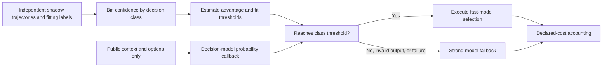
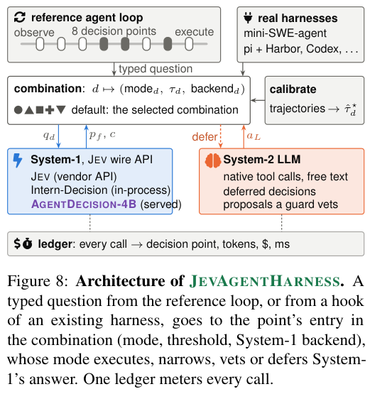

# JevAgentHarness: Calibrated Delegation Between Fast and Slow Decisions

<!-- source-sha256: 854380423ac4e7193d6ea93e939b46d57ba8b4d4230373babc316666bcdb8351 -->

[简体中文](README.md) · English

> `component_only` / L1 CPU. Implements per-decision-class threshold fitting, low-confidence fallback, and declared-cost accounting. No Jev or LLM calls, AgentDecision-4B training, or unified Evolve integration.

## Paper information

| Field | Details |
| --- | --- |
| Paper | [JevAgentHarness](https://arxiv.org/abs/2610.21412) |
| Affiliations | First author Kunlun Zhu, UIUC; collaborators from Princeton and Google. |
| First public release | 2026-10-15, arXiv v1; overlap backfill for the 10-16 announcement |
| Authors' open-source code | [JevAgentHarness/JevAgentHarness](https://github.com/JevAgentHarness/JevAgentHarness) is publicly readable; the full reuse license was not verified in this review. |
| Local adapter | None (`adapter: null`); component key `jev-agent-harness` |
| Local implementation | `src/auto_research/agent_research/jev_agent_harness.py`; `scripts/run_oct18_agent_components.py` |

## Original paper summary

### Background and main changes

An agent need not have an expensive LLM generate long text at every step. But high offline multiple-choice accuracy does not guarantee a correct closed loop. JevAgentHarness calibrates delegation thresholds separately for tool, argument, and other decisions on shadow trajectories that the agent itself visits. Low-confidence decisions return to the LLM. It reports success, cost, and critical-path latency. AgentDecision-4B also trains on reached states after errors, rather than imitating only successful trajectories. [§§2–4 and Appendices A/D](https://arxiv.org/html/2610.21412v1)



<!-- paper-figure:start -->
### Key figure from the paper

[](https://arxiv.org/pdf/2610.21412v1#page=25)

> **Figure 8 from the paper:** JEVAGENTHARNESS typed-decision routing, System-1/System-2 roles, and per-call cost ledger. This is the paper's integrated architecture, not local acceptance of the official framework. The figure comes from the [original paper](https://arxiv.org/abs/2610.21412), © the original authors. Select the image to see the source.
<!-- paper-figure:end -->

### Core equations

Given paired shadow correctness and task value $V$, the local implementation estimates a bin's delegation advantage:

$$
\widehat A_b={1\over |b|}\sum_{i\in b}
[V(c_i^{decision}-c_i^{strong})+\Delta C_i],\quad
\hat\tau=\min\{\ell_b:\ \forall j\ge b,\widehat A_j\ge0\}.
$$

This independently implements the paper's benefit estimation by confidence bin and suffix-threshold search, not a single constant threshold. Each bin defaults to at least 20 rows; confidence ties are never split. A short tail is merged with the preceding bin. If an entire class has too few rows, it always falls back. Classes with no qualifying suffix and unknown classes also fall back. Fitting reads only calibration/validation, and runtime task IDs cannot overlap fitting. `PublicDecision` contains no gold, correctness, or strong-model answer. Costs are caller declarations, not measured API bills or latency.

### Reported offline and online results, including negative results

The abstract reports 81.1–89.0% lower cost and up to 2.5× speedup on in-distribution tasks, with task success within a prespecified 3-percentage-point non-inferiority margin. This does not generalize to every task. The paper discloses several failed preregistered hypotheses: SFT accounted for the main gain, additional GRPO gave no measurable improvement, and OPD failed the development gate. Threshold fitting did not return all overconfident models to the cost–success frontier. No production online A/B test was reported. These negatives are part of the result, not details to remove in favor of the headline. [Full training pipeline and results](https://arxiv.org/html/2610.21412v1)

## Local reproduction

```bash
PYTHONPATH=src python scripts/run_oct18_agent_components.py \
  --methods jev-agent-harness --seeds 42,43,44 --device cpu \
  --output runs/oct18-agent/jev-agent-harness.json
```

Each seed randomizes low and high confidences. A 40-row numeric shadow fixture fits different thresholds. On 12 independent public requests, the runner actually calls the probability or strong-model callback. A negative control lowers the threshold to 0.5 and retains incorrect delegations. NaN outputs trigger fallback. Independent accounting verifies costs, and runtime callbacks are checked for absence of gold fields. The callbacks are hand-written functions, not models, so delegation rate is not agent accuracy. [CPU artifact](metrics/component-cpu-seeds42-44.json)

### Cost and limits

The paper uses 2.2 GPU-hours for SFT and 4.5 more GPU-hours for GRPO without measurable gain. One AgentDecision-4B training round costs 15.1 host-hours on one L40S plus USD 142.36 in API fees. Full training, real tool tasks, and multi-arm evaluation exceed this round's one-A100, one-A30, or Mac budget and **were not reproduced (review complete)**. `diagnostic_only=true`, `promotion_eligible=false`, `evolve_integrated=false`. CPU only; no CUDA validation is fabricated.
