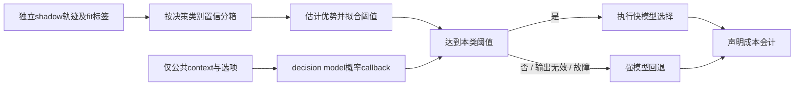
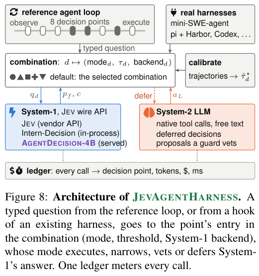

# JevAgentHarness：经校准的快慢决策委派

> `component_only` / L1 CPU。实现按决策类别拟合阈值、低置信回退及声明成本会计；没有 Jev／LLM 调用、AgentDecision-4B 训练或统一 Evolve 接入。

## 论文信息

| 字段 | 内容 |
| --- | --- |
| 论文链接 | [JevAgentHarness](https://arxiv.org/abs/2610.21412) |
| 公司/机构 | 一作 Kunlun Zhu；UIUC；合作者来自 Princeton、Google |
| 首次公开日期 | 2026-10-15，arXiv v1；10-16 公告重叠补漏 |
| 原文开源代码 | [JevAgentHarness/JevAgentHarness](https://github.com/JevAgentHarness/JevAgentHarness)；公开代码可读，完整复用许可证本轮未核实 |
| 本地 Adapter | 无（`adapter: null`）；组件 key：`jev-agent-harness` |
| 本地复现代码 | `src/auto_research/agent_research/jev_agent_harness.py`；`scripts/run_oct18_agent_components.py` |

## 原始论文总结

### 背景与主要改动

Agent 不需要每一步都让昂贵 LLM 生成长文本，但离线多选题高准确率也不保证闭环不出错。JevAgentHarness 在 agent 自己访问的 shadow trajectories 上，分别校准工具、参数等决策的委派阈值，低置信交回 LLM，并报告成功／费用／关键路径延迟。AgentDecision-4B 另用到达过的错误后状态训练，避免只模仿成功轨迹。[原文 §2–4、附录 A/D](https://arxiv.org/html/2610.21412v1)



<!-- paper-figure:start -->
### 原论文关键图

[](https://arxiv.org/pdf/2610.21412v1#page=25)

> **原论文 Figure 8（关键图）**：JEVAGENTHARNESS 的 typed decision 路由、System-1/System-2 分工与逐调用成本账本；图为原论文集成架构，不是本地官方框架验收。图片来自[原论文](https://arxiv.org/abs/2610.21412)，版权归原作者所有；点击图片可查看来源。
<!-- paper-figure:end -->

### 核心公式

在 shadow 配对正确性及任务价值 $V$ 下，本地估计 bin 的委派优势：

$$
\widehat A_b={1\over |b|}\sum_{i\in b}
[V(c_i^{decision}-c_i^{strong})+\Delta C_i],\quad
\hat\tau=\min\{\ell_b:\ \forall j\ge b,\widehat A_j\ge0\}.
$$

这是原文按置信区间估计收益再找 suffix threshold 的独立数值实现，不是统一常量阈值。默认每 bin 至少 20 行，同置信行不拆分；尾部不足并入前一 bin，整类不足则全部回退。无合格 suffix 或未知类别也回退。fit 只接 calibration/validation，执行 task ID 不与 fit 重合；`PublicDecision` 不含 gold、correctness 或强模型答案。成本为调用方声明值，不是实测 API 账单或延迟。

### 论文离线与线上效果及负结果

摘要报告同分布任务费用降低 81.1–89.0%、至多 2.5 倍提速，task success 不劣于 3 个百分点的预设门槛；不能推广到全部任务。正文披露许多预注册假设被否证：SFT 是主要收益，追加 GRPO 没有可测改进；OPD 被开发门槛淘汰；阈值拟合也没有让所有过度自信模型回到成本—成功前沿。未报告生产线上 A/B。这些负结果不能被删掉只保留标题。[完整训练链与结果](https://arxiv.org/html/2610.21412v1)

## 本地复现

```bash
PYTHONPATH=src python scripts/run_oct18_agent_components.py \
  --methods jev-agent-harness --seeds 42,43,44 --device cpu \
  --output runs/oct18-agent/jev-agent-harness.json
```

每 seed 的低／高置信值随机化，40 行 shadow 数值 fixture 拟合不同阈值，在 12 个独立公共请求上实际调用概率 callback 或强模型 callback。负对照把阈值压低到 0.5，保留错误委派；NaN 输出触发回退；独立重算费用并检查 runtime callback 无 gold 字段。这里 callback 是人工函数，不是模型，不能把委派率写成 Agent 准确率。[CPU 产物](metrics/component-cpu-seeds42-44.json)

### 成本与边界

原文 SFT 2.2 GPU-hours，追加 GRPO 4.5 GPU-hours 但无可测收益；一个 AgentDecision-4B 训练轮为单 L40S 15.1 host-hours 加 142.36 美元 API 费用。对单 A100/A30 或 Mac 的本轮预算，完整训练、真实工具任务和多臂评测**成本过高，不复现（审查 DONE）**。本地 `diagnostic_only=true`、`promotion_eligible=false`、`evolve_integrated=false`；只用 CPU，不伪造 CUDA 验证。
