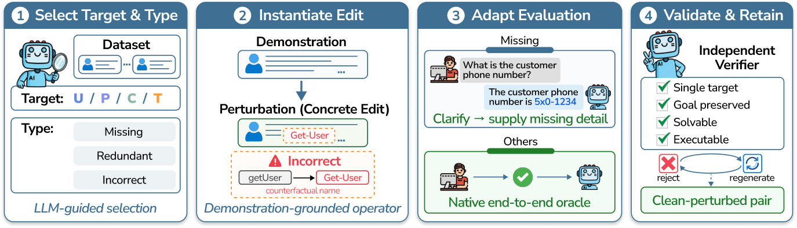

# AgentPerturb: single-target interaction perturbations and paired robustness measurement

<!-- source-sha256: 48a9e1dc9ba05b73631fee28a656c334e3f3d207d76bb6e1b08f3dee0110b68b -->

[简体中文](README.md)

> `evaluation_protocol_interface` / L1 CPU. The implementation covers perturbation boundaries, independent validation, and paired records. It does not generate the official tasks or claim that syntax checks prove semantic preservation.

## Paper information

| Field | Details |
| --- | --- |
| Paper | [AgentPerturb: Evaluating LLM Agent Robustness under Controlled Interaction Perturbations](https://arxiv.org/abs/2610.21624) |
| Organization | First author Yuanjian Xu, The Hong Kong University of Science and Technology (Guangzhou) |
| First public release | October 15, 2026 at 10:05:54 UTC, arXiv v1. This was recovered in the overlap with the October 16 announcement; it was not first published on October 19. |
| Authors' code | The official [xuyj233/AgentPerturb](https://github.com/xuyj233/AgentPerturb) repository was still empty when checked on October 19, 2026. The method code and data had not been released. |
| Local adapter | None (`adapter: null`); protocol key: `agent-perturb` |
| Local reproduction code | `src/auto_research/agent_research/agent_perturb.py`; `scripts/run_oct19_agent_components.py` |

## Original paper

### Motivation and method

Agent failures do not always come from model reasoning. Incomplete user requests, outdated skill specifications, incorrect inherited context, and drift in tool descriptions can all propagate through a trajectory. AgentPerturb crosses four targets—user request $U$, procedural specification $P$, inherited context $C$, and tool contract $T$—with three perturbation types: omission, redundancy, and error. That yields 12 families. Each pair changes one target; the other three, the backend, and the success oracle stay fixed. See [Section 3 and Appendix F](https://arxiv.org/html/2610.21624v1).

Valid JSON is not enough to accept a candidate. A semantic verifier independent of the generator must confirm all four conditions: the edit affects only the specified target, preserves the objective, remains solvable, and is executable. A native validator must also approve it. If necessary information is omitted, evaluation-side recovery annotations can require the agent to ask for clarification before the native user simulator supplies that information. The local implementation does not pass the recovery annotation to the actor.

~~~mermaid
flowchart LR
    C[Clean public interaction] --> P[Specify one target and perturbation type]
    P --> E[Replace only that input surface]
    E --> V[Four checks by an independent semantic verifier]
    V --> N[Native schema and execution validator]
    N --> B[Matched clean and perturbed pair]
    B --> A[Native actor callback]
    A --> G[Private reference and native grader]
    G --> M[Paired difference, coverage, failures, and cost]
~~~

<!-- paper-figure:start -->
### Key figure from the paper

> **Figure 2:** Four stages of perturbation construction: select one target and type, edit with examples, adapt evaluation annotations when needed, and independently verify objective preservation, solvability, and executability. From the [original paper](https://arxiv.org/abs/2610.21624); copyright remains with the authors. Click the figure to see the source.
<!-- paper-figure:end -->

### Core equations

On the **same set $S$ of task pairs scored in both conditions**:

$$
C={1\over |S|}\sum_{i\in S}c_i,\quad P={1\over |S|}\sum_{i\in S}p_i,\quad
\Delta=C-P,\quad D={C-P\over C}\quad(C>0).
$$

Locally, all $N$ requests are retained: `pair_coverage=|S|/N`. Unknown scores are in $[0,1]$, so an overall mean lies in $[\sum\mathrm{known}/N,(\sum\mathrm{known}+N_{\mathrm{missing}})/N]$. The intervals for the two conditions yield lower and upper bounds on the overall difference. Native rewards are not forced into binary form. APEX partial scores and Toolathlon binary success cannot be pooled directly into one mean.

### Paper results and selection bias

Across 10 frontier models on APEX-Agents and Toolathlon, the paper reports that perturbations degrade performance, with the dominant target and type depending on the environment. Stronger general capability does not guarantee the same robustness. Toolathlon retains only 25 of 79 tasks that complete all 12 control conditions; the paper also excludes ungraded runs from the aggregate. These absolute scores therefore do not represent the complete Toolathlon suite, and the local implementation does not silently discard such outcomes. See the [paper's experiments and Appendix A.2](https://arxiv.org/html/2610.21624v1#A1.SS2).

## Local reproduction

~~~bash
PYTHONPATH=src python scripts/run_oct19_agent_components.py \
  --methods agent-perturb --seeds 42,43,44 --device cpu \
  --output runs/oct19-agent/agent-perturb.json
~~~

Each seed runs all 12 families on arithmetic/tool-contract fixtures with no external side effects. The actor parses only public input; the grader scores separately. An independent domain verifier rejects edits that change the actual goal, whereas a syntax-only negative control incorrectly accepts them. Injected parse/tool failures and grader interruptions test paired coverage, failure counts, and bounds for unknown scores instead of dropping failures and reporting a perfect score. Aggregation requires the complete `requested_pairs` list; requests with no run record still count toward the unknown denominator. Outputs are non-overwritable and record each pair's outcome, seed, fixture, and execution source digest. See the [CPU protocol artifact](metrics/component-cpu-seeds42-44.json).

### Provenance, gold isolation, and cost

The final CPU runs used three seeds at frozen commit `39e912c1124c49b7d3a85957909fb143d8c9ba3c`. Each covers all 12 families; zero gold or condition fields were exposed to the actor. Under injected grading failures, mean paired scoring coverage was about 0.62083. Ungraded requests and requests without records remain in the denominator. This is not model success or an official Toolathlon result. The artifact above contains complete pair-level records.

`prepare_pair` requires independent `semantic_verifier` and `native_validator` callbacks. It cannot itself prove arbitrary natural-language equivalence. The local verifier is limited to the explicit public arithmetic fixtures and does not stand in for the paper's LLM generator/verifier. Callers must keep the native backend and grader fixed. The actor sees one public instance at a time, not the clean/perturbed pair, perturbation labels, verifier annotations, recovery plans, or the reference. Evaluation callbacks are trusted code, not a sandbox for hostile Python plugins.

Unlike CODA, which freezes the original retrieval set and changes skill contents only, this protocol changes one of four interaction input surfaces. The two are not substitutes. The full paper setup uses 10 frontier models × 2 real environments × 25 tasks × 12 perturbation families; a task can reach 200 turns or a roughly 30-minute cap, and the setup also requires generation and semantic-verification APIs. **Full experiments were not reproduced due to cost (review complete).** Local execution uses no model, network, or GPU. `diagnostic_only=true`, `promotion_eligible=false`, and `evolve_integrated=false`.
