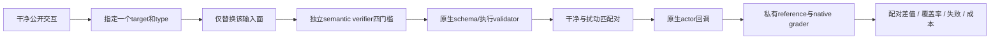
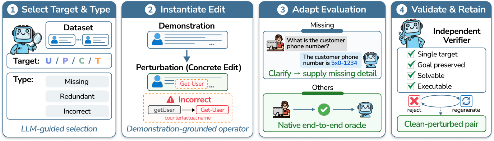

# AgentPerturb：单目标交互扰动与配对稳健性测量

> `evaluation_protocol_interface` / L1 CPU。实现扰动边界、独立验证与配对记录，不生成官方任务，不声称语法检查能够证明语义保持。

## 论文信息

| 字段 | 内容 |
| --- | --- |
| 论文链接 | [AgentPerturb: Evaluating LLM Agent Robustness under Controlled Interaction Perturbations](https://arxiv.org/abs/2610.21624) |
| 公司/机构 | 一作 Yuanjian Xu；The Hong Kong University of Science and Technology (Guangzhou) |
| 首次公开日期 | 2026-10-15 10:05:54 UTC，arXiv v1；10-16公告重叠补漏，不是10-19首发 |
| 原文开源代码 | 官方地址 [xuyj233/AgentPerturb](https://github.com/xuyj233/AgentPerturb)；2026-10-19核对仍为空仓库，方法代码与数据尚未发布 |
| 本地 Adapter | 无（`adapter: null`）；协议 key：`agent-perturb` |
| 本地复现代码 | `src/auto_research/agent_research/agent_perturb.py`；`scripts/run_oct19_agent_components.py` |

## 原始论文总结

### 背景与主要改动

Agent 失败不一定来自模型推理：用户请求缺信息、技能规范过时、历史上下文出错和工具说明漂移都可能沿轨迹传播。AgentPerturb 交叉组织四个目标——用户请求 $U$、过程规范 $P$、继承上下文 $C$、工具契约 $T$——与缺失、冗余、错误三类扰动，得到12个家族。每对只改一个目标，其余三个、后端和成功 oracle 不变。[原文 §3、附录 F](https://arxiv.org/html/2610.21624v1)

候选不能因为“JSON合法”就入选：与生成器独立的语义 verifier 必须确认单目标、目标不变、仍可求解、可执行四项全部通过，再结合原生 validator。缺失必要信息时，可由评测侧恢复注释要求 Agent 先澄清，再由原生用户模拟器给出信息；本地不把恢复注释直接塞给 actor。



<!-- paper-figure:start -->
### 原论文关键图

[](https://arxiv.org/html/2610.21624v1/pipeline0823.png)

> **原论文 Figure 2（关键图）**：扰动构造的四阶段流程：选择单一目标及类型、示例驱动编辑、必要时适配评测注释，再由独立 verifier 检查目标保持、可解性和可执行性。图片来自[原论文](https://arxiv.org/abs/2610.21624)，版权归原作者所有；点击图片可查看来源。
<!-- paper-figure:end -->

### 核心公式

在**相同且双侧已评分**的任务对集合 $S$ 上：

$$
C={1\over |S|}\sum_{i\in S}c_i,\quad P={1\over |S|}\sum_{i\in S}p_i,\quad
\Delta=C-P,\quad D={C-P\over C}\quad(C>0).
$$

本地另外保留全部请求 $N$：`pair_coverage=|S|/N`。未知评分在 $[0,1]$，因此总体均值处于 $[\sum\mathrm{known}/N,(\sum\mathrm{known}+N_{\mathrm{missing}})/N]$；由两侧区间推导总体差值上下界。原生 reward 不被强行二值化；APEX 的部分分与 Toolathlon 的二值成功不能直接混成一个均分。

### 论文效果与选择偏差

原文在10个前沿模型、APEX-Agents 和 Toolathlon 上观察到扰动均会退化表现，主导目标/类型依赖环境；更强的通用能力也不保证相同稳健性。需注意：Toolathlon 只保留完成全部12类对照的25/79个任务，原文聚合排除了未评分运行。因此其绝对分数不是完整 Toolathlon 结果，本地不照搬这种静默筛除。[原文实验与 Appendix A.2](https://arxiv.org/html/2610.21624v1#A1.SS2)

## 本地复现

```bash
PYTHONPATH=src python scripts/run_oct19_agent_components.py \
  --methods agent-perturb --seeds 42,43,44 --device cpu \
  --output runs/oct19-agent/agent-perturb.json
```

每 seed 在无外部副作用的算术/工具契约 fixture 上实际执行全部12家族，actor 只解析公开输入，grader 单独判分。独立的领域 verifier 拒绝改变真实目标的编辑；语法-only负对照会错误放行这些编辑。注入解析/工具故障与 grader 中断，检查配对覆盖率、失败数及未知评分上下界，而不是删掉失败后报告满分。汇总必须提交完整 `requested_pairs`，尚无记录的请求也保留在未知分母中。记录逐对 outcome、随机种子、fixture 和执行源码摘要，输出不可覆盖。结果见 [CPU 协议产物](metrics/component-cpu-seeds42-44.json)。

### 真实性、gold 隔离与成本

最终 CPU 三seed在冻结提交 `39e912c1124c49b7d3a85957909fb143d8c9ba3c` 执行，均覆盖12类扰动，actor暴露gold/条件字段数为0。注入评分失败后，配对评分覆盖率均值约0.62083，未评分和缺记录继续保留在请求分母；这不是被测模型的成功率或官方Toolathlon结果。完整逐pair记录见上方指标产物。

`prepare_pair` 必须接收独立 `semantic_verifier` 与 `native_validator` 回调；它不能自行证明任意自然语言等价。本地 verifier 只适用于明确公开的算术 fixture，不冒充论文的 LLM 生成/审查。native backend 和 grader 由调用方保持固定。actor 每次仅收到一个公开实例，不收到干净/扰动对、扰动标签、verifier注释、恢复计划或 reference；评测侧回调是受信任代码，不是恶意 Python 插件沙箱。

与 CODA 的区别是这里改交互的四种输入面，而 CODA 冻结原检索集合、只改技能内容；两者不互相替代。原文完整配置为10个前沿模型×2真实环境×25任务×12类扰动，单任务可达200轮、约30分钟上限，还需生成/语义验证 API，**成本过高，不复现（审查 DONE）**。本地无模型、网络或GPU，`diagnostic_only=true`、`promotion_eligible=false`、`evolve_integrated=false`。
