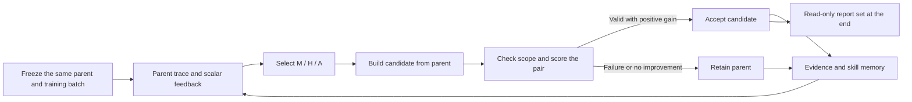
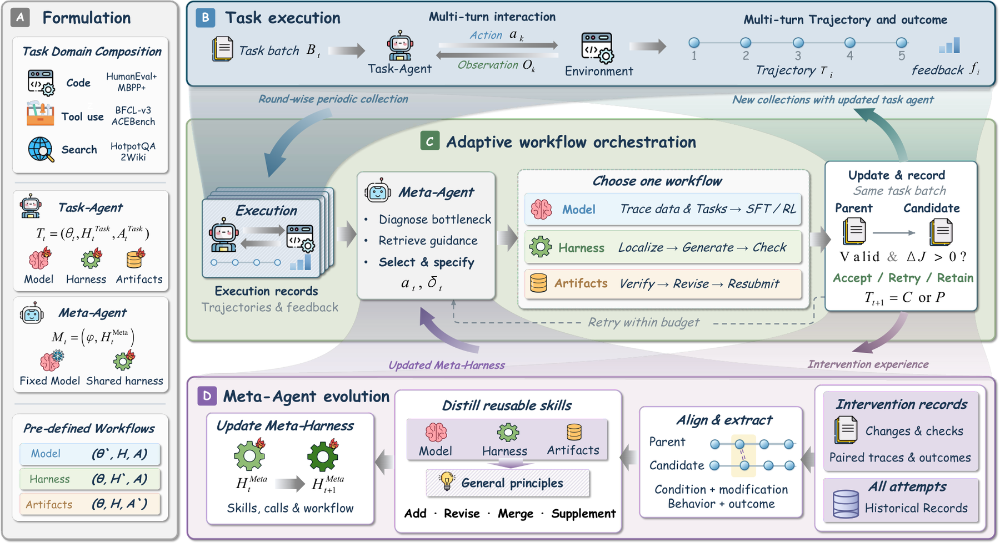

# RSIFlow: Evidence-Guided Control for Three-Branch Self-Improvement

<!-- source-sha256: 1b4c11a1a6d3b214da0926c4be00470901621ed0dd2ba6f636fb8ad1eb8928e4 -->

[简体中文](README.md) · English

> `component_only` / L1 CPU mechanism diagnostic. Implements a fixed callback controller and skill-experience records. It does not train a language model, execute arbitrary self-modifying metaprograms, or participate in shared Evolve promotion.

## Paper information

| Field | Details |
| --- | --- |
| Paper | [RSIFlow](https://arxiv.org/abs/2610.21791) |
| Affiliations | First author Huan Zhang and co-first author Mingju Chen, Beihang University; collaborators include Tsinghua University and BAAI. |
| First public release | 2026-10-15, arXiv v1 12:45:08 UTC; a follow-up review of the 10-16 announcement, not a first release on 10-17. |
| Authors' open-source code | [Author repository](https://github.com/1HUAN1/RSI-Flow), MIT. The released version is the skill-memory variant, with a fixed executable Meta program. |
| Local adapter | None (`adapter: null`); component key `rsiflow` |
| Local implementation | `src/auto_research/agent_research/rsi_flow.py`; `scripts/run_oct17_supplement_agent.py` |

## Original paper summary

### Background and main changes

The bottleneck may be in model parameters, the execution harness, or merely the current deliverable. Updating one fixed part or alternating on a fixed schedule may not address the current failure. RSIFlow's Meta-Agent uses task-execution evidence to choose a Model, Harness, or Artifacts intervention. It compares candidates derived from the same parent on the same task batch and maintains skills from successes and failures. Meta-model parameters remain fixed. The local component follows the released skill-memory variant and does not turn it into a system for arbitrary code self-modification.



<!-- paper-figure:start -->
### Key figure from the paper

[](https://arxiv.org/html/2610.21791v1/Overview.png)

> **Figure 2 from the paper:** Overall workflow, key stages, and data flow. The figure comes from the [original paper](https://arxiv.org/abs/2610.21791), © the original authors. Select the image to see the source.
<!-- paper-figure:end -->

### Core equations

[Paper §§3.2–3.3 and Appendix B](https://arxiv.org/html/2610.21791v1) define intervention type $a\in\{M,H,A\}$. Each candidate derives from the same frozen parent:

$$
C_{t,j}=U_{a_{t,j}}(P_t,\mathcal B_t),\qquad
\Delta J=J(C_{t,j};\mathcal B_t)-J(P_t;\mathcal B_t).
$$

Accept only a valid candidate with $\Delta J>0$; otherwise, the next attempt still starts from $P_t$. Skill maintenance reads this round's training experience, not report-set scores. The local skills are structured evidence records. A `skill_distiller` callback also lets a trusted caller generate serializable skill content. There is no built-in LLM or program executor.

### Reported offline and online results

The paper compares Qwen3-4B/8B across six tasks: HumanEval+, MBPP+, BFCL-v3, ACEBench, HotpotQA, and 2WikiMultiHopQA. It reports outperforming the strongest comparator in 11 of 12 benchmark–backbone conditions. The training pool has 3,000 tasks and the fixed report set 744. Task success, weighted tool accuracy, and QA F1 have different definitions and are not a common accuracy measure. No production online A/B test was reported.

## Local reproduction

### Data protocol and execution

```bash
PYTHONPATH=src python scripts/run_oct17_supplement_agent.py \
  --methods rsiflow --device cpu --seeds 42,43,44 \
  --output runs/oct17-supplement-agent/rsiflow.json
```

Each seed initializes three batches of four numeric fixtures and five independent report tasks. Private target values remain only in the evaluator closure. M/H/A proposers see public tasks, scalar parent scores, and existing training skills. Each round first produces an explicit implementation failure and then a valid candidate, verifying that failures remain visible and cannot contaminate the parent. Both task IDs and canonical payload hashes are checked for train/report overlap.

### CPU results

Each of three seeds ran 6 candidate attempts, accepted 3, and retained 3 implementation failures and 6 skill experiences. Attempts in the same round shared the parent hash. Report feedback was used for selection 0 times. Mean report-fixture score was -0.480937, an artificial numerical distance score, **not an agent success rate or a model gain**. See the [CPU artifact](metrics/component-cpu-seeds42-44.json) for metrics, source hash, and seeds.

### Code mapping, cost, and limits

`evolve` executes callbacks, checks declared component scope, makes paired acceptance decisions, and produces the final report. `Attempt` retains every attempt; for exceptions it records only stage and type, not private evaluator exception text for subsequent rounds. `TaskState` uses deep copies and hashes to protect the frozen parent. In-process callbacks are trusted interfaces, **not a sandbox for malicious Python**.

The paper uses five rounds, up to two candidates per round, 4B/8B models, SFT/GRPO, 16K/32K context, and 8 ranks, plus Meta API calls and real tool execution. The full multi-arm evaluation exceeds the budget of one A100, A30, or Mac. **It was not reproduced (review complete)**. There was no model training, capability evaluation on the six benchmarks, or executable Evolve integration in this round; `promotion_eligible=false`, `evolve_integrated=false`.
