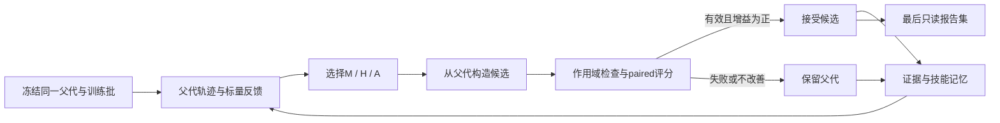
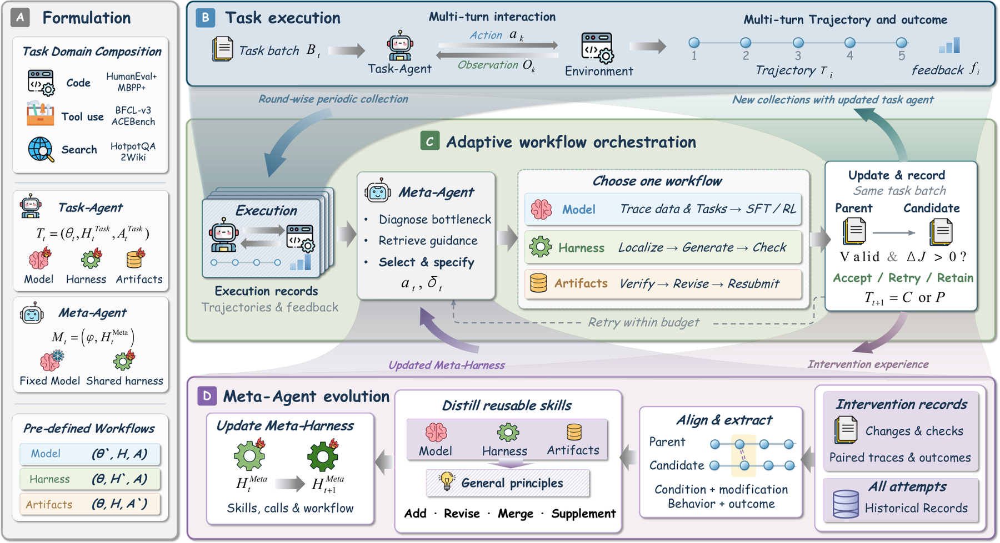

# RSIFlow：有证据的三分支自改进控制

> `component_only` / L1 CPU 机制诊断。实现固定 callback 控制器与技能经验记录，不训练语言模型，不执行任意元程序自改，不进入统一 Evolve 晋级。

## 论文信息

| 字段 | 内容 |
| --- | --- |
| 论文链接 | [RSIFlow](https://arxiv.org/abs/2610.21791) |
| 公司/机构 | 一作 Huan Zhang、共同一作 Mingju Chen；Beihang University；合作者包括清华、BAAI |
| 首次公开日期 | 2026-10-15，arXiv v1 12:45:08 UTC；属于 10-16 公告补审，不是 10-17 首发 |
| 原文开源代码 | [作者仓库](https://github.com/1HUAN1/RSI-Flow)，MIT；发布的是 skill-memory variant，Meta 可执行程序固定 |
| 本地 Adapter | 无（`adapter: null`）；组件 key：`rsiflow` |
| 本地复现代码 | `src/auto_research/agent_research/rsi_flow.py`；`scripts/run_oct17_supplement_agent.py` |

## 原始论文总结

### 背景与主要改动

性能瓶颈可能来自模型参数、执行 Harness，也可能只是当前交付物。固定只改其中一项，或固定交替更新，未必对应当前失败。RSIFlow 的 Meta-Agent 用任务执行证据选择 Model / Harness / Artifacts 干预，比较同父代、同任务批的候选，并从成功和失败中维护技能。Meta 模型参数保持固定；本地遵循已发布的技能记忆变体，不把它扩写成任意自改代码系统。



<!-- paper-figure:start -->
### 原论文关键图

[](https://arxiv.org/html/2610.21791v1/Overview.png)

> **原论文 Figure 2（关键图）**：展示原论文的整体流程、关键阶段及其数据流向。图片来自[原论文](https://arxiv.org/abs/2610.21791)，版权归原作者所有；点击图片可查看来源。
<!-- paper-figure:end -->

### 核心公式

[原文 §3.2–3.3、附录 B](https://arxiv.org/html/2610.21791v1)将干预类型写成 $a\in\{M,H,A\}$，候选由同一冻结父代构造：

$$
C_{t,j}=U_{a_{t,j}}(P_t,\mathcal B_t),\qquad
\Delta J=J(C_{t,j};\mathcal B_t)-J(P_t;\mathcal B_t).
$$

只有候选有效且 $\Delta J>0$ 才接受；否则下一次尝试仍从 $P_t$ 开始。技能维护读取本轮训练经验，不能读取报告集分数。当前本地技能是结构化证据记录，也提供 `skill_distiller` callback 供可信调用方生成可序列化技能内容；没有内置 LLM 或程序执行器。

### 论文离线与线上效果

原文比较 Qwen3-4B/8B 上六套任务：HumanEval+、MBPP+、BFCL-v3、ACEBench、HotpotQA、2WikiMultiHopQA；作者报告 12 个 benchmark–backbone 条件中 11 个优于最强对照。训练池 3,000 任务，固定报告集 744 任务；任务成功、加权工具准确率和 QA F1 的口径不同，不能视作同一种准确率。未报告生产线上 A/B。

## 本地复现

### 数据协议与运行

```bash
PYTHONPATH=src python scripts/run_oct17_supplement_agent.py \
  --methods rsiflow --device cpu --seeds 42,43,44 \
  --output runs/oct17-supplement-agent/rsiflow.json
```

每 seed 初始化三批、每批四个数值 fixture 和五个独立报告任务；私有目标值仅由 evaluator 闭包持有。M/H/A proposer 只拿公共任务、父代标量分数及已有训练技能。每轮先产生一个明确实现失败，再产生有效候选，验证失败不会消失、不会污染父代。任务 ID 和规范化 payload hash 均检查训练/报告重叠。

### 本轮 CPU 结果

三 seed 均执行 6 次候选尝试，接受 3 次，保留 3 次实现失败和 6 条技能经验；同轮尝试的父代 hash 一致，报告反馈参与选择次数为 0。报告数值 fixture 均分为 -0.480937；它是人工数值任务的距离分数，**不是 Agent 成功率或模型提升**。指标、来源 hash 与 seed 见 [CPU 产物](metrics/component-cpu-seeds42-44.json)。

### 代码映射、成本与边界

`evolve` 执行 callback、声明组件作用域、paired 接受和最后报告；`Attempt` 记录所有尝试，异常只保存阶段与类型，不把私有 evaluator 的异常文本回灌给下一轮；`TaskState` 以深拷贝和 hash 保护冻结父代。进程内 callback 是可信接口，**不是对恶意 Python 的安全沙箱**。

原文五轮、每轮最多两个候选、4B/8B、SFT/GRPO、16K/32K 与 8 ranks，加上 Meta API 和真实工具执行，完整多臂评测对单 A100/A30 或 Mac 成本过高，**成本过高，不复现（审查 DONE）**。本轮没有模型训练、六 benchmark 能力评测或可执行 Evolve 接入，`promotion_eligible=false`、`evolve_integrated=false`。
