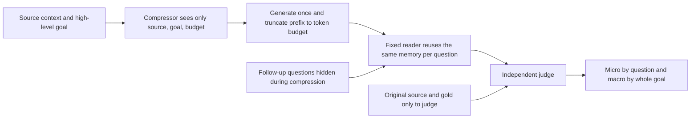
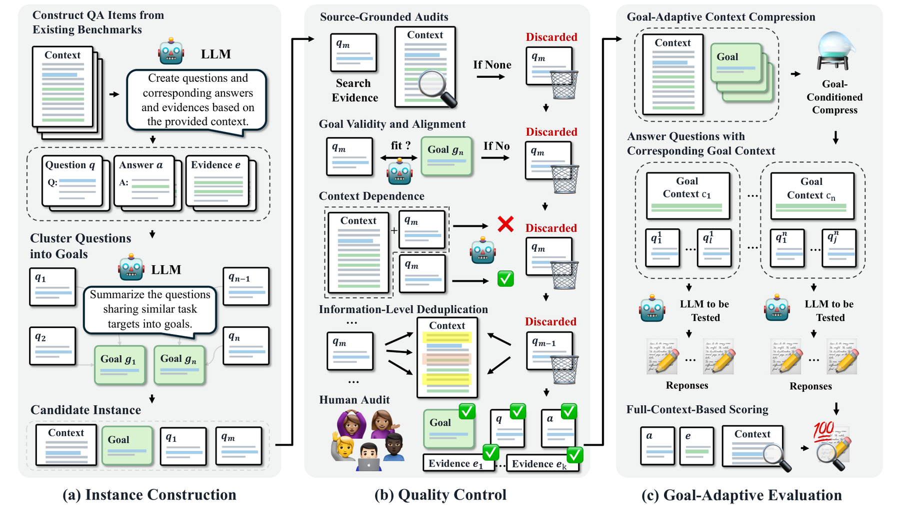

# GACC-Bench: Evaluating Goal-Conditioned Compression with Future Questions Held Out

<!-- source-sha256: 6957d1e473ae877270ea4bf20d7ddc95a6468baebf190b7439dc620d349c685b -->

[简体中文](README.md) · English

> `evaluation_protocol_interface` / L1 CPU contract diagnostic. The interface can use real compressor, reader, judge, and tokenizer callbacks. This round uses only a fixed token-ID/rule fixture, without official data or LLM runs, and does not implement a new compression model.

## Paper information

| Field | Details |
| --- | --- |
| Paper | [GACC-Bench](https://arxiv.org/abs/2610.21893) |
| Affiliations | First author Weiting Liu, Fudan University; collaborators include JD.com, HUST, HIT, and HKUST(GZ). |
| First public release | 2026-10-15, arXiv v1 13:51:56 UTC; follow-up review of the 10-16 announcement |
| Authors' open-source code | [Official code/data entry](https://github.com/weiting24/GACC-Bench). The full reuse license was unconfirmed; source-data licensing must be preserved. The [Hugging Face data entry](https://huggingface.co/datasets/Regimes/GACC-Bench) was not readable in this review. |
| Local adapter | None (`adapter: null`); protocol key `gacc-bench` |
| Local implementation | `src/auto_research/agent_research/gacc_bench.py`; `scripts/run_oct17_supplement_agent.py` |

## Original paper summary

### Background and main changes

Long contexts are often compressed before specific follow-up questions are known, though a user may have provided a high-level goal. GACC-Bench groups several follow-up questions by context and goal. The compressor sees only the source, goal, and budget. A fixed reader answers each question from the same compressed memory, then a fixed judge scores against the original source and references. This tests whether compression preserves evidence for the entire goal.



<!-- paper-figure:start -->
### Key figure from the paper

[](https://arxiv.org/html/2610.21893v1/GACC-Bench.png)

> **Figure 3 from the paper:** Overall method design and key components. The figure comes from the [original paper](https://arxiv.org/abs/2610.21893), © the original authors. Select the image to see the source.
<!-- paper-figure:end -->

### Core equations

[§§3.3–4.1](https://arxiv.org/html/2610.21893v1) use `cl100k_base` as a common reference tokenizer. For source token count $N$ and retention fraction $r$:

$$
L=\lfloor rN\rfloor,\qquad
M=decode(encode(compressor(C,g,L))[:L]).
$$

The local interface supports $r=0$ and short inputs whose budget rounds down to zero. A zero budget retains empty memory, not an obligatory token. A short generation is not padded, and over-budget generations retain only a prefix, without regeneration. This is what the reader actually receives; unused budget is not padding cost. Each row records proposed, retained, and unused budget, re-encoded memory tokens, and a zero-padding ledger. Each context–goal–budget combination generates memory once for all its questions. Micro measures accuracy over all questions. Macro is not mean goal-wise question accuracy; it is the proportion of goals for which **every question is correct**:

$$
Micro=\frac{\sum_g\sum_q c_{gq}}{\sum_g |Q_g|},\qquad
Macro=\frac{1}{|G|}\sum_g\prod_{q\in Q_g}c_{gq}.
$$

### Reported offline and online results

The paper builds 281 contexts, 500 goals, and 2,571 questions from seven sources and compares ten compressors. With fixed DeepSeek-V4-Pro reader/judge, the full-context baseline is Micro=99.38%, Macro=96.80%. Compression still leaves a large gap; Own-goal usually outperforms No-goal and Cross-goal. These main results are for the paper's API-model protocol, not local compression scores. No production online A/B test was reported.

## Local reproduction

```bash
PYTHONPATH=src python scripts/run_oct17_supplement_agent.py \
  --methods gacc-bench --device cpu --seeds 42,43,44 \
  --output runs/oct17-supplement-agent/gacc-bench.json
```

### Data protocol and CPU results

Each seed creates two small string sources, four goals, and 12 questions. A rule compressor chooses the line containing the goal, a rule reader parses only retained fields, and a fixture judge compares exactly. None is an LLM. The explicitly named Unicode codepoint token-ID codec **is not `cl100k_base`; actual runs with the official tokenizer: 0**. Formal use requires pinned real `cl100k_base` encode/decode callbacks. No dependency or tokenizer download was added in this round. The interface records only the caller's declared tokenizer identity, with `identity_verified=false`. Calling it `cl100k_base` does not count as verification.

For each of three seeds, the compressor ran four times and a repeat read of the same cache made 0 new calls. Micro=2/3 and Macro=0 retain failures where each group's last field was truncated. Independent count error, budget violations, and exposure of questions/gold to the compressor were all 0. See the [CPU artifact](metrics/component-cpu-seeds42-44.json). These values are not comparable to the paper's tables.

### Code mapping, cost, and limits

`CompressorInput` contains only context, goal, and token_budget. `ReaderInput` contains only memory and question. References enter only `JudgeInput`. `evaluate` checks source IDs and goal/question identities. Cache keys bind source and goal content hashes, tokenizer revision, and compressor revision, so different models do not accidentally reuse memory. Callbacks are a trusted in-process protocol, not a sandbox for malicious code.

There was no download of the full official dataset or long-context API evaluation of ten models at multiple budgets with the fixed reader/judge. The total cost of long sources, many questions, and many model calls exceeds the budget; **the full experiments were not reproduced (review complete)**. Inaccessible data and unverified licensing remain additional scope limits. The official benchmark was not validated. The interface is not eligible for Evolve promotion; `diagnostic_only=true`.
